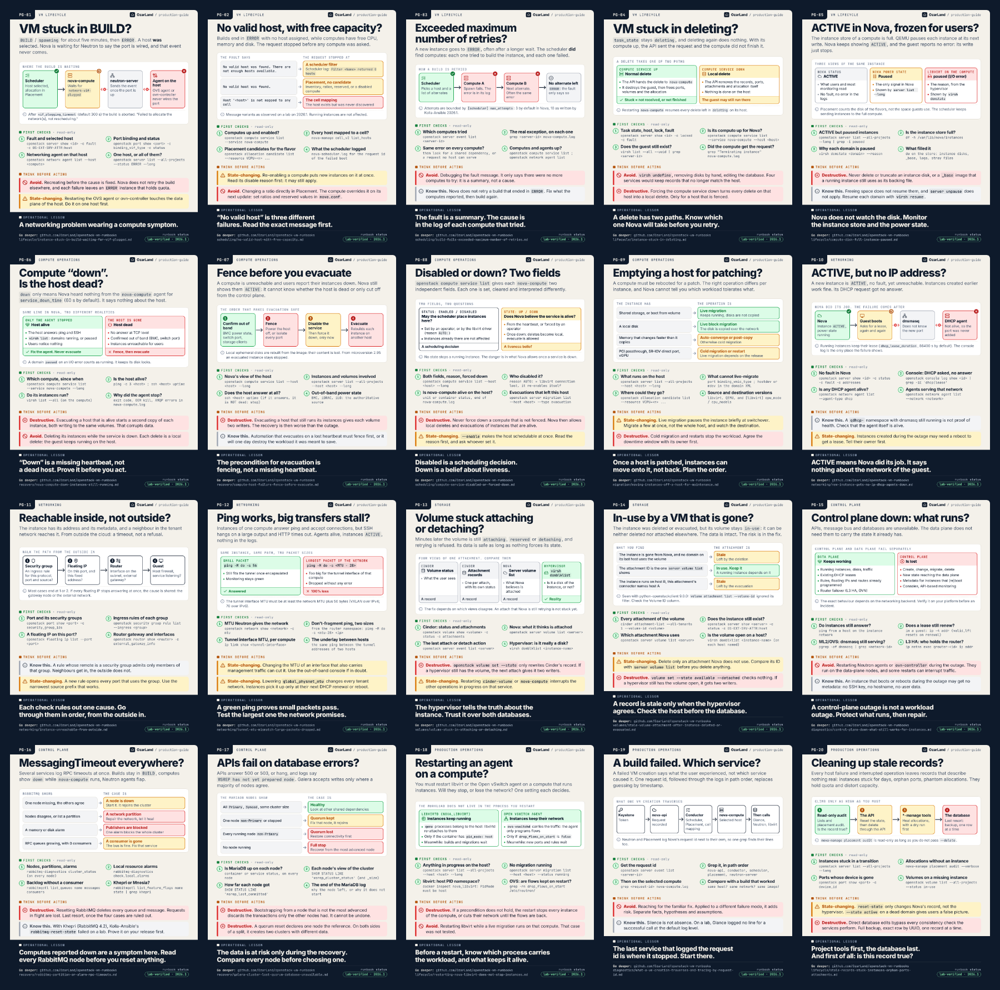

[← Production Guide](README.md)

# Design system

How an OzarLand memo looks, and why. The goal is that an operator recognises a memo before reading a word of it,
and that the twentieth and the two-hundredth look like the first. The rules below are implemented in
[`templates/tokens.css`](templates/tokens.css), [`templates/memo.css`](templates/memo.css) and
[`templates/memo.cjs`](templates/memo.cjs), and enforced by the build wherever a rule can be checked.

## Principles

1. **One memo, one lesson.** If a memo needs two lessons, it is two memos.
2. **Ink on paper, colour for risk.** Colour never decorates and never marks a category. It says one thing: how
   risky an action is, or whether a state is healthy.
3. **The picture shows the mechanism.** A diagram earns its place by showing where a request stops, which case
   applies, or what differs between two things that look alike. No illustration, no screenshot, no ornament.
4. **Readable on a phone.** The memo is designed for a 1080 px wide image seen about 375 pt wide. Content is
   never smaller than 19 px, labels never smaller than 18 px.
5. **Text is cut by its author, never shrunk by the template.** There is no auto-fit. A sentence that does not fit
   is rewritten.
6. **Simplify the presentation, not the reality.** A memo may leave things out; it says so under *Where this
   holds*. It does not state as universal what a runbook observed in one place.

## Format

| | |
|---|---|
| Canvas | 1080 × 1350 px, portrait (LinkedIn 4:5) |
| Export | PNG at 1× in `dist/`. `--scale 2` gives 2160 × 2700 for print or slides |
| Margins | 52 px left and right. The header tab and the lesson band bleed to the edges |
| Language | English, OpenStack terminology as upstream writes it (`nova-compute`, `BUILD`, Placement, floating IP) |

## The signature

Four things make a memo recognisable without its name:

- **The memo tab**: a solid ink block at the top left, flush with the corner, with the memo number in monospace
  (`PG·07`).
- **The lesson band**: the bottom of every memo is a full-width ink band with the operational lesson in large
  type. It is the first thing read in a feed and the last thing remembered.
- **Square-bullet section labels** in spaced monospace capitals: `■ FIRST CHECKS`, `■ THINK BEFORE ACTING`.
- **Warm paper, white card**: the page is off-white, and the diagram sits on the only white card.

The OzarLand mark ([`assets/brand/ozarland-mark.svg`](assets/brand/ozarland-mark.svg)) is a cloud above a ground
line on an ink square: the cloud of the OzarLand banner, and the "shared land". It appears once, small, in the
header, next to `OzarLand / production-guide`, which is also the address of the repository.

## Layout

Top to bottom, always in this order:

| Zone | Content | Rule |
|---|---|---|
| Header | Memo tab, category, signature | Fixed, 54 px |
| Title | The situation as a question or statement | 72 px; 62 px above 24 characters; two lines at most |
| Situation | What is seen and what it means | 26 px, three lines at most |
| Diagram | One component, an optional caption and note | White card |
| First checks | Exactly four, numbered, in a 2 × 2 grid | Label 24 px, command hint in monospace 19 px, two lines at most |
| Think before acting | One or two items | 24 px, tinted by risk level |
| Lesson band | Label, the lesson, the runbook reference and its status | Lesson 37 px, two lines at most |

The height left over once every zone has its natural size is shared between the zones, never left in one place.

## Colour

| Token | Value | Use |
|---|---|---|
| `--paper` | `#f4f1ea` | Page background |
| `--card` | `#ffffff` | Diagram card |
| `--ink` | `#0e1a2b` | Text, memo tab, lesson band, neutral diagram nodes |
| `--ink-2`, `--ink-3` | `#435268`, `#76839a` | Secondary text, labels |
| `--line` | `#d8d3c6` | Borders |
| `--ok`, `--ok-bg`, `--ok-line` | `#15803d`, `#dcfce7`, `#16a34a` | Read-only, healthy |
| `--warn`, `--warn-bg`, `--warn-line` | `#b45309`, `#fef3c7`, `#d97706` | State-changing, waiting, degraded |
| `--stop`, `--stop-bg`, `--stop-line` | `#b91c1c`, `#fee2e2`, `#dc2626` | Destructive, failed, to avoid |
| `--mute`, `--mute-bg`, `--mute-line` | `#4b5563`, `#f3f4f6`, `#9ca3af` | Neutral, not involved |

The tints and lines are the
[OzarLand status colours](https://github.com/OzarLand/ozarland/blob/main/docs/conventions/readme-identity.md), so a
memo and a runbook colour the same risk the same way. No gradient, no shadow, no other colour.

In a diagram a tone is written as `ok`, `warn`, `stop`, `mute` or `ink`. Use `ink` for a step that is neither good
nor bad. In a numbered sequence the tone is the risk of the step (a red step is a destructive action); elsewhere it
is its state (a red node is where it failed).

## Typography

| Role | Face | Size | Weight |
|---|---|---|---|
| Title | Inter | 72 / 62 px | 800, tight tracking |
| Lesson | Inter | 37 px | 800 |
| Situation | Inter | 26 px | 400 |
| Checks, cautions | Inter | 24 px | 700 for labels, 400 for text |
| Diagram labels | Inter | 22 px | 700 |
| Diagram details, notes | Inter | 20 px | 400 |
| Commands, states, paths | JetBrains Mono | 19 px and up | 500 |
| Section labels, footer | JetBrains Mono | 18 px | 600 to 700, capitals with wide tracking |

Two families, both vendored in [`assets/fonts`](assets/README.md) so that every machine renders the same image.
Anything typed at a prompt or returned by an API is in monospace: commands, option names, states, log messages.
In the sources, wrap it in backticks.

## Icons

[Lucide](https://lucide.dev) outline icons, 2 px stroke, in the colour of the text around them, from
[`assets/icons`](assets/README.md). One icon per diagram node at most, chosen for the object it stands for (a
server, a network, a disk), never for mood. No emoji on a memo: they render differently on every system.

## Diagram components

Three components cover the first collection. Choose by what the memo must show.

| Component | Shows | Use it when | Limits |
|---|---|---|---|
| `chain` | A path from left to right, with arrows that can be broken or point backwards, and nodes that can be numbered | A request stops somewhere (PG-01, PG-10), or steps must happen in an order (PG-07, PG-20) | 2 to 5 nodes |
| `branches` | "If you see this, the case is that" | The same symptom has several causes told apart by one observation (PG-02, PG-16, PG-17) | 2 to 4 rows |
| `compare` | Two to four columns side by side, each with a verdict | Two things look alike and are not (PG-06, PG-08), or several views of one object disagree (PG-05, PG-13) | 2 to 4 columns, 4 points each |

Every component takes an optional `caption` above it and a `note` below it. The fields of each are in
[`templates/memo.yml`](templates/memo.yml) and in the existing memos.

A new component is justified when a lesson cannot be told with these three, not when a memo would merely look
different. Add its function to `templates/memo.cjs`, its styles to `templates/memo.css` with the existing tokens,
its validation to `scripts/lib/content.cjs`, and a row to this table.

## Writing for the template

- **Title**: what the operator would type into a search box. A question when the memo diagnoses, a statement
  when it gives a rule ("Fence before you evacuate").
- **Situation**: the symptom first, then the one fact that reframes it.
- **First checks**: a label that says what to look at, and a hint that says where. Read-only, always: if a
  command changes anything, it does not belong here.
- **Think before acting**: the level, then the consequence. `destructive` and `state-changing` mean what the
  [risk warnings](https://github.com/OzarLand/ozarland/blob/main/docs/conventions/risk-warnings.md) say. `avoid`
  is for the tempting shortcut. `know` is for a fact that changes the decision.
- **Lesson**: one or two short sentences that still make sense a month later, without the memo.

| Field | Budget |
|---|---|
| Title | 40 characters |
| Situation | 190 characters |
| Check label, check hint | 38, 70 characters |
| Caution | 150 characters |
| Lesson | 100 characters |
| Diagram note | 150 characters |

The budgets are necessary, not sufficient: the build also renders the memo and fails if anything overflows.

## The collection at a glance

## What a memo never has

Dense paragraphs. Terminal screenshots. Decorative illustrations. Gradients. A second accent colour. A style of
its own.
