[← OzarLand home](https://github.com/OzarLand/ozarland)

<div align="center">

# 🗺️ production-guide

**A visual memo for OpenStack operators: one operational lesson per page, to remember, apply and share.**

<p>
  
  
  
  <a href="LICENSE"></a>
</p>

<p>
  <a href="#catalog"><b>Catalog</b></a> ·
  <a href="#-how-to-read-a-memo"><b>How to read a memo</b></a> ·
  <a href="#-not-covered-yet"><b>Not covered yet</b></a> ·
  <a href="#-build-it-yourself"><b>Build</b></a> ·
  <a href="#-contributing"><b>Contribute</b></a>
</p>

<a href="categories/compute/fence-before-evacuate.md">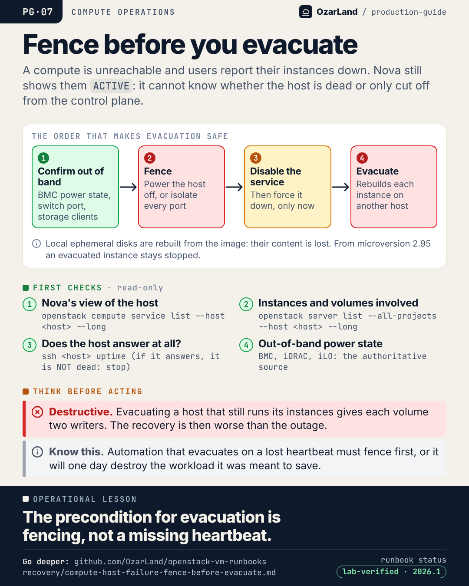</a>
<a href="categories/vm-lifecycle/vm-stuck-in-build.md">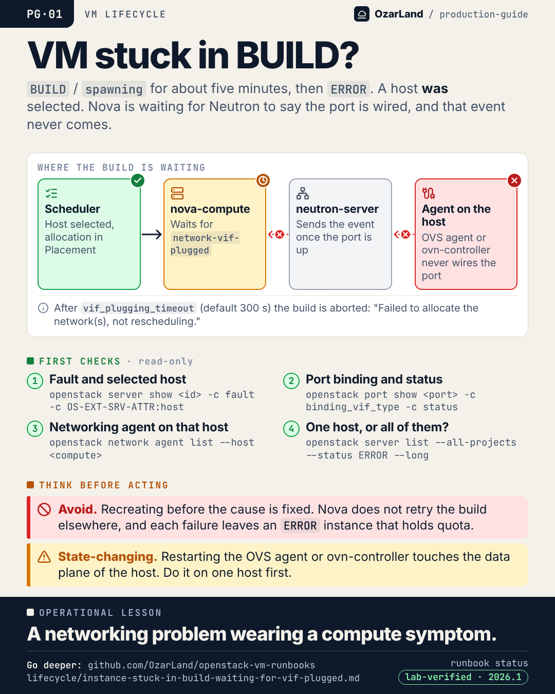</a>
<a href="categories/control-plane/control-plane-down.md">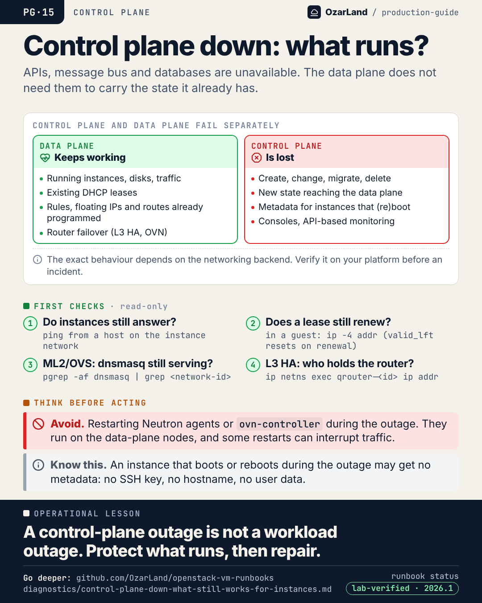</a>

</div>

---

A field guide, not a manual. Each memo takes one situation an operator meets in production and answers four
questions in under a minute: what is happening, what to check first, what not to do yet, and what to remember.
The procedure itself, with every command and its limits, stays in
[openstack-vm-runbooks](https://github.com/OzarLand/openstack-vm-runbooks): every memo links to the runbook it was
written from.

Part of [OzarLand](https://github.com/OzarLand/ozarland): *a shared land for better OpenStack operations.* No imposed
tools, no single way of operating OpenStack.

> **One memo = one operational lesson = one memorable visual.**

## 🧭 How to read a memo

Every memo has the same seven parts, in the same place:

| Part | What it tells you |
|---|---|
| **Title** | The situation, as a short question or statement |
| **Situation** | What you see, and what it means |
| **Diagram** | The mechanism: where a request stops, which case you are in, what differs between two things that look alike |
| **First checks** · green | Four things to look at. Always read-only: they never change the platform |
| **Think before acting** · amber, red | What not to do yet, and the risk of the usual fixes |
| **Operational lesson** | The one sentence to keep |
| **Go deeper** | The path of the runbook in `openstack-vm-runbooks`, and how much that runbook was verified |

Colour means one thing only, the risk of an action, with the same vocabulary as the
[OzarLand risk warnings](https://github.com/OzarLand/ozarland/blob/main/docs/conventions/risk-warnings.md):

| | On a memo | Meaning |
|:-:|---|---|
| 🟩 | Green | Read-only, or the healthy case |
| 🟧 | Amber, **State-changing.** | Changes the platform in a bounded way |
| 🟥 | Red, **Destructive.** or **Avoid.** | Can lose data or end workloads, or a shortcut that makes things worse |
| ⬜ | Grey, **Know this.** | A fact that changes how you read the situation |

> [!WARNING]
> A memo is a memory aid, not a procedure. It is as reliable as the runbook behind it, and it says how reliable
> that is: the pill at the bottom right shows the runbook's status and release. Today every source runbook is
> `lab-verified` on OpenStack 2026.1, mostly with Kolla-Ansible and ML2/OVS, and none has been confirmed on a
> production platform by an operator other than its author. Each memo's page has a **Where this holds** paragraph:
> read it, then read the runbook, before any ⚠️ or 🛑 action.

## Catalog

<!-- count:start -->
**20 memos** across 6 categories.
<!-- count:end -->
Click a memo for its page: the image, the same content as text, the runbook links and the LinkedIn kit.

<!-- catalog:start -->
### VM lifecycle

| | Memo | Operational lesson | Runbook |
|---|---|---|---|
| <a href="categories/vm-lifecycle/vm-stuck-in-build.md"></a> | **PG-01**<br>[VM stuck in BUILD?](categories/vm-lifecycle/vm-stuck-in-build.md) | A networking problem wearing a compute symptom. | [lifecycle/…](https://github.com/OzarLand/openstack-vm-runbooks/blob/main/lifecycle/instance-stuck-in-build-waiting-for-vif-plugged.md)<br>`lab-verified` |
| <a href="categories/vm-lifecycle/no-valid-host.md">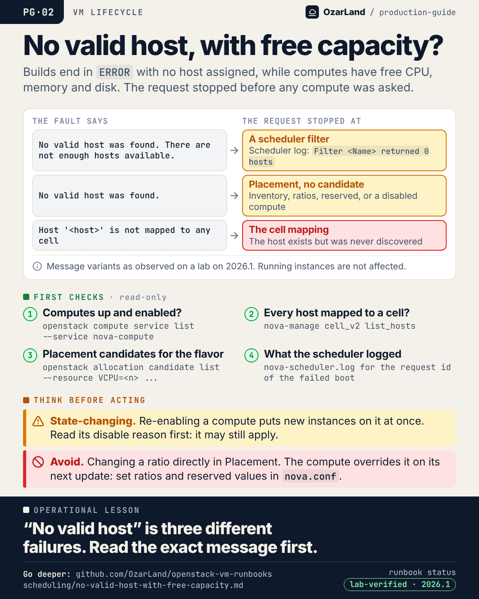</a> | **PG-02**<br>[No valid host, with free capacity?](categories/vm-lifecycle/no-valid-host.md) | “No valid host” is three different failures. Read the exact message first. | [scheduling/…](https://github.com/OzarLand/openstack-vm-runbooks/blob/main/scheduling/no-valid-host-with-free-capacity.md)<br>`lab-verified` |
| <a href="categories/vm-lifecycle/max-retries-exceeded.md">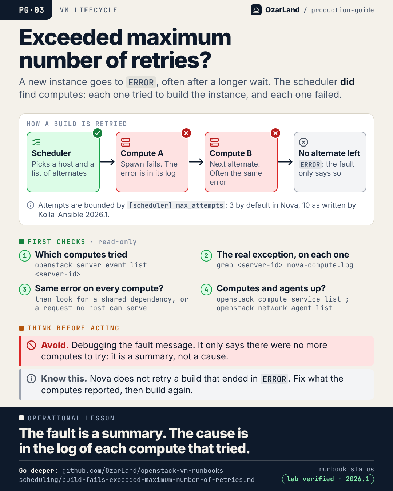</a> | **PG-03**<br>[Exceeded maximum number of retries?](categories/vm-lifecycle/max-retries-exceeded.md) | The fault is a summary. The cause is in the log of each compute that tried. | [scheduling/…](https://github.com/OzarLand/openstack-vm-runbooks/blob/main/scheduling/build-fails-exceeded-maximum-number-of-retries.md)<br>`lab-verified` |
| <a href="categories/vm-lifecycle/vm-stuck-in-deleting.md">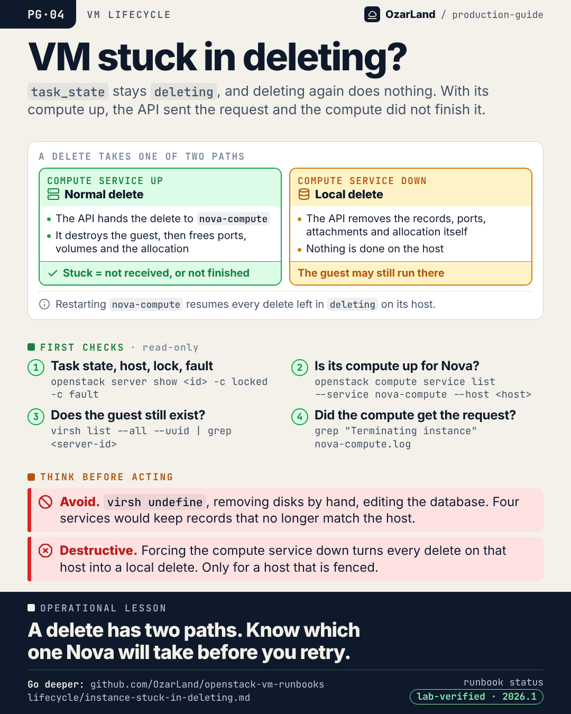</a> | **PG-04**<br>[VM stuck in deleting?](categories/vm-lifecycle/vm-stuck-in-deleting.md) | A delete has two paths. Know which one Nova will take before you retry. | [lifecycle/…](https://github.com/OzarLand/openstack-vm-runbooks/blob/main/lifecycle/instance-stuck-in-deleting.md)<br>`lab-verified` |
| <a href="categories/vm-lifecycle/active-but-frozen.md">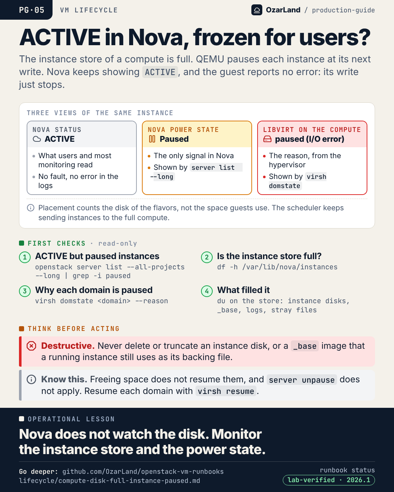</a> | **PG-05**<br>[ACTIVE in Nova, frozen for users?](categories/vm-lifecycle/active-but-frozen.md) | Nova does not watch the disk. Monitor the instance store and the power state. | [lifecycle/…](https://github.com/OzarLand/openstack-vm-runbooks/blob/main/lifecycle/compute-disk-full-instance-paused.md)<br>`lab-verified` |

### Compute operations

| | Memo | Operational lesson | Runbook |
|---|---|---|---|
| <a href="categories/compute/compute-down-is-not-host-down.md">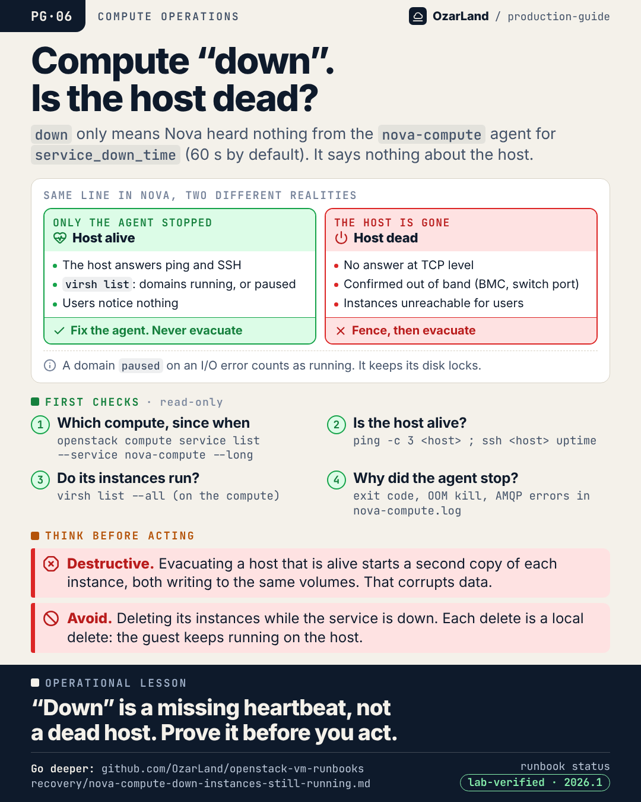</a> | **PG-06**<br>[Compute “down”. Is the host dead?](categories/compute/compute-down-is-not-host-down.md) | “Down” is a missing heartbeat, not a dead host. Prove it before you act. | [recovery/…](https://github.com/OzarLand/openstack-vm-runbooks/blob/main/recovery/nova-compute-down-instances-still-running.md)<br>`lab-verified` |
| <a href="categories/compute/fence-before-evacuate.md"></a> | **PG-07**<br>[Fence before you evacuate](categories/compute/fence-before-evacuate.md) | The precondition for evacuation is fencing, not a missing heartbeat. | [recovery/…](https://github.com/OzarLand/openstack-vm-runbooks/blob/main/recovery/compute-host-failure-fence-before-evacuate.md)<br>`lab-verified` |
| <a href="categories/compute/disabled-or-down.md">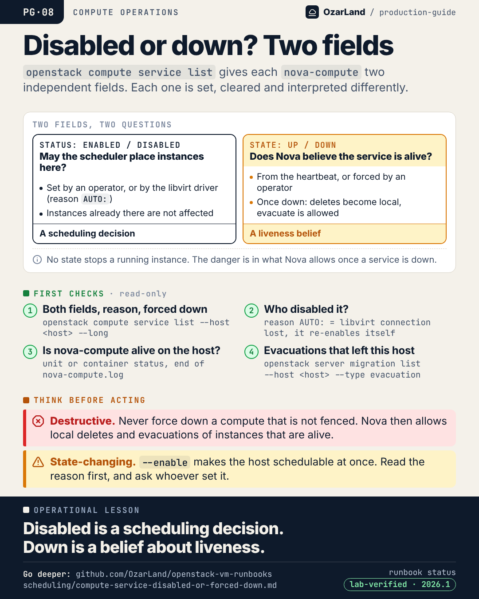</a> | **PG-08**<br>[Disabled or down? Two fields](categories/compute/disabled-or-down.md) | Disabled is a scheduling decision. Down is a belief about liveness. | [scheduling/…](https://github.com/OzarLand/openstack-vm-runbooks/blob/main/scheduling/compute-service-disabled-or-forced-down.md)<br>`lab-verified` |
| <a href="categories/compute/emptying-a-host-for-maintenance.md">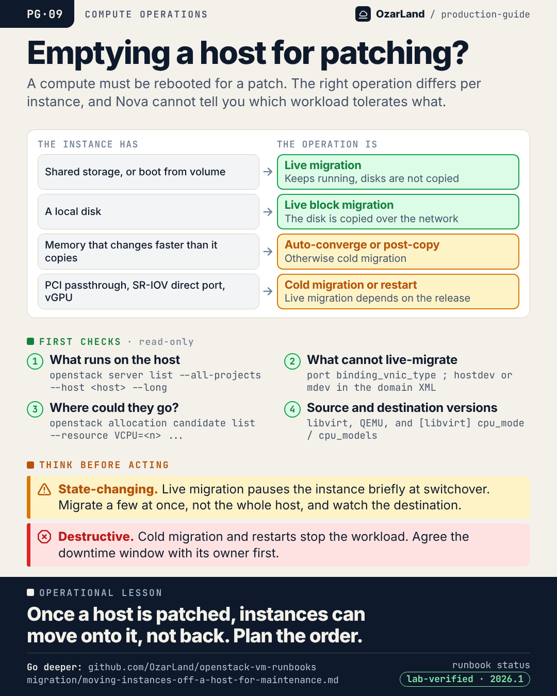</a> | **PG-09**<br>[Emptying a host for patching?](categories/compute/emptying-a-host-for-maintenance.md) | Once a host is patched, instances can move onto it, not back. Plan the order. | [migration/…](https://github.com/OzarLand/openstack-vm-runbooks/blob/main/migration/moving-instances-off-a-host-for-maintenance.md)<br>`lab-verified` |

### Networking

| | Memo | Operational lesson | Runbook |
|---|---|---|---|
| <a href="categories/networking/active-but-no-ip.md">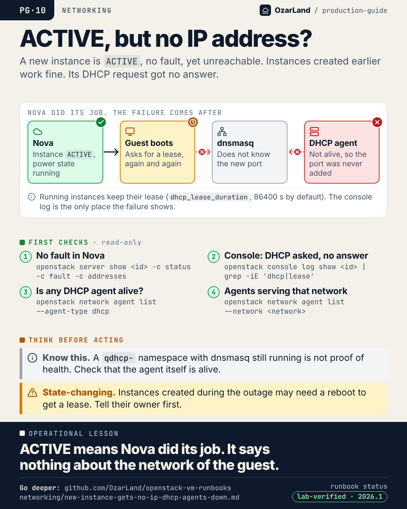</a> | **PG-10**<br>[ACTIVE, but no IP address?](categories/networking/active-but-no-ip.md) | ACTIVE means Nova did its job. It says nothing about the network of the guest. | [networking/…](https://github.com/OzarLand/openstack-vm-runbooks/blob/main/networking/new-instance-gets-no-ip-dhcp-agents-down.md)<br>`lab-verified` |
| <a href="categories/networking/unreachable-from-outside.md">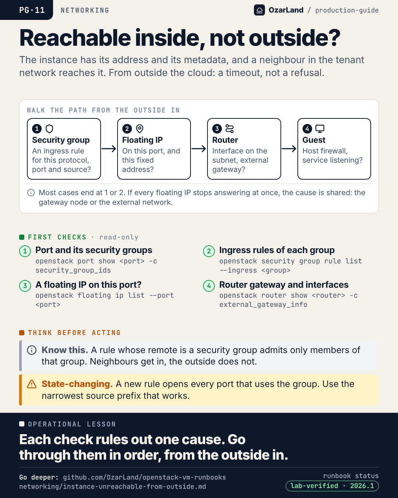</a> | **PG-11**<br>[Reachable inside, not outside?](categories/networking/unreachable-from-outside.md) | Each check rules out one cause. Go through them in order, from the outside in. | [networking/…](https://github.com/OzarLand/openstack-vm-runbooks/blob/main/networking/instance-unreachable-from-outside.md)<br>`lab-verified` |
| <a href="categories/networking/ping-works-transfers-stall.md">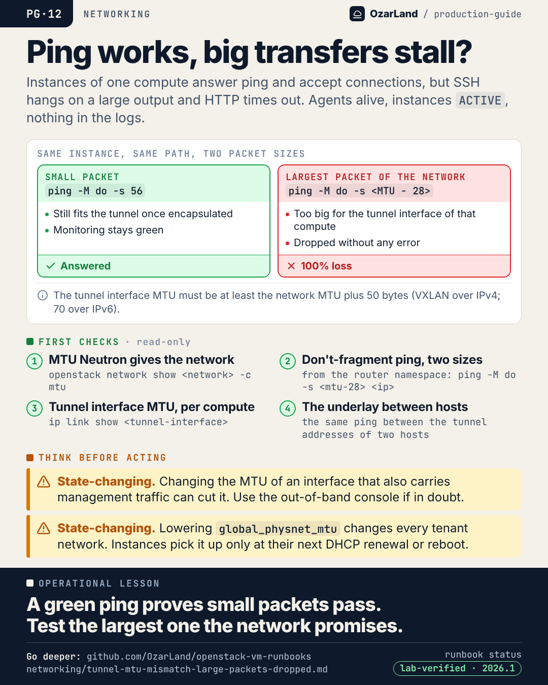</a> | **PG-12**<br>[Ping works, big transfers stall?](categories/networking/ping-works-transfers-stall.md) | A green ping proves small packets pass. Test the largest one the network promises. | [networking/…](https://github.com/OzarLand/openstack-vm-runbooks/blob/main/networking/tunnel-mtu-mismatch-large-packets-dropped.md)<br>`lab-verified` |

### Storage

| | Memo | Operational lesson | Runbook |
|---|---|---|---|
| <a href="categories/storage/volume-stuck-attaching-or-detaching.md">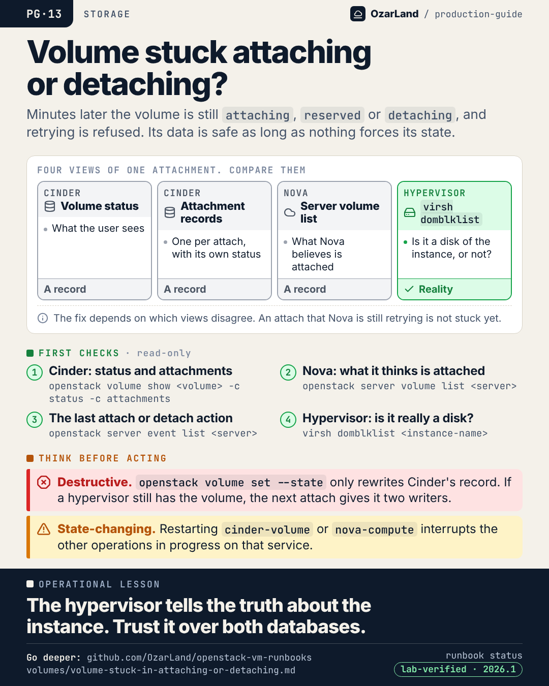</a> | **PG-13**<br>[Volume stuck attaching or detaching?](categories/storage/volume-stuck-attaching-or-detaching.md) | The hypervisor tells the truth about the instance. Trust it over both databases. | [volumes/…](https://github.com/OzarLand/openstack-vm-runbooks/blob/main/volumes/volume-stuck-in-attaching-or-detaching.md)<br>`lab-verified` |
| <a href="categories/storage/volume-in-use-by-a-missing-instance.md">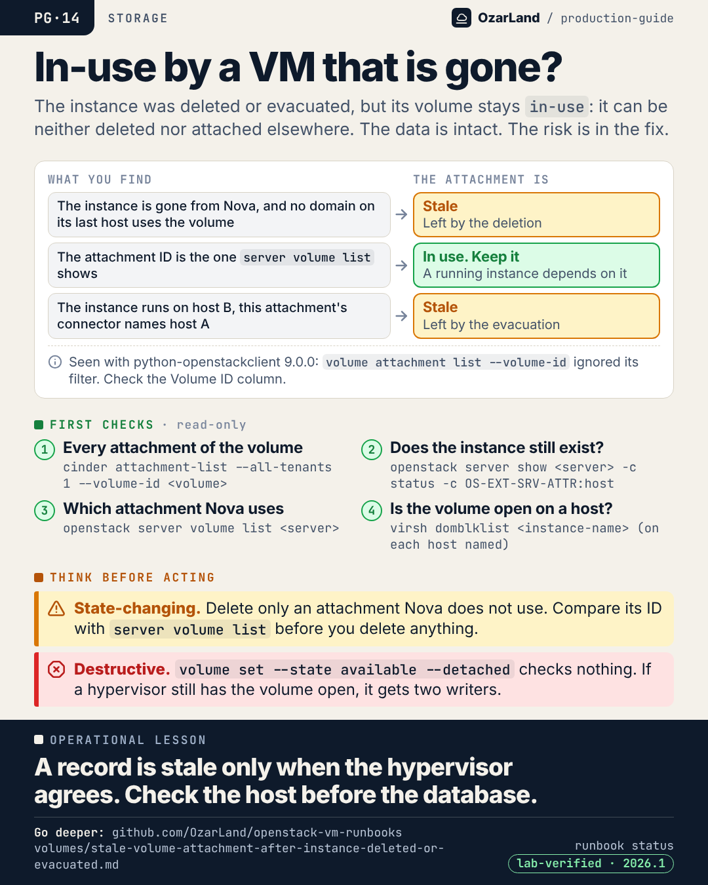</a> | **PG-14**<br>[In-use by a VM that is gone?](categories/storage/volume-in-use-by-a-missing-instance.md) | A record is stale only when the hypervisor agrees. Check the host before the database. | [volumes/…](https://github.com/OzarLand/openstack-vm-runbooks/blob/main/volumes/stale-volume-attachment-after-instance-deleted-or-evacuated.md)<br>`lab-verified` |

### Control plane

| | Memo | Operational lesson | Runbook |
|---|---|---|---|
| <a href="categories/control-plane/control-plane-down.md"></a> | **PG-15**<br>[Control plane down: what runs?](categories/control-plane/control-plane-down.md) | A control-plane outage is not a workload outage. Protect what runs, then repair. | [diagnostics/…](https://github.com/OzarLand/openstack-vm-runbooks/blob/main/diagnostics/control-plane-down-what-still-works-for-instances.md)<br>`lab-verified` |
| <a href="categories/control-plane/rpc-timeouts-everywhere.md">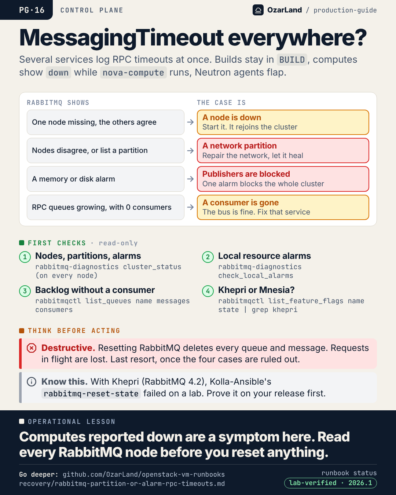</a> | **PG-16**<br>[MessagingTimeout everywhere?](categories/control-plane/rpc-timeouts-everywhere.md) | Computes reported down are a symptom here. Read every RabbitMQ node before you reset anything. | [recovery/…](https://github.com/OzarLand/openstack-vm-runbooks/blob/main/recovery/rabbitmq-partition-or-alarm-rpc-timeouts.md)<br>`lab-verified` |
| <a href="categories/control-plane/galera-lost-quorum.md">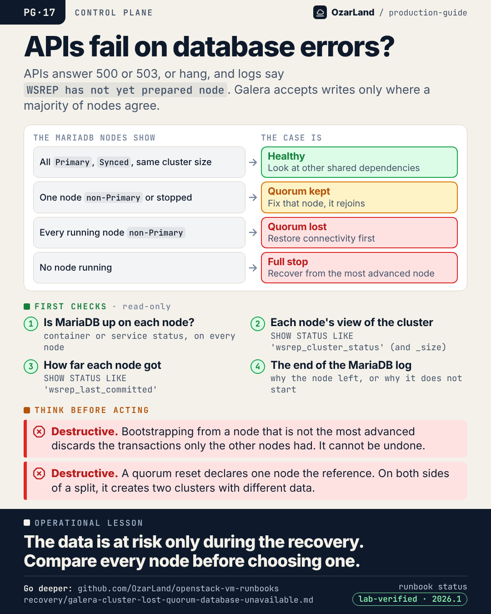</a> | **PG-17**<br>[APIs fail on database errors?](categories/control-plane/galera-lost-quorum.md) | The data is at risk only during the recovery. Compare every node before choosing one. | [recovery/…](https://github.com/OzarLand/openstack-vm-runbooks/blob/main/recovery/galera-cluster-lost-quorum-database-unavailable.md)<br>`lab-verified` |

### Production operations

| | Memo | Operational lesson | Runbook |
|---|---|---|---|
| <a href="categories/production-operations/before-restarting-an-agent.md">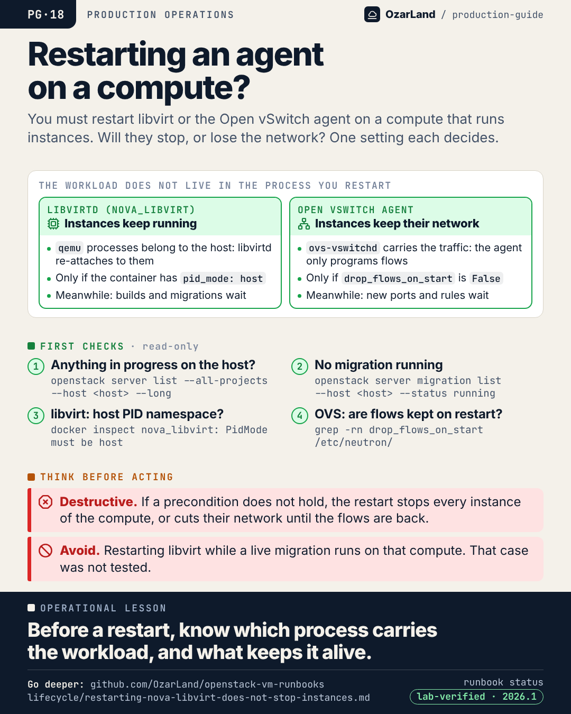</a> | **PG-18**<br>[Restarting an agent on a compute?](categories/production-operations/before-restarting-an-agent.md) | Before a restart, know which process carries the workload, and what keeps it alive. | [lifecycle/…](https://github.com/OzarLand/openstack-vm-runbooks/blob/main/lifecycle/restarting-nova-libvirt-does-not-stop-instances.md)<br>`lab-verified` |
| <a href="categories/production-operations/trace-one-request.md">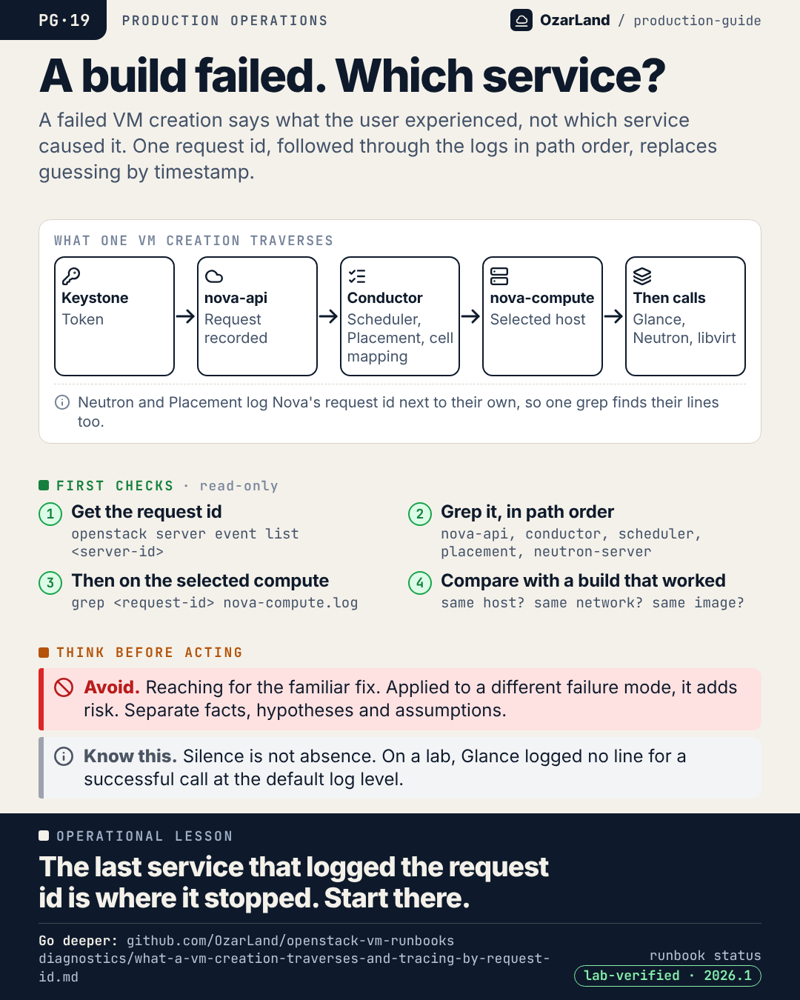</a> | **PG-19**<br>[A build failed. Which service?](categories/production-operations/trace-one-request.md) | The last service that logged the request id is where it stopped. Start there. | [diagnostics/…](https://github.com/OzarLand/openstack-vm-runbooks/blob/main/diagnostics/what-a-vm-creation-traverses-and-tracing-by-request-id.md)<br>`lab-verified` |
| <a href="categories/production-operations/cleaning-up-stale-records.md">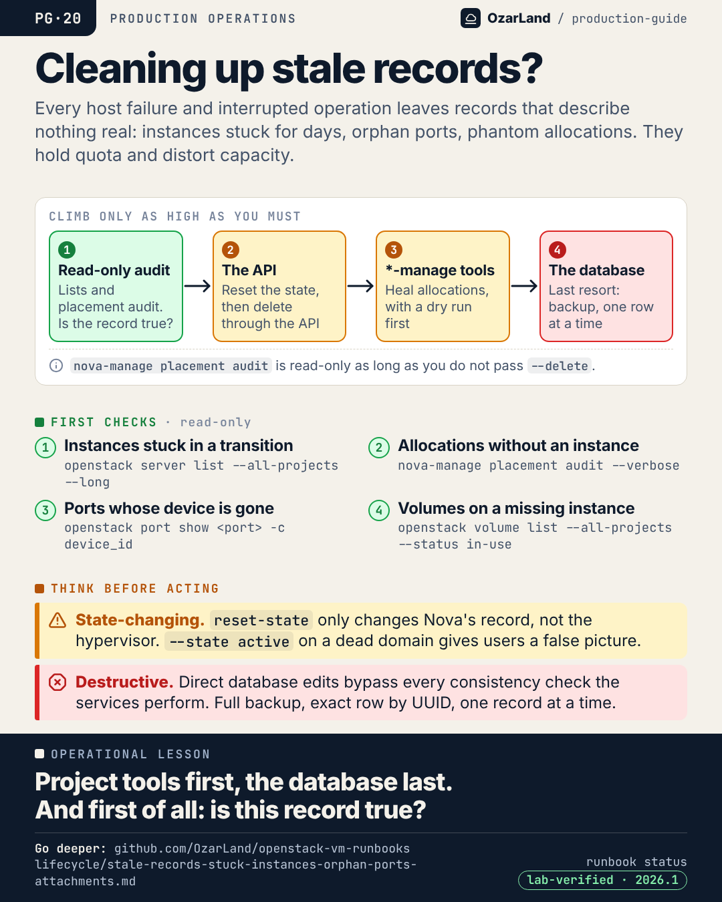</a> | **PG-20**<br>[Cleaning up stale records?](categories/production-operations/cleaning-up-stale-records.md) | Project tools first, the database last. And first of all: is this record true? | [lifecycle/…](https://github.com/OzarLand/openstack-vm-runbooks/blob/main/lifecycle/stale-records-stuck-instances-orphan-ports-attachments.md)<br>`lab-verified` |

<!-- catalog:end -->

## 📌 Not covered yet

A memo is only written from a runbook that documents the subject. These topics were considered for the first
collection and left out, rather than filled with guesses.

**No source yet.** They need a runbook first, from a real occurrence:

| Topic | Where it stands |
|---|---|
| Live migration fails at the pre-check (CPU model, shared storage assumptions) | Listed under *Pages wanted next* in [openstack-vm-runbooks](https://github.com/OzarLand/openstack-vm-runbooks#-pages-wanted-next) |
| Floating IP does not answer with ML2/OVN | Same list. The ML2/OVS case is in PG-11 |
| Shelve and unshelve problems | Same list |
| Multi-attach volumes | Same list |
| Storage backend outage: Cinder backend unavailable, storage capacity exhausted | Same list ("storage outage"). Storage-backend-only problems are out of the runbooks' scope |
| Multipath problems | Only a log-reading guide exists (`draft`): not enough for a memo |
| CPU overcommitment, hypervisor out of resources | No runbook. Allocation ratios appear only as a cause in PG-02 |
| Before applying a configuration change, before patching: the general checklist | No runbook. PG-09 and PG-18 cover two specific cases |

**A source exists, a memo does not.** Good candidates for a first contribution:

| Topic | Runbook | Status |
|---|---|---|
| Instance goes `SHUTOFF` by itself (host OOM killer) | [lifecycle/instance-shut-off-by-host-oom-killer.md](https://github.com/OzarLand/openstack-vm-runbooks/blob/main/lifecycle/instance-shut-off-by-host-oom-killer.md) | `draft` |
| A security group rule has no effect | [networking/security-group-rules-not-applied.md](https://github.com/OzarLand/openstack-vm-runbooks/blob/main/networking/security-group-rules-not-applied.md) | `draft` |
| Live migration never completes | [migration/live-migration-never-completes-or-times-out.md](https://github.com/OzarLand/openstack-vm-runbooks/blob/main/migration/live-migration-never-completes-or-times-out.md) | `draft` |
| 401 for tokens that should be valid (Fernet keys, clock) | [recovery/keystone-401-for-every-request-fernet-keys-or-clock.md](https://github.com/OzarLand/openstack-vm-runbooks/blob/main/recovery/keystone-401-for-every-request-fernet-keys-or-clock.md) | `lab-verified` |
| API returns 503, HAProxy backend down, VIP flapping | [recovery/api-returns-503-haproxy-backend-down-or-vip-flapping.md](https://github.com/OzarLand/openstack-vm-runbooks/blob/main/recovery/api-returns-503-haproxy-backend-down-or-vip-flapping.md) | `lab-verified` |
| Every instance of one compute loses the network (ovs-vswitchd down) | [networking/ovs-vswitchd-down-on-compute.md](https://github.com/OzarLand/openstack-vm-runbooks/blob/main/networking/ovs-vswitchd-down-on-compute.md) | `lab-verified` |
| Resize stuck in `VERIFY_RESIZE` | [lifecycle/resize-stuck-in-verify-resize-or-failed.md](https://github.com/OzarLand/openstack-vm-runbooks/blob/main/lifecycle/resize-stuck-in-verify-resize-or-failed.md) | `lab-verified` |
| Database connections exhausted | [recovery/database-too-many-connections-or-pool-exhausted.md](https://github.com/OzarLand/openstack-vm-runbooks/blob/main/recovery/database-too-many-connections-or-pool-exhausted.md) | `draft` |

Memos written from a `draft` runbook are welcome: the status is printed on the memo.

## 🗂️ How content is organised

Content and presentation are separate. A memo is a small YAML file; the look comes from one template.

```text
categories/<category>/<slug>.yml   the source of a memo: its text, its diagram, its runbook, its LinkedIn kit
categories/<category>/<slug>.md    generated: the memo's page
templates/                         the template (memo.cjs), its styles (memo.css), the design tokens (tokens.css),
                                   and memo.yml, the starting point of a new memo
assets/                            vendored fonts and icons, the OzarLand mark
scripts/                           build.cjs (validate, render, generate), new-memo.cjs
dist/                              the exported images, 1080 × 1350, ready to post
LINKEDIN.md                        generated: every post title, caption and hashtag set in one place
DESIGN.md                          the visual identity and the rules of the template
```

## 🔧 Build it yourself

Requires Node.js 20 or later.

```bash
npm ci
```

```bash
npx playwright install chromium
```

```bash
npm run build
```

The build validates every memo, checks each runbook reference against a checkout of `openstack-vm-runbooks`
(the path, and that the status and release printed on the memo are the runbook's own), renders the images and
regenerates the pages, this catalog and `LINKEDIN.md`. It fails if a text is over its length budget or if anything
does not fit the canvas: the template never shrinks text to make it fit.

| Command | What it does |
|---|---|
| `npm run new -- <category> <slug>` | Creates a new memo source from the template, with the next number |
| `npm run build -- --only <slug>` | Renders one memo while you write it |
| `npm run validate` | Checks content and runbook references, renders nothing |
| `npm run build -- --scale 2` | Exports at 2160 × 2700 (not committed) |
| `npm run build -- --runbooks <dir>` | Uses your own checkout of the runbooks. Otherwise the build looks for `../openstack-vm-runbooks`, then clones it into `.cache/` |

## 🤝 Contributing

| | How |
|:-:|---|
| 🐛 | **Something is wrong, or your platform behaves differently:** [open an issue](https://github.com/OzarLand/production-guide/issues/new). If the runbook is wrong too, the correction belongs [there first](https://github.com/OzarLand/openstack-vm-runbooks/issues/new?template=documentation-proposal.yml) |
| 💡 | **Propose a memo:** open an issue with the situation, the lesson and the runbook it would rest on |
| ✍️ | **Write a memo:** `npm run new`, fill in the YAML, build, open a pull request. No design tool needed |
| 🧱 | **No runbook for your lesson?** Share the problem you solved in [openstack-vm-runbooks](https://github.com/OzarLand/openstack-vm-runbooks/issues/new?template=problem-solved.yml) first. The memo follows |
| 💬 | **A question:** [start a discussion](https://github.com/OzarLand/ozarland/discussions/new?category=q-a) in `ozarland`, where all OzarLand discussions live |

> [!IMPORTANT]
> Rules that are not optional: every statement is backed by a runbook; the first checks are read-only;
> state-changing and destructive actions are flagged; the memo says where it was observed; no secrets, hostnames or
> addresses. Full guide: [CONTRIBUTING.md](CONTRIBUTING.md). Design rules: [DESIGN.md](DESIGN.md).

## 🌍 Part of OzarLand

**OzarLand: a shared land for better OpenStack operations.** It started as a personal initiative by Soufian Zaouam
to share practical OpenStack operational knowledge, and it is meant to grow into a space where operators exchange
experience, document solutions and help each other run more reliable platforms. It is open to everyone: your
knowledge, questions and corrections are welcome.

| | Repository | What it holds |
|:-:|---|---|
| | [ozarland](https://github.com/OzarLand/ozarland) | Start here: newcomer path, community rules, [Discussions](https://github.com/OzarLand/ozarland/discussions) |
| 🔧 | [openstack-vm-runbooks](https://github.com/OzarLand/openstack-vm-runbooks) | Symptom-driven runbooks for instance problems |
| 🗺️ | `production-guide` **(you are here)** | Visual memos: one operational lesson per page |
| 🏗️ | [kolla-ansible-deployment-patterns](https://github.com/OzarLand/kolla-ansible-deployment-patterns) | Ways to deploy with Kolla-Ansible, compared |
| 🧪 | [openstack-quick-lab](https://github.com/OzarLand/openstack-quick-lab) | A disposable OpenStack lab to practise on |
| 🤖 | [openstack-operator-skills](https://github.com/OzarLand/openstack-operator-skills) | Agent skills that apply this knowledge |

## ⚖️ License

All content, documentation and code alike, is licensed under the Apache License 2.0 ([LICENSE](LICENSE)). Reuse it
freely with attribution. See [licensing](https://github.com/OzarLand/ozarland/blob/main/docs/conventions/licensing.md).
The vendored fonts and icons keep their own licences: see [assets/README.md](assets/README.md).

OpenStack is a project of the OpenInfra Foundation community. OzarLand is an independent community initiative.
