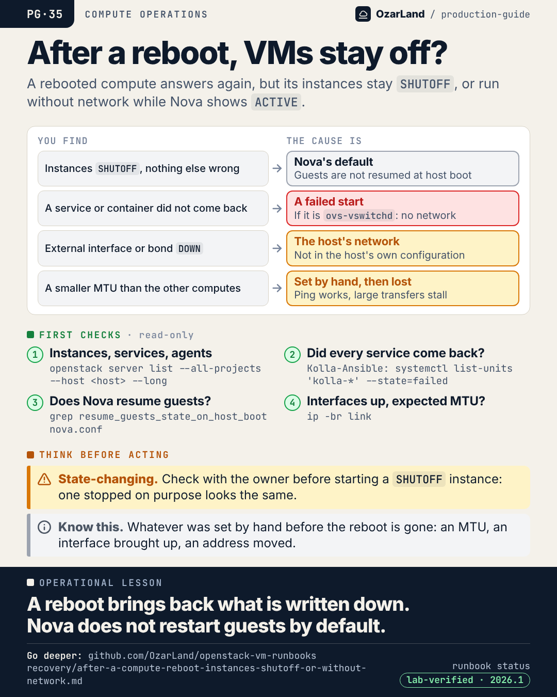

[← Production Guide](../../README.md#catalog) · Compute operations

<!-- Generated by scripts/build.cjs from after-a-compute-reboot.yml. Do not edit: change the source and rebuild. -->

# PG-35 · After a reboot, VMs stay off?



> **Operational lesson.** A reboot brings back what is written down. Nova does not restart guests by default.

## The memo as text

**Situation.** A rebooted compute answers again, but its instances stay `SHUTOFF`, or run without network while Nova shows `ACTIVE`.

**First checks** (read-only):

1. **Instances, services, agents**: `openstack server list --all-projects --host <host> --long`
2. **Did every service come back?**: `Kolla-Ansible: systemctl list-units 'kolla-*' --state=failed`
3. **Does Nova resume guests?**: `grep resume_guests_state_on_host_boot nova.conf`
4. **Interfaces up, expected MTU?**: `ip -br link`

**Think before acting:**

- ⚠️ **State-changing.** Check with the owner before starting a `SHUTOFF` instance: one stopped on purpose looks the same.
- ℹ️ **Know this.** Whatever was set by hand before the reboot is gone: an MTU, an interface brought up, an address moved.

## Go deeper

This memo is a memory aid. The procedure, with every command, its risk warning and its limits, is in the runbook:

- [After a compute reboot, instances stay SHUTOFF or come back without network](https://github.com/OzarLand/openstack-vm-runbooks/blob/main/recovery/after-a-compute-reboot-instances-shutoff-or-without-network.md) · `lab-verified` on 2026.1 · highest risk in the page: state-changing
- [Every instance on one compute loses the network while Nova shows them ACTIVE (ovs-vswitchd down)](https://github.com/OzarLand/openstack-vm-runbooks/blob/main/networking/ovs-vswitchd-down-on-compute.md) · `lab-verified` on 2026.1 · highest risk in the page: state-changing
- [Instances of one compute answer ping, but large transfers stall](https://github.com/OzarLand/openstack-vm-runbooks/blob/main/networking/tunnel-mtu-mismatch-large-packets-dropped.md) · `lab-verified` on 2026.1 · highest risk in the page: state-changing

**Where this holds.** Written from the Nova 2026.1 configuration reference and Kolla-Ansible 2026.1, which does not set resume_guests_state_on_host_boot. Observed on one all-in-one lab: instances staying SHUTOFF, with and without the option, and an external interface down. Not observed: a container that does not come back, a lost MTU, and the reboot of a compute of a multinode platform. ML2/OVN and DPDK are not covered.

## LinkedIn kit

- **Image:** [`dist/pg-35-after-a-compute-reboot.png`](../../dist/pg-35-after-a-compute-reboot.png) (1080 × 1350)
- **Post title:** After a compute reboot, the instances stay SHUTOFF. That is the default.

```text
A compute was rebooted for a kernel update. It is back, it answers SSH, nova-compute is up. And every instance on it is SHUTOFF.

Nothing is broken. resume_guests_state_on_host_boot defaults to False: Nova does not start the guests that were running before a host reboot. Someone has to.

The other surprises after a reboot come from the same place: what was never written down.
→ a service that did not come back, and if it is ovs-vswitchd, every instance is cut off
→ an external interface or bond that is DOWN
→ an MTU that was set by hand, months ago, and is back to the default

One caution before starting everything again: an instance that was stopped on purpose before the reboot looks exactly like the others.

Runbook: https://github.com/OzarLand/openstack-vm-runbooks/blob/main/recovery/after-a-compute-reboot-instances-shutoff-or-without-network.md
More memos: https://github.com/OzarLand/production-guide

#OpenStack #Nova #Maintenance #CloudOperations #SRE #OzarLand
```

---

*Source: [`after-a-compute-reboot.yml`](after-a-compute-reboot.yml). Found an error, or does your platform behave differently? [Open an issue](https://github.com/OzarLand/production-guide/issues/new) or see [CONTRIBUTING](../../CONTRIBUTING.md).*
