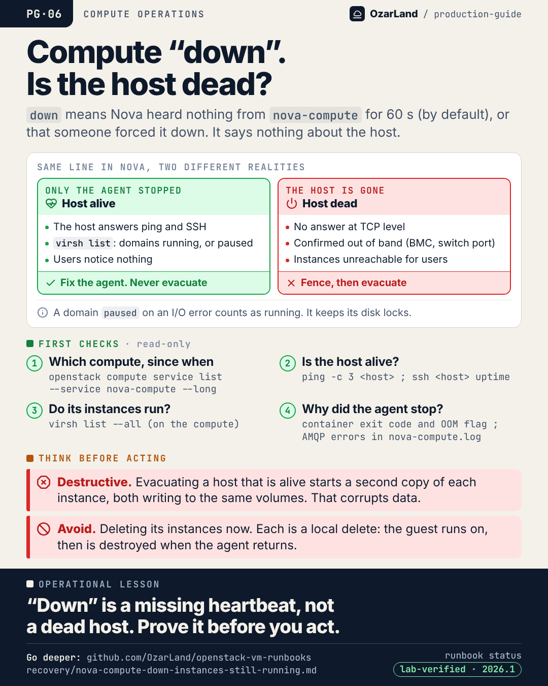

[← Production Guide](../../README.md#catalog) · Compute operations

<!-- Generated by scripts/build.cjs from compute-down-is-not-host-down.yml. Do not edit: change the source and rebuild. -->

# PG-06 · Compute “down”. Is the host dead?



> **Operational lesson.** “Down” is a missing heartbeat, not a dead host. Prove it before you act.

## The memo as text

**Situation.** `down` means Nova heard nothing from `nova-compute` for 60 s (by default), or that someone forced it down. It says nothing about the host.

**First checks** (read-only):

1. **Which compute, since when**: `openstack compute service list --service nova-compute --long`
2. **Is the host alive?**: `ping -c 3 <host> ; ssh <host> uptime`
3. **Do its instances run?**: `virsh list --all (on the compute)`
4. **Why did the agent stop?**: `container exit code and OOM flag ; AMQP errors in nova-compute.log`

**Think before acting:**

- 🛑 **Destructive.** Evacuating a host that is alive starts a second copy of each instance, both writing to the same volumes. That corrupts data.
- ⛔ **Avoid.** Deleting its instances now. Each is a local delete: the guest runs on, then is destroyed when the agent returns.

## Go deeper

This memo is a memory aid. The procedure, with every command, its risk warning and its limits, is in the runbook:

- [nova-compute is down on a compute, but its instances are still running](https://github.com/OzarLand/openstack-vm-runbooks/blob/main/recovery/nova-compute-down-instances-still-running.md) · `lab-verified` on 2026.1 · highest risk in the page: state-changing
- [nova-compute is down and the compute refuses an SSH login, but the host is alive](https://github.com/OzarLand/openstack-vm-runbooks/blob/main/recovery/nova-compute-down-host-alive-ssh-refused.md) · `lab-verified` on 2026.1 · highest risk in the page: state-changing
- [Compute host unreachable, instances down. Fence before you evacuate](https://github.com/OzarLand/openstack-vm-runbooks/blob/main/recovery/compute-host-failure-fence-before-evacuate.md) · `lab-verified` on 2026.1 · highest risk in the page: destructive

**Where this holds.** Lab-verified on OpenStack 2026.1 with Kolla-Ansible and ML2/OVS, and observed in production on an earlier release by the runbook's maintainer. The lab stopped the agent on purpose: the real causes (crash, OOM kill, lost RabbitMQ connection) were not reproduced. A host that answers on TCP but refuses your SSH login is alive too. Applies to the libvirt driver.

## LinkedIn kit

- **Image:** [`dist/pg-06-compute-down-is-not-host-down.png`](../../dist/pg-06-compute-down-is-not-host-down.png) (1080 × 1350)
- **Post title:** "Compute down" does not mean the host is down

```text
openstack compute service list shows a compute "down". What does Nova actually know?

Only this: it has heard nothing from the nova-compute agent of that host for service_down_time, 60 seconds by default, unless someone forced the service down. Nothing about the host. Nothing about the instances.

When only the agent stopped, the hypervisor and the instances run on, and users notice nothing. The danger is the operator, or the automation, that treats it as a dead host: evacuating now starts a second copy of every instance, writing to the same volumes.

Before anything else:
→ does the host answer ping and SSH?
→ does virsh list show the domains running?

If yes: fix the agent. Never evacuate.

Runbook: https://github.com/OzarLand/openstack-vm-runbooks/blob/main/recovery/nova-compute-down-instances-still-running.md
More memos: https://github.com/OzarLand/production-guide

#OpenStack #Nova #HighAvailability #CloudOperations #SRE #OzarLand
```

---

*Source: [`compute-down-is-not-host-down.yml`](compute-down-is-not-host-down.yml). Found an error, or does your platform behave differently? [Open an issue](https://github.com/OzarLand/production-guide/issues/new) or see [CONTRIBUTING](../../CONTRIBUTING.md).*
