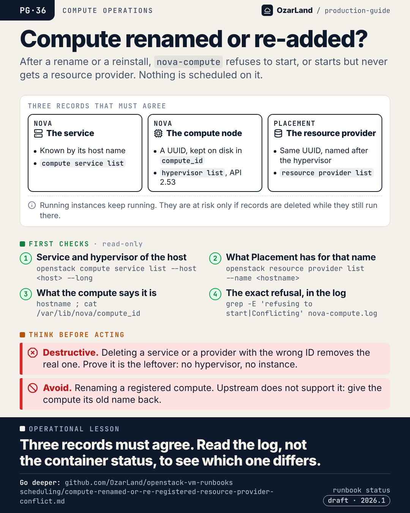

[← Production Guide](../../README.md#catalog) · Compute operations

<!-- Generated by scripts/build.cjs from compute-renamed-or-re-added.yml. Do not edit: change the source and rebuild. -->

# PG-36 · Compute renamed or re-added?



> **Operational lesson.** Three records must agree. Read the log, not the container status, to see which one differs.

## The memo as text

**Situation.** After a rename or a reinstall, `nova-compute` refuses to start, or starts but never gets a resource provider. Nothing is scheduled on it.

**First checks** (read-only):

1. **Service and hypervisor of the host**: `openstack compute service list --host <host> --long`
2. **What Placement has for that name**: `openstack resource provider list --name <hostname>`
3. **What the compute says it is**: `hostname ; cat /var/lib/nova/compute_id`
4. **The exact refusal, in the log**: `grep -E 'refusing to start|Conflicting' nova-compute.log`

**Think before acting:**

- 🛑 **Destructive.** Deleting a service or a provider with the wrong ID removes the real one. Prove it is the leftover: no hypervisor, no instance.
- ⛔ **Avoid.** Renaming a registered compute. Upstream does not support it: give the compute its old name back.

## Go deeper

This memo is a memory aid. The procedure, with every command, its risk warning and its limits, is in the runbook:

- [A compute was renamed, reinstalled or re-added. nova-compute refuses to start, or gets no resource provider](https://github.com/OzarLand/openstack-vm-runbooks/blob/main/scheduling/compute-renamed-or-re-registered-resource-provider-conflict.md) · `draft` on 2026.1 · highest risk in the page: destructive
- [Placement allocations do not match the instances. Compute looks full or empty, audit and heal](https://github.com/OzarLand/openstack-vm-runbooks/blob/main/scheduling/placement-allocations-out-of-sync-audit-and-heal.md) · `lab-verified` on 2026.1 · highest risk in the page: destructive

**Where this holds.** The runbook is a draft, written from the Nova and Placement 2026.1 sources and the upstream Compute Node Identification guide; the compute_id file exists from 2023.1. On a Kolla-Ansible lab, nova-compute logged "Possible rename detected" and kept running without heartbeat: the container stayed healthy while the service went down. With Kolla-Ansible the container keeps the host name it was created with.

## LinkedIn kit

- **Image:** [`dist/pg-36-compute-renamed-or-re-added.png`](../../dist/pg-36-compute-renamed-or-re-added.png) (1080 × 1350)
- **Post title:** A compute was renamed. Now nova-compute refuses to start.

```text
A compute was reinstalled, or its host name went from a short name to an FQDN. Since then, nova-compute refuses to start. Or it starts, shows "up", and no instance ever lands on it.

Nova ties a compute to three records that must agree:
→ the service, known by its host name
→ the compute node, known by a UUID the compute keeps on disk (compute_id)
→ the Placement resource provider, same UUID, named after the hypervisor

Change the name, lose the file, or leave an old provider behind, and one of them disagrees.

Two things to remember. Read the nova-compute log, not the container status: on a lab the container stayed "healthy" while the service was down. And do not fix it by deleting records while instances still run on that host.

Source runbook status: draft.

Runbook: https://github.com/OzarLand/openstack-vm-runbooks/blob/main/scheduling/compute-renamed-or-re-registered-resource-provider-conflict.md
More memos: https://github.com/OzarLand/production-guide

#OpenStack #Nova #Placement #CloudOperations #SRE #OzarLand
```

---

*Source: [`compute-renamed-or-re-added.yml`](compute-renamed-or-re-added.yml). Found an error, or does your platform behave differently? [Open an issue](https://github.com/OzarLand/production-guide/issues/new) or see [CONTRIBUTING](../../CONTRIBUTING.md).*
