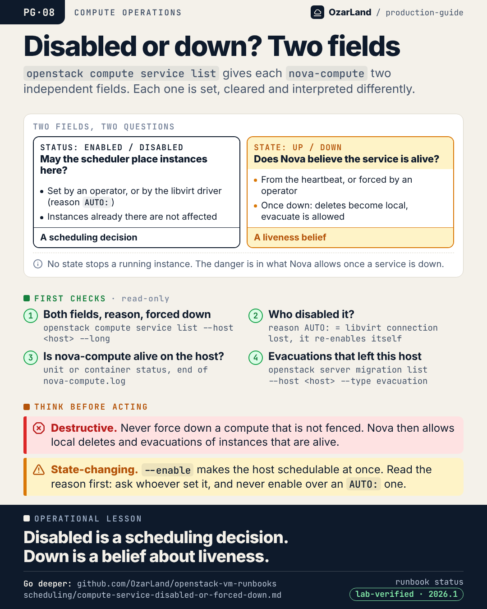

[← Production Guide](../../README.md#catalog) · Compute operations

<!-- Generated by scripts/build.cjs from disabled-or-down.yml. Do not edit: change the source and rebuild. -->

# PG-08 · Disabled or down? Two fields



> **Operational lesson.** Disabled is a scheduling decision. Down is a belief about liveness.

## The memo as text

**Situation.** `openstack compute service list` gives each `nova-compute` two independent fields. Each one is set, cleared and interpreted differently.

**First checks** (read-only):

1. **Both fields, reason, forced down**: `openstack compute service list --host <host> --long`
2. **Who disabled it?**: `reason AUTO: = libvirt connection lost, it re-enables itself`
3. **Is nova-compute alive on the host?**: `unit or container status, end of nova-compute.log`
4. **Evacuations that left this host**: `openstack server migration list --host <host> --type evacuation`

**Think before acting:**

- 🛑 **Destructive.** Never force down a compute that is not fenced. Nova then allows local deletes and evacuations of instances that are alive.
- ⚠️ **State-changing.** `--enable` makes the host schedulable at once. Read the reason first: ask whoever set it, and never enable over an `AUTO:` one.

## Go deeper

This memo is a memory aid. The procedure, with every command, its risk warning and its limits, is in the runbook:

- [A compute shows disabled or down. Why, what still works on it, and how to bring it back](https://github.com/OzarLand/openstack-vm-runbooks/blob/main/scheduling/compute-service-disabled-or-forced-down.md) · `lab-verified` on 2026.1 · highest risk in the page: destructive

**Where this holds.** Written from the Nova 2026.1 source and reproduced on a Kolla-Ansible lab (ML2/OVS, no Cinder). The Forced Down column needs compute API microversion 2.11 or later. Nova refuses to set a service back up while evacuation records from that host are still "done": nova-compute must be restarted there first, which destroys the local copies of the evacuated instances. Ironic is not covered.

## LinkedIn kit

- **Image:** [`dist/pg-08-disabled-or-down.png`](../../dist/pg-08-disabled-or-down.png) (1080 × 1350)
- **Post title:** Compute service: disabled and down are two different things

```text
openstack compute service list shows two fields for every nova-compute. They are independent, and mixing them up is how instances get lost.

Status (enabled / disabled) answers: may the scheduler place new instances here?
It is a scheduling decision. Running instances are not affected.

State (up / down) answers: does Nova believe the service is alive?
It comes from the heartbeat, or from an operator who forced it down.

The danger is in what Nova allows once a service is down: deleting an instance becomes a local delete (the guest runs on until nova-compute returns and destroys it), and evacuation is allowed.

So never force down a compute that is not fenced. And before you re-enable one, read the disable reason: a reason starting with "AUTO:" was set by the libvirt driver and clears itself.

Runbook: https://github.com/OzarLand/openstack-vm-runbooks/blob/main/scheduling/compute-service-disabled-or-forced-down.md
More memos: https://github.com/OzarLand/production-guide

#OpenStack #Nova #CloudOperations #SRE #InfrastructureEngineering #OzarLand
```

---

*Source: [`disabled-or-down.yml`](disabled-or-down.yml). Found an error, or does your platform behave differently? [Open an issue](https://github.com/OzarLand/production-guide/issues/new) or see [CONTRIBUTING](../../CONTRIBUTING.md).*
