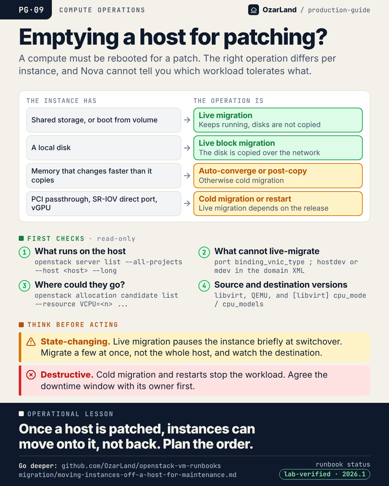

[← Production Guide](../../README.md#catalog) · Compute operations

<!-- Generated by scripts/build.cjs from emptying-a-host-for-maintenance.yml. Do not edit: change the source and rebuild. -->

# PG-09 · Emptying a host for patching?



> **Operational lesson.** Once a host is patched, instances can move onto it, not back. Plan the order.

## The memo as text

**Situation.** A compute must be rebooted for a patch. The right operation differs per instance, and Nova cannot tell you which workload tolerates what.

**First checks** (read-only):

1. **What runs on the host**: `openstack server list --all-projects --host <host> --long`
2. **What cannot live-migrate**: `port binding_vnic_type ; hostdev or mdev in the domain XML`
3. **Where could they go?**: `openstack allocation candidate list --resource VCPU=<n> ...`
4. **Source and destination versions**: `libvirt, QEMU, and [libvirt] cpu_mode / cpu_models`

**Think before acting:**

- ⚠️ **State-changing.** Live migration pauses the instance briefly at switchover. Migrate a few at once, not the whole host, and watch the destination.
- 🛑 **Destructive.** Cold migration and restarts stop the workload. Agree the downtime window with its owner first.

## Go deeper

This memo is a memory aid. The procedure, with every command, its risk warning and its limits, is in the runbook:

- [Moving instances off a compute host for planned maintenance](https://github.com/OzarLand/openstack-vm-runbooks/blob/main/migration/moving-instances-off-a-host-for-maintenance.md) · `lab-verified` on 2026.1 · highest risk in the page: destructive
- [Live migration runs for a long time, then is aborted. The instance writes memory faster than it can be copied](https://github.com/OzarLand/openstack-vm-runbooks/blob/main/migration/live-migration-never-completes-or-times-out.md) · `draft` on 2026.1 · highest risk in the page: state-changing

**Where this holds.** Derived from an operator's patching campaign on several hundred hosts; the disable, live migration and re-enable steps were lab-verified on OpenStack 2026.1, cold migration was not. Migration from a newer libvirt or QEMU to an older one is not supported. Constraints for PCI, SR-IOV, vGPU and CPU models depend on the release: check the Nova documentation of yours. A running instance keeps the old QEMU binary until it is migrated or restarted.

## LinkedIn kit

- **Image:** [`dist/pg-09-emptying-a-host-for-maintenance.png`](../../dist/pg-09-emptying-a-host-for-maintenance.png) (1080 × 1350)
- **Post title:** Emptying a compute host: one operation does not fit every instance

```text
A compute needs a reboot for a kernel or QEMU patch. "Just live-migrate everything" is rarely the whole answer.

The operation depends on the instance:
→ shared storage or boot from volume: live migration
→ local disk: live block migration, the disk travels over the network
→ memory changing faster than it copies: auto-converge or post-copy, else cold migration
→ PCI passthrough, SR-IOV, vGPU: cold migration or restart, depending on your release

And one trap of every patching campaign: migration from a newer libvirt/QEMU to an older one is not supported. Once a host is patched, instances can move onto it, but not back. The order of patching decides where instances can go.

Nova cannot tell you which workload tolerates a pause or a restart. The owning teams can.

Runbook: https://github.com/OzarLand/openstack-vm-runbooks/blob/main/migration/moving-instances-off-a-host-for-maintenance.md
More memos: https://github.com/OzarLand/production-guide

#OpenStack #Nova #LiveMigration #Patching #CloudOperations #OzarLand
```

---

*Source: [`emptying-a-host-for-maintenance.yml`](emptying-a-host-for-maintenance.yml). Found an error, or does your platform behave differently? [Open an issue](https://github.com/OzarLand/production-guide/issues/new) or see [CONTRIBUTING](../../CONTRIBUTING.md).*
