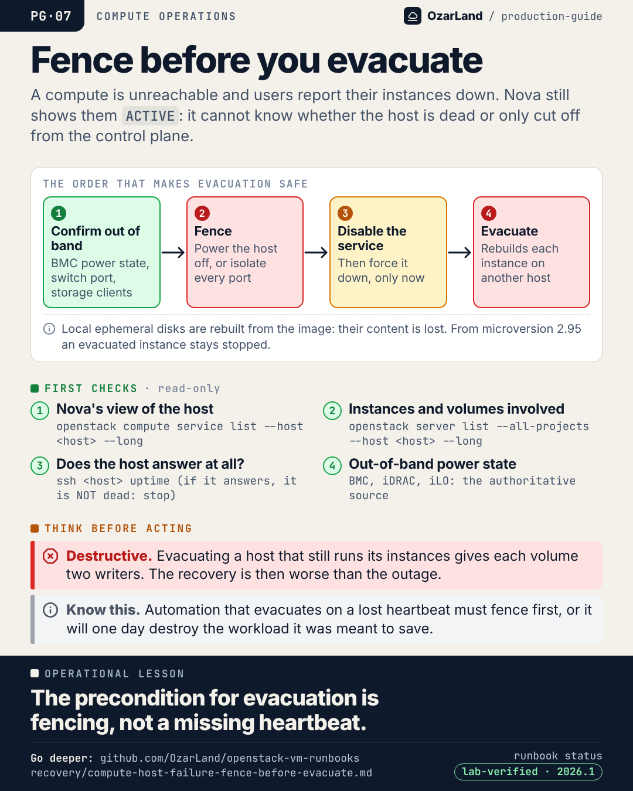

[← Production Guide](../../README.md#catalog) · Compute operations

<!-- Generated by scripts/build.cjs from fence-before-evacuate.yml. Do not edit: change the source and rebuild. -->

# PG-07 · Fence before you evacuate



> **Operational lesson.** The precondition for evacuation is fencing, not a missing heartbeat.

## The memo as text

**Situation.** A compute is unreachable and users report their instances down. Nova still shows them `ACTIVE`: it cannot know whether the host is dead or only cut off from the control plane.

**First checks** (read-only):

1. **Nova's view of the host**: `openstack compute service list --host <host> --long`
2. **Instances and volumes involved**: `openstack server list --all-projects --host <host> --long`
3. **Does the host answer at all?**: `ssh <host> uptime (if it answers, it is NOT dead: stop)`
4. **Out-of-band power state**: `BMC, iDRAC, iLO: the authoritative source`

**Think before acting:**

- 🛑 **Destructive.** Evacuating a host that still runs its instances gives each volume two writers. The recovery is then worse than the outage.
- ℹ️ **Know this.** Automation that evacuates on a lost heartbeat must fence first, or it will one day destroy the workload it was meant to save.

## Go deeper

This memo is a memory aid. The procedure, with every command, its risk warning and its limits, is in the runbook:

- [Compute host unreachable, instances down. Fence before you evacuate](https://github.com/OzarLand/openstack-vm-runbooks/blob/main/recovery/compute-host-failure-fence-before-evacuate.md) · `lab-verified` on 2026.1 · highest risk in the page: destructive

**Where this holds.** Derived from a real incident and lab-verified on OpenStack 2026.1 (Kolla-Ansible, ML2/OVS, local disks and Cinder LVM). Fencing through IPMI or the switch, the Ceph blocklist and evacuation with shared instance storage were not run on the lab. Evacuation semantics for local storage and the behaviour of a returning host should be checked against the Nova documentation of your release. Assumes the libvirt driver.

## LinkedIn kit

- **Image:** [`dist/pg-07-fence-before-evacuate.png`](../../dist/pg-07-fence-before-evacuate.png) (1080 × 1350)
- **Post title:** Fence before you evacuate. Always.

```text
A compute host stops answering. The instances on it are down. The pressure to run "server evacuate" is immediate.

But Nova cannot tell a dead host from an unreachable one. If the host is only cut off from the control plane, its instances may still be running, and still writing. Evacuate now and each volume gets two writers.

The order that makes it safe:
1. Confirm out of band (BMC, switch port, storage side)
2. Fence: power off, or isolate every port
3. Disable the service, force it down only now
4. Evacuate

The same goes for auto-evacuation tooling: if it reacts to a lost heartbeat without fencing, it will one day destroy the workload it was meant to save.

The precondition for evacuation is fencing, not a missing heartbeat.

Runbook: https://github.com/OzarLand/openstack-vm-runbooks/blob/main/recovery/compute-host-failure-fence-before-evacuate.md
More memos: https://github.com/OzarLand/production-guide

#OpenStack #Nova #HighAvailability #DisasterRecovery #CloudOperations #OzarLand
```

---

*Source: [`fence-before-evacuate.yml`](fence-before-evacuate.yml). Found an error, or does your platform behave differently? [Open an issue](https://github.com/OzarLand/production-guide/issues/new) or see [CONTRIBUTING](../../CONTRIBUTING.md).*
