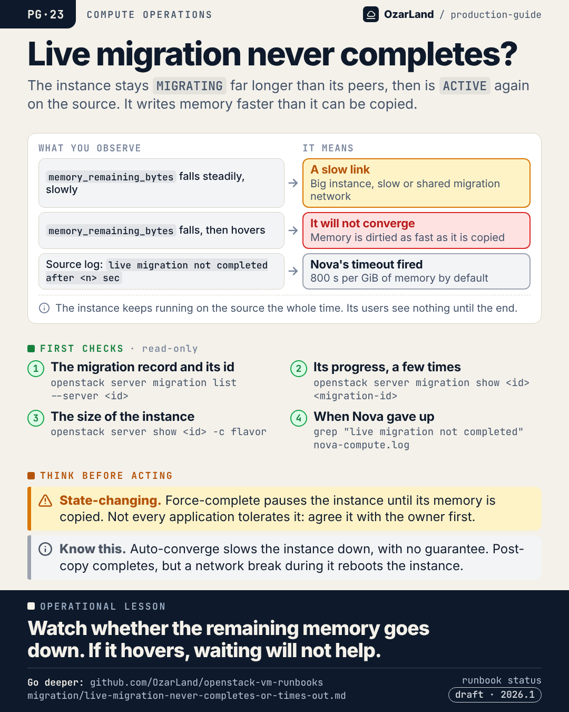

[← Production Guide](../../README.md#catalog) · Compute operations

<!-- Generated by scripts/build.cjs from live-migration-never-completes.yml. Do not edit: change the source and rebuild. -->

# PG-23 · Live migration never completes?



> **Operational lesson.** Watch whether the remaining memory goes down. If it hovers, waiting will not help.

## The memo as text

**Situation.** The instance stays `MIGRATING` far longer than its peers, then is `ACTIVE` again on the source. It writes memory faster than it can be copied.

**First checks** (read-only):

1. **The migration record and its id**: `openstack server migration list --server <id>`
2. **Its progress, a few times**: `openstack server migration show <id> <migration-id>`
3. **The size of the instance**: `openstack server show <id> -c flavor`
4. **When Nova gave up**: `grep "live migration not completed" nova-compute.log`

**Think before acting:**

- ⚠️ **State-changing.** Force-complete pauses the instance until its memory is copied. Not every application tolerates it: agree it with the owner first.
- ℹ️ **Know this.** Auto-converge slows the instance down, with no guarantee. Post-copy completes, but a network break during it reboots the instance.

## Go deeper

This memo is a memory aid. The procedure, with every command, its risk warning and its limits, is in the runbook:

- [Live migration runs for a long time, then is aborted. The instance writes memory faster than it can be copied](https://github.com/OzarLand/openstack-vm-runbooks/blob/main/migration/live-migration-never-completes-or-times-out.md) · `draft` on 2026.1 · highest risk in the page: state-changing
- [Moving instances off a compute host for planned maintenance](https://github.com/OzarLand/openstack-vm-runbooks/blob/main/migration/moving-instances-off-a-host-for-maintenance.md) · `lab-verified` on 2026.1 · highest risk in the page: destructive

**Where this holds.** The runbook is a draft, written from the Nova 2026.1 live migration guides and not reproduced on a lab. The timeout is Nova's default ([libvirt] live_migration_completion_timeout); a deployment may have changed it. The progress fields need compute API 2.24 or later. Auto-converge and post-copy must be allowed on all computes. A migration refused at once by a pre-check is a different case, as are PCI devices, vGPU and NUMA-pinned instances.

## LinkedIn kit

- **Image:** [`dist/pg-23-live-migration-never-completes.png`](../../dist/pg-23-live-migration-never-completes.png) (1080 × 1350)
- **Post title:** A live migration that never completes: watch one number

```text
A live migration starts fine. Then it runs. And runs. Much longer than the others. Eventually the instance is ACTIVE again, on the source, and the migration is marked failed.

Live migration copies memory while the instance keeps running. Every page written again must be copied again. If the instance dirties memory faster than the network copies it, the migration cannot converge.

One number tells you which case you are in, memory_remaining_bytes:
→ it falls steadily, slowly: a slow or shared migration network
→ it falls, then hovers: it will not converge without help

The ways out all have a price. Force-complete pauses the instance. Auto-converge throttles its CPU. Post-copy completes, but a network break during that phase reboots the instance.

Source runbook status: draft, not yet reproduced on a lab.

Runbook: https://github.com/OzarLand/openstack-vm-runbooks/blob/main/migration/live-migration-never-completes-or-times-out.md
More memos: https://github.com/OzarLand/production-guide

#OpenStack #Nova #LiveMigration #Libvirt #CloudOperations #OzarLand
```

---

*Source: [`live-migration-never-completes.yml`](live-migration-never-completes.yml). Found an error, or does your platform behave differently? [Open an issue](https://github.com/OzarLand/production-guide/issues/new) or see [CONTRIBUTING](../../CONTRIBUTING.md).*
