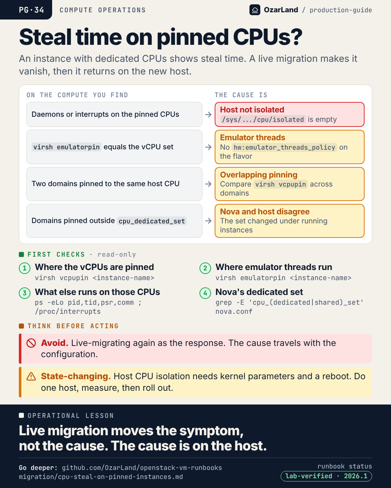

[← Production Guide](../../README.md#catalog) · Compute operations

<!-- Generated by scripts/build.cjs from steal-time-on-pinned-cpus.yml. Do not edit: change the source and rebuild. -->

# PG-34 · Steal time on pinned CPUs?



> **Operational lesson.** Live migration moves the symptom, not the cause. The cause is on the host.

## The memo as text

**Situation.** An instance with dedicated CPUs shows steal time. A live migration makes it vanish, then it returns on the new host.

**First checks** (read-only):

1. **Where the vCPUs are pinned**: `virsh vcpupin <instance-name>`
2. **Where emulator threads run**: `virsh emulatorpin <instance-name>`
3. **What else runs on those CPUs**: `ps -eLo pid,tid,psr,comm ; /proc/interrupts`
4. **Nova's dedicated set**: `grep -E 'cpu_(dedicated|shared)_set' nova.conf`

**Think before acting:**

- ⛔ **Avoid.** Live-migrating again as the response. The cause travels with the configuration.
- ⚠️ **State-changing.** Host CPU isolation needs kernel parameters and a reboot. Do one host, measure, then roll out.

## Go deeper

This memo is a memory aid. The procedure, with every command, its risk warning and its limits, is in the runbook:

- [CPU steal time on instances with dedicated (pinned) CPUs. Live migration moves the symptom, not the cause](https://github.com/OzarLand/openstack-vm-runbooks/blob/main/migration/cpu-steal-on-pinned-instances.md) · `lab-verified` on 2026.1 · highest risk in the page: state-changing

**Where this holds.** Derived from an operator's incident. On a lab (2026.1) the steal was reproduced and emulator threads moved; host isolation (it depends on the OS and hardware: check your vendor's guidance) and the overlap fix were not run. Per-CPU kernel threads (ksoftirqd, kworker...) exist on every CPU and are expected. With Kolla-Ansible, virsh runs in the nova_libvirt container. Live migration of pinned instances only became NUMA-aware in Train; before that a migration could itself create overlapping pinning. Changing a flavor's extra specs does not change running instances.

## LinkedIn kit

- **Image:** [`dist/pg-34-steal-time-on-pinned-cpus.png`](../../dist/pg-34-steal-time-on-pinned-cpus.png) (1080 × 1350)
- **Post title:** Steal time on pinned CPUs: live migration is not the fix

```text
An instance was created with dedicated CPUs. It should never see steal time: each vCPU owns a host CPU. And yet top shows 7% steal, and the latency-sensitive workload reports jitter.

Someone live-migrates it. Steal drops to zero. Problem solved.

It comes back days or weeks later on the new host. So it gets migrated again. And again.

Live migration moves the symptom, not the cause. The cause is on the host, and it travels with the configuration:
→ daemons or interrupts running on the pinned CPUs: the host is not isolated
→ emulator threads sharing the vCPU set
→ two instances pinned to the same host CPU
→ domains pinned outside the set Nova believes is dedicated

All of them are visible from the compute, read-only, with virsh vcpupin, virsh emulatorpin and a look at what else runs on those CPUs.

Runbook: https://github.com/OzarLand/openstack-vm-runbooks/blob/main/migration/cpu-steal-on-pinned-instances.md
More memos: https://github.com/OzarLand/production-guide

#OpenStack #Nova #Performance #NFV #CloudOperations #OzarLand
```

---

*Source: [`steal-time-on-pinned-cpus.yml`](steal-time-on-pinned-cpus.yml). Found an error, or does your platform behave differently? [Open an issue](https://github.com/OzarLand/production-guide/issues/new) or see [CONTRIBUTING](../../CONTRIBUTING.md).*
