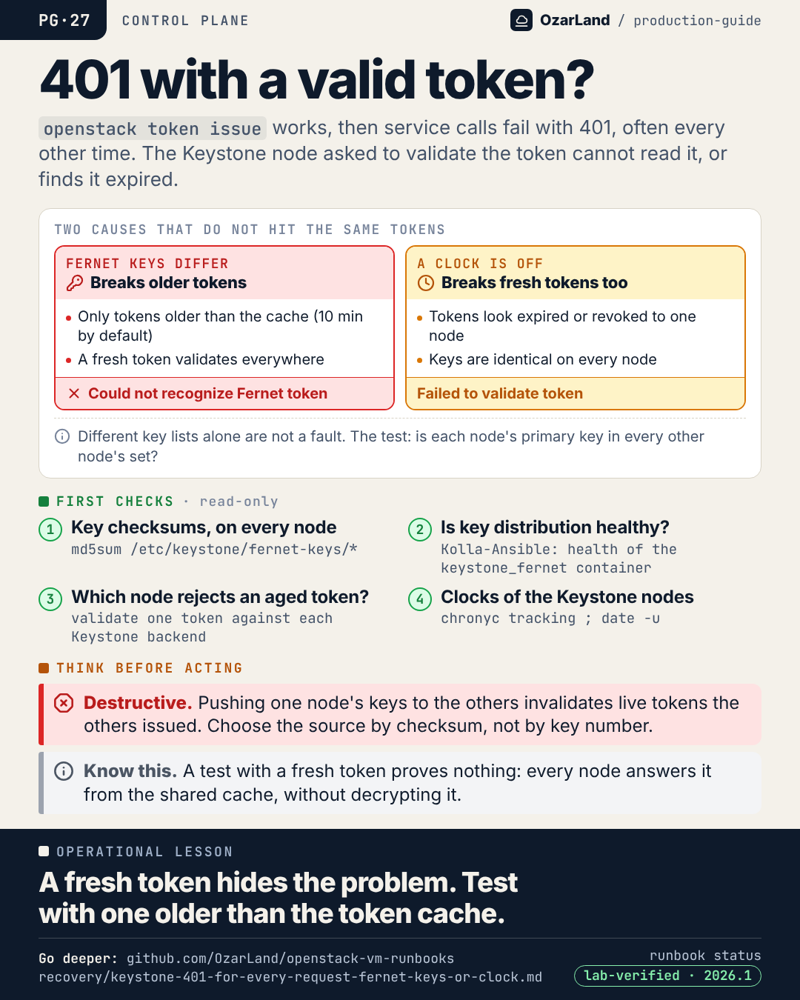

[← Production Guide](../../README.md#catalog) · Control plane

<!-- Generated by scripts/build.cjs from 401-with-a-valid-token.yml. Do not edit: change the source and rebuild. -->

# PG-27 · 401 with a valid token?



> **Operational lesson.** A fresh token hides the problem. Test with one older than the token cache.

## The memo as text

**Situation.** `openstack token issue` works, then service calls fail with 401, often every other time. The Keystone node asked to validate the token cannot read it, or finds it expired.

**First checks** (read-only):

1. **Key checksums, on every node**: `md5sum /etc/keystone/fernet-keys/*`
2. **Is key distribution healthy?**: `Kolla-Ansible: health of the keystone_fernet container`
3. **Which node rejects an aged token?**: `validate one token against each Keystone backend`
4. **Clocks of the Keystone nodes**: `chronyc tracking ; date -u`

**Think before acting:**

- 🛑 **Destructive.** Pushing one node's keys to the others invalidates live tokens the others issued. Choose the source by checksum, not by key number.
- ℹ️ **Know this.** A test with a fresh token proves nothing: every node answers it from the shared cache, without decrypting it.

## Go deeper

This memo is a memory aid. The procedure, with every command, its risk warning and its limits, is in the runbook:

- [Requests fail with 401 for tokens that should be valid. Fernet keys differ between Keystone nodes, or a clock is off](https://github.com/OzarLand/openstack-vm-runbooks/blob/main/recovery/keystone-401-for-every-request-fernet-keys-or-clock.md) · `lab-verified` on 2026.1 · highest risk in the page: destructive
- [Every API call fails at once. Expired TLS certificates or inconsistent Keystone Fernet keys](https://github.com/OzarLand/openstack-vm-runbooks/blob/main/diagnostics/expired-certificates-and-fernet-keys-break-every-api-call.md) · `draft` on 2026.1 · highest risk in the page: destructive

**Where this holds.** Written from the Keystone 2026.1 source and lab-verified on Kolla-Ansible with three controllers, where Keystone caches tokens in memcached shared by all nodes (600 s by default) and the keystone_fernet containers rotate and push the keys. Other deployments distribute keys differently. Intermittent failure is common but not the rule. If keys were replaced on every node, every client must simply authenticate again.

## LinkedIn kit

- **Image:** [`dist/pg-27-401-with-a-valid-token.png`](../../dist/pg-27-401-with-a-valid-token.png) (1080 × 1350)
- **Post title:** 401 with a token that should be valid: the fresh token is lying to you

```text
openstack token issue works. The next command fails with 401. Then works. Then fails.

Behind a load balancer, that pattern means one Keystone node cannot validate tokens the others issued. Two usual reasons, and they do not hit the same tokens:

→ Fernet keys differ between nodes: it breaks tokens older than the token cache, 10 minutes by default. Long-running clients, scripts, Horizon sessions.
→ A clock is off on one node: it breaks fresh tokens too.

Here is the trap. Keystone caches every token it issues in a cache shared by all nodes. For 10 minutes, any node answers from the cache, without decrypting anything. So your test with a brand new token passes on every node, with diverged keys.

Test with a token older than the cache. And compare key checksums across nodes, not key numbers.

Runbook: https://github.com/OzarLand/openstack-vm-runbooks/blob/main/recovery/keystone-401-for-every-request-fernet-keys-or-clock.md
More memos: https://github.com/OzarLand/production-guide

#OpenStack #Keystone #Authentication #ControlPlane #CloudOperations #OzarLand
```

---

*Source: [`401-with-a-valid-token.yml`](401-with-a-valid-token.yml). Found an error, or does your platform behave differently? [Open an issue](https://github.com/OzarLand/production-guide/issues/new) or see [CONTRIBUTING](../../CONTRIBUTING.md).*
