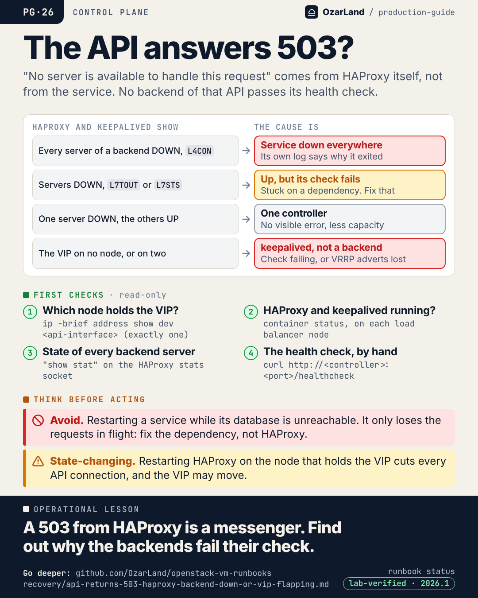

[← Production Guide](../../README.md#catalog) · Control plane

<!-- Generated by scripts/build.cjs from api-returns-503.yml. Do not edit: change the source and rebuild. -->

# PG-26 · The API answers 503?



> **Operational lesson.** A 503 from HAProxy is a messenger. Find out why the backends fail their check.

## The memo as text

**Situation.** "No server is available to handle this request" comes from HAProxy itself, not from the service. No backend of that API passes its health check.

**First checks** (read-only):

1. **Which node holds the VIP?**: `ip -brief address show dev <api-interface> (exactly one)`
2. **HAProxy and keepalived running?**: `container status, on each load balancer node`
3. **State of every backend server**: `"show stat" on the HAProxy stats socket`
4. **The health check, by hand**: `curl http://<controller>:<port>/healthcheck`

**Think before acting:**

- ⛔ **Avoid.** Restarting a service while its database is unreachable. It only loses the requests in flight: fix the dependency, not HAProxy.
- ⚠️ **State-changing.** Restarting HAProxy on the node that holds the VIP cuts every API connection, and the VIP may move.

## Go deeper

This memo is a memory aid. The procedure, with every command, its risk warning and its limits, is in the runbook:

- [The API returns 503, an HAProxy backend is DOWN, or the VIP flaps or sits on two nodes](https://github.com/OzarLand/openstack-vm-runbooks/blob/main/recovery/api-returns-503-haproxy-backend-down-or-vip-flapping.md) · `lab-verified` on 2026.1 · highest risk in the page: state-changing

**Where this holds.** Specific to Kolla-Ansible 2026.1, where keepalived holds a VIP and HAProxy checks each API backend (GET /healthcheck, or GET / for Nova and Placement, expecting 200). Lab-verified; HAProxy down on every node and a virtual router ID collision were not run. A 503 on Keystone breaks every command. Running instances keep running: their data path does not go through HAProxy, but instances booting at that moment can miss their metadata.

## LinkedIn kit

- **Image:** [`dist/pg-26-api-returns-503.png`](../../dist/pg-26-api-returns-503.png) (1080 × 1350)
- **Post title:** 503 from the API: HAProxy is the messenger, not the cause

```text
"503 Service Unavailable: No server is available to handle this request."

That sentence does not come from Nova or Keystone. It comes from HAProxy, and it means one precise thing: no backend of that API is passing its health check.

What HAProxy shows tells you where to go next:
→ every server DOWN with L4CON: the service is down on every controller. Its own log says why.
→ servers DOWN with L7TOUT or L7STS: the service runs but cannot answer. It is stuck on a dependency.
→ one server DOWN, the others UP: one controller. Users see nothing.
→ the VIP on no node, or on two: keepalived, not a backend.

The tempting fix is to restart things at the front door. But restarting a service whose database is unreachable only loses the requests in flight.

Running instances keep running through all of it.

Runbook: https://github.com/OzarLand/openstack-vm-runbooks/blob/main/recovery/api-returns-503-haproxy-backend-down-or-vip-flapping.md
More memos: https://github.com/OzarLand/production-guide

#OpenStack #HAProxy #ControlPlane #HighAvailability #CloudOperations #OzarLand
```

---

*Source: [`api-returns-503.yml`](api-returns-503.yml). Found an error, or does your platform behave differently? [Open an issue](https://github.com/OzarLand/production-guide/issues/new) or see [CONTRIBUTING](../../CONTRIBUTING.md).*
