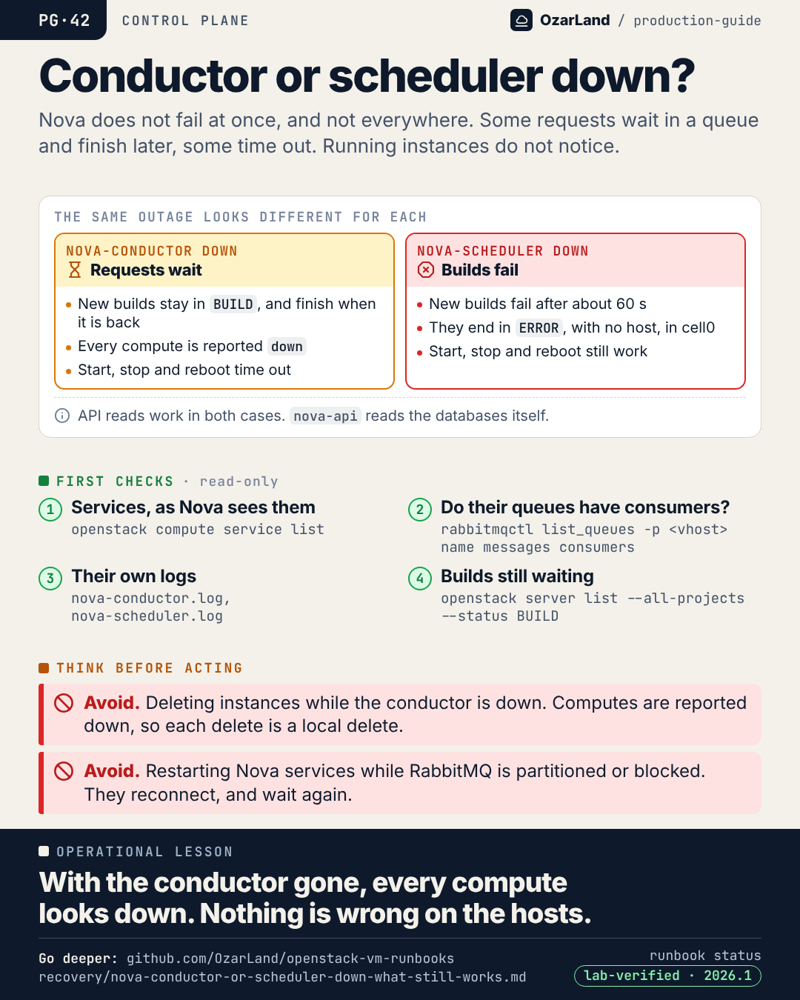

[← Production Guide](../../README.md#catalog) · Control plane

<!-- Generated by scripts/build.cjs from conductor-or-scheduler-down.yml. Do not edit: change the source and rebuild. -->

# PG-42 · Conductor or scheduler down?



> **Operational lesson.** With the conductor gone, every compute looks down. Nothing is wrong on the hosts.

## The memo as text

**Situation.** Nova does not fail at once, and not everywhere. Some requests wait in a queue and finish later, some time out. Running instances do not notice.

**First checks** (read-only):

1. **Services, as Nova sees them**: `openstack compute service list`
2. **Do their queues have consumers?**: `rabbitmqctl list_queues -p <vhost> name messages consumers`
3. **Their own logs**: `nova-conductor.log, nova-scheduler.log`
4. **Builds still waiting**: `openstack server list --all-projects --status BUILD`

**Think before acting:**

- ⛔ **Avoid.** Deleting instances while the conductor is down. Computes are reported down, so each delete is a local delete.
- ⛔ **Avoid.** Restarting Nova services while RabbitMQ is partitioned or blocked. They reconnect, and wait again.

## Go deeper

This memo is a memory aid. The procedure, with every command, its risk warning and its limits, is in the runbook:

- [nova-conductor or nova-scheduler is down. What still works, what waits, what fails, and where failed builds go (cell0)](https://github.com/OzarLand/openstack-vm-runbooks/blob/main/recovery/nova-conductor-or-scheduler-down-what-still-works.md) · `lab-verified` on 2026.1 · highest risk in the page: destructive
- [RPC timeouts in every service, computes reported down. RabbitMQ is partitioned, blocked by an alarm, or a node is missing](https://github.com/OzarLand/openstack-vm-runbooks/blob/main/recovery/rabbitmq-partition-or-alarm-rpc-timeouts.md) · `lab-verified` on 2026.1 · highest risk in the page: destructive

**Where this holds.** Written from the Nova 2026.1 source and lab-verified with Kolla-Ansible. The 60 s is rpc_response_timeout, Nova's default. Builds that timed out are not retried: their owners build again. A start, stop or reboot sent while the conductor was down can leave a task state that nothing clears. Applies when every copy of the service is down, in a single cell. Queued builds survive with quorum queues and RabbitMQ staying up; a RabbitMQ reset drops them.

## LinkedIn kit

- **Image:** [`dist/pg-42-conductor-or-scheduler-down.png`](../../dist/pg-42-conductor-or-scheduler-down.png) (1080 × 1350)
- **Post title:** nova-conductor down: every compute looks dead, and none of them is

```text
nova-conductor and nova-scheduler live on the controllers. When every copy of one of them is down, Nova does not fail at once, and not everywhere.

With the conductor down:
→ new builds stay in BUILD, and finish by themselves when it is back
→ within a minute every compute is reported "down", while its instances keep running
→ start, stop and reboot time out

With the scheduler down:
→ new builds fail after about a minute, and land in ERROR in cell0, with no host
→ start, stop and reboot still work

In both cases API reads work, and running instances notice nothing.

The trap is the wall of "down" computes. nova-compute has no database access of its own: its heartbeat goes through the conductor. Nothing is wrong on the hosts. And deleting an instance at that moment is a local delete.

Runbook: https://github.com/OzarLand/openstack-vm-runbooks/blob/main/recovery/nova-conductor-or-scheduler-down-what-still-works.md
More memos: https://github.com/OzarLand/production-guide

#OpenStack #Nova #ControlPlane #IncidentResponse #CloudOperations #OzarLand
```

---

*Source: [`conductor-or-scheduler-down.yml`](conductor-or-scheduler-down.yml). Found an error, or does your platform behave differently? [Open an issue](https://github.com/OzarLand/production-guide/issues/new) or see [CONTRIBUTING](../../CONTRIBUTING.md).*
