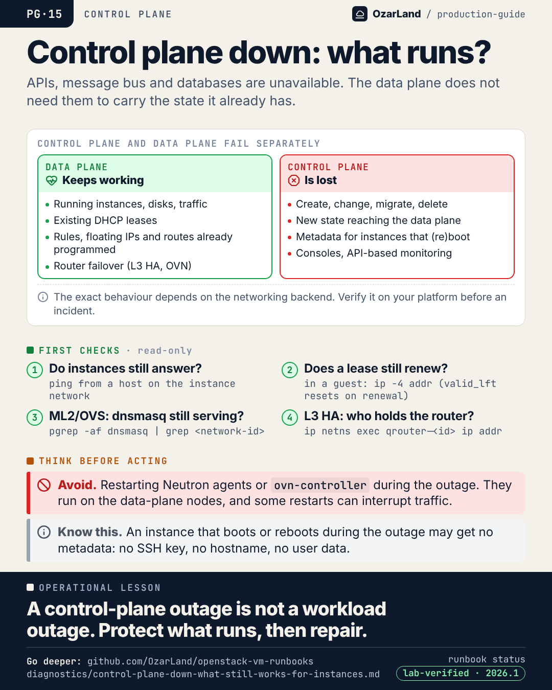

[← Production Guide](../../README.md#catalog) · Control plane

<!-- Generated by scripts/build.cjs from control-plane-down.yml. Do not edit: change the source and rebuild. -->

# PG-15 · Control plane down: what runs?



> **Operational lesson.** A control-plane outage is not a workload outage. Protect what runs, then repair.

## The memo as text

**Situation.** APIs, message bus and databases are unavailable. The data plane does not need them to carry the state it already has.

**First checks** (read-only):

1. **Do instances still answer?**: `ping from a host on the instance network`
2. **Does a lease still renew?**: `in a guest: ip -4 addr (valid_lft resets on renewal)`
3. **ML2/OVS: dnsmasq still serving?**: `pgrep -af dnsmasq | grep <network-id>`
4. **L3 HA: who holds the router?**: `ip netns exec qrouter-<id> ip addr`

**Think before acting:**

- ⛔ **Avoid.** Restarting Neutron agents or `ovn-controller` during the outage. They run on the data-plane nodes, and some restarts can interrupt traffic.
- ℹ️ **Know this.** An instance that boots or reboots during the outage may get no metadata: no SSH key, no hostname, no user data.

## Go deeper

This memo is a memory aid. The procedure, with every command, its risk warning and its limits, is in the runbook:

- [Control plane down. What still works for running instances, and what does not](https://github.com/OzarLand/openstack-vm-runbooks/blob/main/diagnostics/control-plane-down-what-still-works-for-instances.md) · `lab-verified` on 2026.1 · highest risk in the page: read-only
- [Reopening provisioning after a control-plane incident. Stop the APIs, recover, verify, reopen](https://github.com/OzarLand/openstack-vm-runbooks/blob/main/recovery/reopening-provisioning-after-control-plane-incident.md) · `draft` on 2026.1 · highest risk in the page: destructive

**Where this holds.** General behaviour of Nova and Neutron as documented upstream and observed by an operator in a real control-plane incident. The lab confirmation (OpenStack 2026.1, Kolla-Ansible all-in-one) covers ML2/OVS with a non-HA router only: OVN, L3 HA and router failover were not tested. Linux Bridge, SR-IOV and vendor SDN differ. Octavia, Designate and other services with their own data plane are not covered.

## LinkedIn kit

- **Image:** [`dist/pg-15-control-plane-down.png`](../../dist/pg-15-control-plane-down.png) (1080 × 1350)
- **Post title:** Control plane down is not the same as workloads down

```text
The APIs do not answer. The message bus is broken. The database is unavailable. Is production down?

Not necessarily. The control plane and the data plane fail separately, and the data plane does not need the APIs to carry the state it already has.

What keeps working:
→ running instances, their disks, their traffic
→ existing DHCP leases
→ security groups, floating IPs and routes already programmed

What is lost:
→ create, change, migrate, delete
→ any new state reaching the data plane
→ metadata for instances that boot or reboot
→ consoles, and monitoring that reads the APIs

This is what makes "protect the running workloads, then repair" a real option. But it depends on your networking backend: verify it on a lab before the incident, and write the result down.

Runbook: https://github.com/OzarLand/openstack-vm-runbooks/blob/main/diagnostics/control-plane-down-what-still-works-for-instances.md
More memos: https://github.com/OzarLand/production-guide

#OpenStack #ControlPlane #IncidentResponse #CloudOperations #SRE #OzarLand
```

---

*Source: [`control-plane-down.yml`](control-plane-down.yml). Found an error, or does your platform behave differently? [Open an issue](https://github.com/OzarLand/production-guide/issues/new) or see [CONTRIBUTING](../../CONTRIBUTING.md).*
