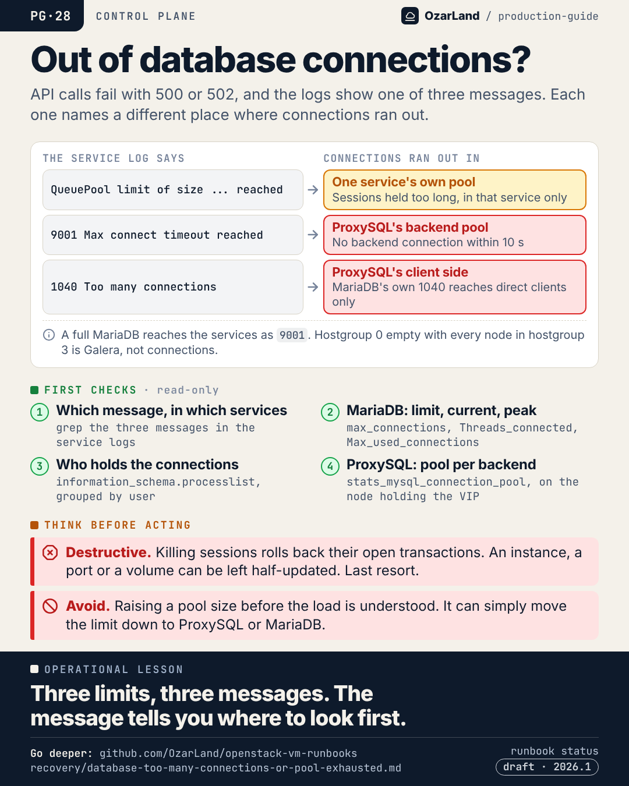

[← Production Guide](../../README.md#catalog) · Control plane

<!-- Generated by scripts/build.cjs from database-connections-exhausted.yml. Do not edit: change the source and rebuild. -->

# PG-28 · Out of database connections?



> **Operational lesson.** Three limits, three messages. The message tells you where to look first.

## The memo as text

**Situation.** API calls fail with 500 or 502, and the logs show one of three messages. Each one names a different place where connections ran out.

**First checks** (read-only):

1. **Which message, in which services**: `grep the three messages in the service logs`
2. **MariaDB: limit, current, peak**: `max_connections, Threads_connected, Max_used_connections`
3. **Who holds the connections**: `information_schema.processlist, grouped by user`
4. **ProxySQL: pool per backend**: `stats_mysql_connection_pool, on the node holding the VIP`

**Think before acting:**

- 🛑 **Destructive.** Killing sessions rolls back their open transactions. An instance, a port or a volume can be left half-updated. Last resort.
- ⛔ **Avoid.** Raising a pool size before the load is understood. It can simply move the limit down to ProxySQL or MariaDB.

## Go deeper

This memo is a memory aid. The procedure, with every command, its risk warning and its limits, is in the runbook:

- [Services fail on "Too many connections", "Max connect timeout" or "QueuePool limit". Database connections are exhausted](https://github.com/OzarLand/openstack-vm-runbooks/blob/main/recovery/database-too-many-connections-or-pool-exhausted.md) · `draft` on 2026.1 · highest risk in the page: destructive
- [Every API fails on database errors. The Galera cluster lost quorum, or stopped on every node](https://github.com/OzarLand/openstack-vm-runbooks/blob/main/recovery/galera-cluster-lost-quorum-database-unavailable.md) · `lab-verified` on 2026.1 · highest risk in the page: destructive

**Where this holds.** The runbook is a draft, specific to Kolla-Ansible 2026.1, where every service reaches MariaDB through ProxySQL on the internal VIP; it was only partly reproduced on a lab. The limits and the 10 s timeout are Kolla-Ansible's defaults. Without ProxySQL the messages and the layers differ. Running instances are not affected; computes may be reported down if the conductor cannot write their heartbeat.

## LinkedIn kit

- **Image:** [`dist/pg-28-database-connections-exhausted.png`](../../dist/pg-28-database-connections-exhausted.png) (1080 × 1350)
- **Post title:** "Too many connections": three limits, three messages

```text
API calls fail with 500. The logs talk about database connections. The reflex is to raise a limit somewhere.

With MariaDB behind ProxySQL, there are three places where connections can run out, and each has its own message:

→ "QueuePool limit of size ... reached": the SQLAlchemy pool inside one service. The database is fine. That service holds its sessions too long.
→ "9001 Max connect timeout reached": ProxySQL could not get a backend connection in time.
→ "1040 Too many connections": ProxySQL's client side. A full MariaDB shows up in the services as 9001.

Read the message before touching a setting. A larger pool per process, multiplied by the number of processes and controllers, can simply move the limit one layer down.

And one false friend: 9001 with the writer hostgroup empty and every node offline is a Galera problem, not a connection problem.

Source runbook status: draft.

Runbook: https://github.com/OzarLand/openstack-vm-runbooks/blob/main/recovery/database-too-many-connections-or-pool-exhausted.md
More memos: https://github.com/OzarLand/production-guide

#OpenStack #MariaDB #ProxySQL #ControlPlane #CloudOperations #OzarLand
```

---

*Source: [`database-connections-exhausted.yml`](database-connections-exhausted.yml). Found an error, or does your platform behave differently? [Open an issue](https://github.com/OzarLand/production-guide/issues/new) or see [CONTRIBUTING](../../CONTRIBUTING.md).*
