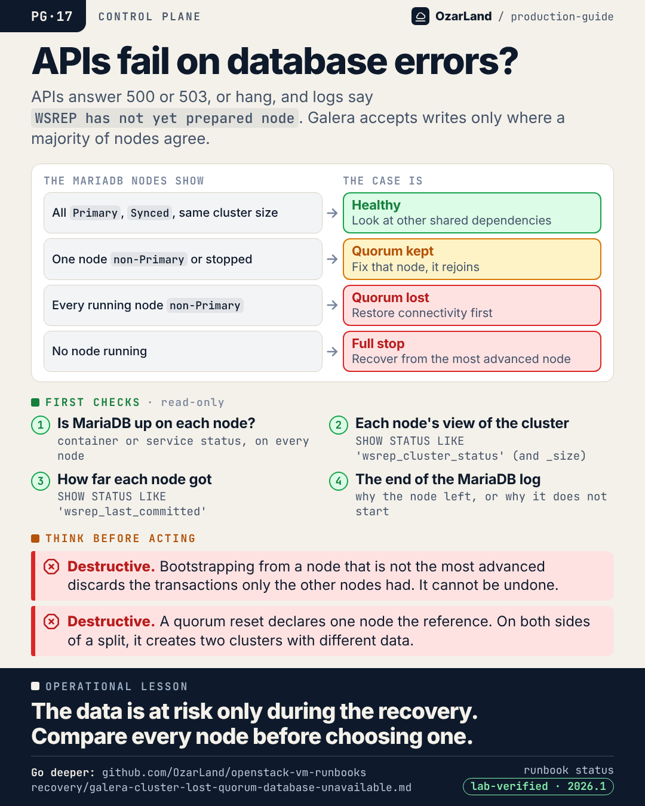

[← Production Guide](../../README.md#catalog) · Control plane

<!-- Generated by scripts/build.cjs from galera-lost-quorum.yml. Do not edit: change the source and rebuild. -->

# PG-17 · APIs fail on database errors?



> **Operational lesson.** The data is at risk only during the recovery. Compare every node before choosing one.

## The memo as text

**Situation.** APIs answer 500 or 503, or hang, and logs say `WSREP has not yet prepared node`. Galera accepts writes only where a majority of nodes agree.

**First checks** (read-only):

1. **Is MariaDB up on each node?**: `container or service status, on every node`
2. **Each node's view of the cluster**: `SHOW STATUS LIKE 'wsrep_cluster_status' (and _size)`
3. **How far each node got**: `SHOW STATUS LIKE 'wsrep_last_committed'`
4. **The end of the MariaDB log**: `why the node left, or why it does not start`

**Think before acting:**

- 🛑 **Destructive.** Bootstrapping from a node that is not the most advanced discards the transactions only the other nodes had. It cannot be undone.
- 🛑 **Destructive.** A quorum reset declares one node the reference. On both sides of a split, it creates two clusters with different data.

## Go deeper

This memo is a memory aid. The procedure, with every command, its risk warning and its limits, is in the runbook:

- [Every API fails on database errors. The Galera cluster lost quorum, or stopped on every node](https://github.com/OzarLand/openstack-vm-runbooks/blob/main/recovery/galera-cluster-lost-quorum-database-unavailable.md) · `lab-verified` on 2026.1 · highest risk in the page: destructive

**Where this holds.** Written from Kolla-Ansible 2026.1 and the Galera crash recovery and quorum reset guides; lab-verified on a disposable Kolla-Ansible lab with ProxySQL in front of MariaDB. With ProxySQL the services see its errors ("Max connect timeout reached") instead of the WSREP message. Running instances keep running. Single-node MariaDB, restoring from a backup and Galera arbitrators are not covered.

## LinkedIn kit

- **Image:** [`dist/pg-17-galera-lost-quorum.png`](../../dist/pg-17-galera-lost-quorum.png) (1080 × 1350)
- **Post title:** Galera lost quorum: the data is at risk during the recovery, not before

```text
Every OpenStack API fails or hangs. The logs say "WSREP has not yet prepared node for application use".

Galera accepts writes only in a Primary component, a majority of the last known nodes. Lose the majority and the remaining nodes refuse queries. That is a safety mechanism, not the failure.

Running instances keep running. And the data is not at risk yet. It becomes at risk during the recovery, if the cluster is bootstrapped from a node that is not the most advanced: the transactions only the other nodes had are discarded, for good.

So before any recovery command, on every node:
→ is MariaDB running?
→ wsrep_cluster_status: Primary or non-Primary?
→ wsrep_last_committed: how far did this node get?

One node down, quorum lost and full stop are three different cases with three different answers.

Runbook: https://github.com/OzarLand/openstack-vm-runbooks/blob/main/recovery/galera-cluster-lost-quorum-database-unavailable.md
More memos: https://github.com/OzarLand/production-guide

#OpenStack #MariaDB #Galera #ControlPlane #DatabaseReliability #OzarLand
```

---

*Source: [`galera-lost-quorum.yml`](galera-lost-quorum.yml). Found an error, or does your platform behave differently? [Open an issue](https://github.com/OzarLand/production-guide/issues/new) or see [CONTRIBUTING](../../CONTRIBUTING.md).*
