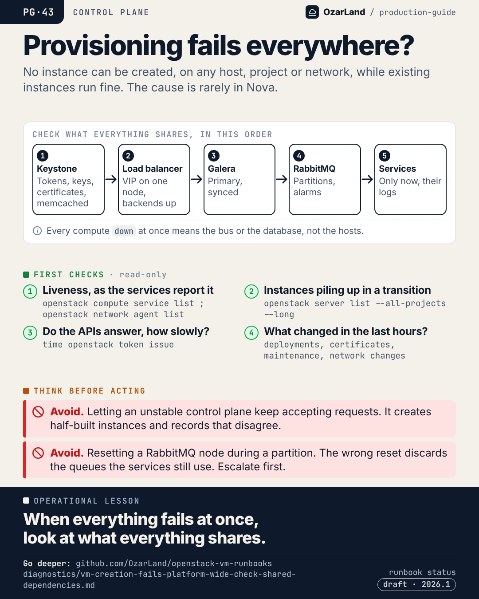

[← Production Guide](../../README.md#catalog) · Control plane

<!-- Generated by scripts/build.cjs from provisioning-fails-everywhere.yml. Do not edit: change the source and rebuild. -->

# PG-43 · Provisioning fails everywhere?



> **Operational lesson.** When everything fails at once, look at what everything shares.

## The memo as text

**Situation.** No instance can be created, on any host, project or network, while existing instances run fine. The cause is rarely in Nova.

**First checks** (read-only):

1. **Liveness, as the services report it**: `openstack compute service list ; openstack network agent list`
2. **Instances piling up in a transition**: `openstack server list --all-projects --long`
3. **Do the APIs answer, how slowly?**: `time openstack token issue`
4. **What changed in the last hours?**: `deployments, certificates, maintenance, network changes`

**Think before acting:**

- ⛔ **Avoid.** Letting an unstable control plane keep accepting requests. It creates half-built instances and records that disagree.
- ⛔ **Avoid.** Resetting a RabbitMQ node during a partition. The wrong reset discards the queues the services still use. Escalate first.

## Go deeper

This memo is a memory aid. The procedure, with every command, its risk warning and its limits, is in the runbook:

- [VM creation fails platform-wide while instances keep running. Check the shared dependencies first](https://github.com/OzarLand/openstack-vm-runbooks/blob/main/diagnostics/vm-creation-fails-platform-wide-check-shared-dependencies.md) · `draft` on 2026.1 · highest risk in the page: read-only
- [Reopening provisioning after a control-plane incident. Stop the APIs, recover, verify, reopen](https://github.com/OzarLand/openstack-vm-runbooks/blob/main/recovery/reopening-provisioning-after-control-plane-incident.md) · `draft` on 2026.1 · highest risk in the page: destructive
- [Every API call fails at once. Expired TLS certificates or inconsistent Keystone Fernet keys](https://github.com/OzarLand/openstack-vm-runbooks/blob/main/diagnostics/expired-certificates-and-fernet-keys-break-every-api-call.md) · `draft` on 2026.1 · highest risk in the page: destructive

**Where this holds.** The runbook is a draft: a read-only triage derived from an operator's incident, later traced to a RabbitMQ partition. Its checks ran on a Kolla-Ansible 2026.1 lab with three controllers, healthy and during a RabbitMQ memory alarm; not run: certificates, Fernet keys, memcached, Galera out of Primary. What a RabbitMQ partition looks like depends on its metadata store (Mnesia or Khepri). With OVN the agent list does not reflect the bus. Keystone, the load balancer, Galera and RabbitMQ each have their own memo for the repair.

## LinkedIn kit

- **Image:** [`dist/pg-43-provisioning-fails-everywhere.png`](../../dist/pg-43-provisioning-fails-everywhere.png) (1080 × 1350)
- **Post title:** VM creation fails everywhere: the cause is rarely in Nova

```text
Nobody can create an instance. Any host, any project, any network. Existing instances run fine.

The reflex is to open the Nova logs. But when every provisioning request fails at once, the cause is rarely in Nova. It is in something every service shares.

Check those first, in dependency order, read-only:
1. Keystone and memcached: tokens, Fernet keys, certificates
2. The load balancer: the VIP on exactly one node, backends up
3. Galera: Primary, synced
4. RabbitMQ: partitions, alarms
5. Only now, the OpenStack services, by request id

And ask the question that resolves more incidents than any metric: what changed in the last hours?

The workloads are not at risk from the condition. They are at risk from an uncontrolled attempt to fix it.

Source runbook status: draft.

Runbook: https://github.com/OzarLand/openstack-vm-runbooks/blob/main/diagnostics/vm-creation-fails-platform-wide-check-shared-dependencies.md
More memos: https://github.com/OzarLand/production-guide

#OpenStack #IncidentResponse #ControlPlane #SRE #CloudOperations #OzarLand
```

---

*Source: [`provisioning-fails-everywhere.yml`](provisioning-fails-everywhere.yml). Found an error, or does your platform behave differently? [Open an issue](https://github.com/OzarLand/production-guide/issues/new) or see [CONTRIBUTING](../../CONTRIBUTING.md).*
