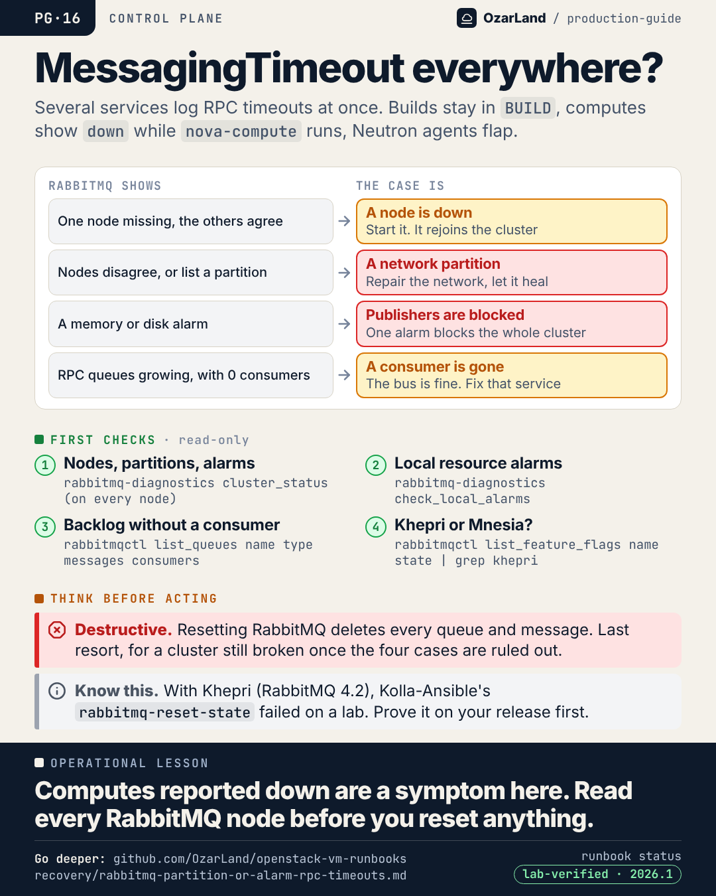

[← Production Guide](../../README.md#catalog) · Control plane

<!-- Generated by scripts/build.cjs from rpc-timeouts-everywhere.yml. Do not edit: change the source and rebuild. -->

# PG-16 · MessagingTimeout everywhere?



> **Operational lesson.** Computes reported down are a symptom here. Read every RabbitMQ node before you reset anything.

## The memo as text

**Situation.** Several services log RPC timeouts at once. Builds stay in `BUILD`, computes show `down` while `nova-compute` runs, Neutron agents flap.

**First checks** (read-only):

1. **Nodes, partitions, alarms**: `rabbitmq-diagnostics cluster_status (on every node)`
2. **Local resource alarms**: `rabbitmq-diagnostics check_local_alarms`
3. **Backlog without a consumer**: `rabbitmqctl list_queues name type messages consumers`
4. **Khepri or Mnesia?**: `rabbitmqctl list_feature_flags name state | grep khepri`

**Think before acting:**

- 🛑 **Destructive.** Resetting RabbitMQ deletes every queue and message. Last resort, for a cluster still broken once the four cases are ruled out.
- ℹ️ **Know this.** With Khepri (RabbitMQ 4.2), Kolla-Ansible's `rabbitmq-reset-state` failed on a lab. Prove it on your release first.

## Go deeper

This memo is a memory aid. The procedure, with every command, its risk warning and its limits, is in the runbook:

- [RPC timeouts in every service, computes reported down. RabbitMQ is partitioned, blocked by an alarm, or a node is missing](https://github.com/OzarLand/openstack-vm-runbooks/blob/main/recovery/rabbitmq-partition-or-alarm-rpc-timeouts.md) · `lab-verified` on 2026.1 · highest risk in the page: destructive

**Where this holds.** Written from Kolla-Ansible 2026.1 and the RabbitMQ 4.2 guides, lab-verified with three controllers, quorum queues and Khepri. On that lab a partition healed by itself once the network was back; the manual partition recovery and a disk alarm were not run. What a partition does depends on the metadata store (Khepri or Mnesia) and on the queue types of your deployment. Requests sent during the incident can leave resources in transitional states.

## LinkedIn kit

- **Image:** [`dist/pg-16-rpc-timeouts-everywhere.png`](../../dist/pg-16-rpc-timeouts-everywhere.png) (1080 × 1350)
- **Post title:** MessagingTimeout in every service: diagnose the bus before the services

```text
MessagingTimeout in Nova. In Neutron. In Cinder. Computes reported down although nova-compute is running. Agents flapping.

When every service shows the same symptom at once, start with what they share: the message bus.

On every RabbitMQ node, read-only:
→ one node missing, the others agree: a node is down
→ nodes disagree, or partitions listed: a network partition
→ a memory or disk alarm: publishers are blocked, cluster-wide
→ RPC queues growing with 0 consumers: the bus is fine, a service is gone

Four cases, four different responses. And one thing to keep for last: resetting RabbitMQ deletes every queue and every message.

Running instances keep running through all of this.

Runbook: https://github.com/OzarLand/openstack-vm-runbooks/blob/main/recovery/rabbitmq-partition-or-alarm-rpc-timeouts.md
More memos: https://github.com/OzarLand/production-guide

#OpenStack #RabbitMQ #ControlPlane #IncidentResponse #CloudOperations #OzarLand
```

---

*Source: [`rpc-timeouts-everywhere.yml`](rpc-timeouts-everywhere.yml). Found an error, or does your platform behave differently? [Open an issue](https://github.com/OzarLand/production-guide/issues/new) or see [CONTRIBUTING](../../CONTRIBUTING.md).*
