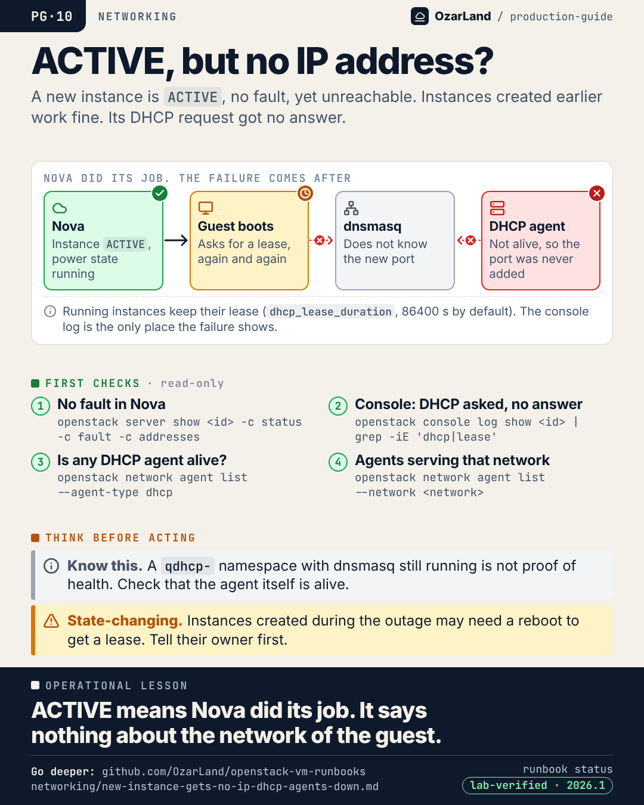

[← Production Guide](../../README.md#catalog) · Networking

<!-- Generated by scripts/build.cjs from active-but-no-ip.yml. Do not edit: change the source and rebuild. -->

# PG-10 · ACTIVE, but no IP address?



> **Operational lesson.** ACTIVE means Nova did its job. It says nothing about the network of the guest.

## The memo as text

**Situation.** A new instance is `ACTIVE`, no fault, yet unreachable. Instances created earlier work fine. Its DHCP request got no answer.

**First checks** (read-only):

1. **No fault in Nova**: `openstack server show <id> -c status -c fault -c addresses`
2. **Console: DHCP asked, no answer**: `openstack console log show <id> | grep -iE 'dhcp|lease'`
3. **Is any DHCP agent alive?**: `openstack network agent list --agent-type dhcp`
4. **Agents serving that network**: `openstack network agent list --network <network>`

**Think before acting:**

- ℹ️ **Know this.** A `qdhcp-` namespace with dnsmasq still running is not proof of health. Check that the agent itself is alive.
- ⚠️ **State-changing.** Instances created during the outage may need a reboot to get a lease. Tell their owner first.

## Go deeper

This memo is a memory aid. The procedure, with every command, its risk warning and its limits, is in the runbook:

- [New instance is ACTIVE but unreachable, it never got an IP address](https://github.com/OzarLand/openstack-vm-runbooks/blob/main/networking/new-instance-gets-no-ip-dhcp-agents-down.md) · `lab-verified` on 2026.1 · highest risk in the page: state-changing

**Where this holds.** Applies to ML2/OVS with DHCP agents. Lab-verified on OpenStack 2026.1 with Kolla-Ansible for the case where every DHCP agent is down; a single network without a live agent and a missing dnsmasq were not reproduced. With OVN, DHCP is answered locally by ovn-controller and this memo does not apply. Starting the agents again can move networks to another DHCP agent (observed on a lab, without traffic loss).

## LinkedIn kit

- **Image:** [`dist/pg-10-active-but-no-ip.png`](../../dist/pg-10-active-but-no-ip.png) (1080 × 1350)
- **Post title:** ACTIVE, no fault, no IP address: Nova did its job

```text
A new instance is ACTIVE. No fault. Nothing in the Nova logs. And nobody can reach it.

Instances created yesterday are fine, which makes it look like a problem with this one VM. It is not.

With ML2/OVS, a new port must be added to dnsmasq by a DHCP agent. If no agent is alive, the guest asks for a lease and never gets an answer. Running instances keep theirs (24 hours by default), so the outage is invisible until someone creates an instance.

Where to look:
→ the console log of the guest: DHCP asked, never answered
→ openstack network agent list --agent-type dhcp

ACTIVE means Nova did its job. It says nothing about the network of the guest.

Runbook: https://github.com/OzarLand/openstack-vm-runbooks/blob/main/networking/new-instance-gets-no-ip-dhcp-agents-down.md
More memos: https://github.com/OzarLand/production-guide

#OpenStack #Neutron #Networking #CloudOperations #SRE #OzarLand
```

---

*Source: [`active-but-no-ip.yml`](active-but-no-ip.yml). Found an error, or does your platform behave differently? [Open an issue](https://github.com/OzarLand/production-guide/issues/new) or see [CONTRIBUTING](../../CONTRIBUTING.md).*
