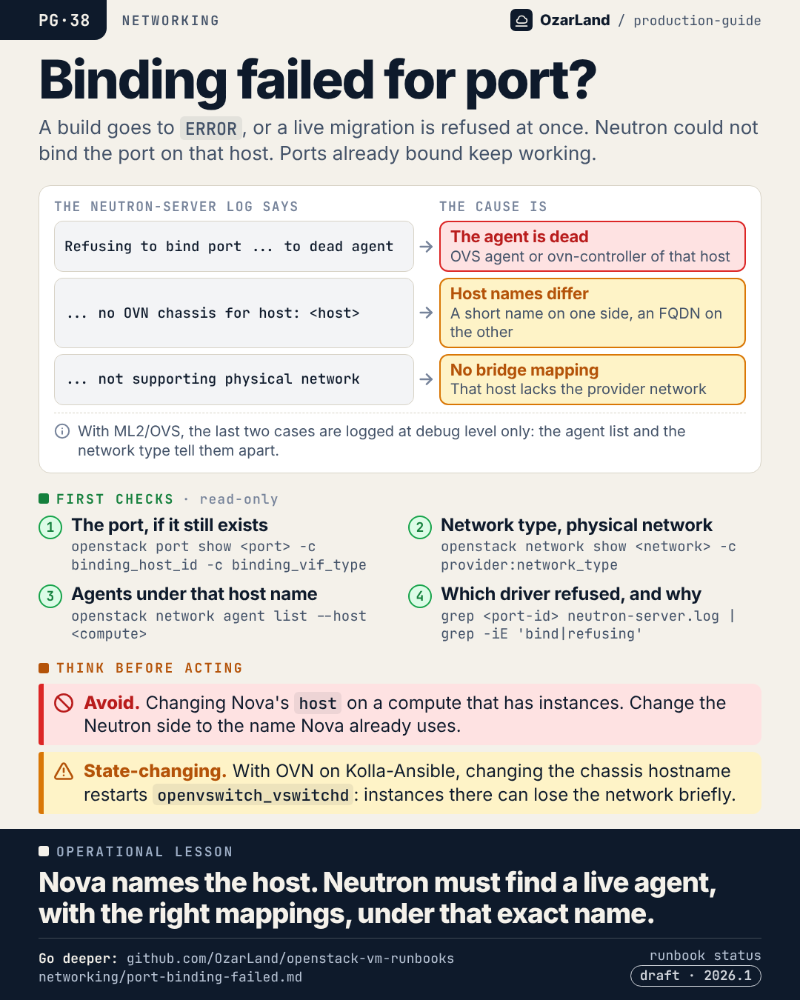

[← Production Guide](../../README.md#catalog) · Networking

<!-- Generated by scripts/build.cjs from binding-failed-for-port.yml. Do not edit: change the source and rebuild. -->

# PG-38 · Binding failed for port?



> **Operational lesson.** Nova names the host. Neutron must find a live agent, with the right mappings, under that exact name.

## The memo as text

**Situation.** A build goes to `ERROR`, or a live migration is refused at once. Neutron could not bind the port on that host. Ports already bound keep working.

**First checks** (read-only):

1. **The port, if it still exists**: `openstack port show <port> -c binding_host_id -c binding_vif_type`
2. **Network type, physical network**: `openstack network show <network> -c provider:network_type`
3. **Agents under that host name**: `openstack network agent list --host <compute>`
4. **Which driver refused, and why**: `grep <port-id> neutron-server.log | grep -iE 'bind|refusing'`

**Think before acting:**

- ⛔ **Avoid.** Changing Nova's `host` on a compute that has instances. Change the Neutron side to the name Nova already uses.
- ⚠️ **State-changing.** With OVN on Kolla-Ansible, changing the chassis hostname restarts `openvswitch_vswitchd`: instances there can lose the network briefly.

## Go deeper

This memo is a memory aid. The procedure, with every command, its risk warning and its limits, is in the runbook:

- [Instance build or live migration fails with "Binding failed for port". Neutron could not bind the port on that host](https://github.com/OzarLand/openstack-vm-runbooks/blob/main/networking/port-binding-failed.md) · `draft` on 2026.1 · highest risk in the page: state-changing
- [Instance stuck in BUILD, then ERROR after vif_plugging_timeout](https://github.com/OzarLand/openstack-vm-runbooks/blob/main/lifecycle/instance-stuck-in-build-waiting-for-vif-plugged.md) · `lab-verified` on 2026.1 · highest risk in the page: state-changing

**Where this holds.** The runbook is a draft, written from the Neutron and Nova 2026.1 sources. A dead agent, mismatched host names and a missing mapping were reproduced on an ML2/OVS Kolla-Ansible lab; the ML2/OVN parts and an unsupported network type were not. Ports Nova created for a build are deleted when it fails. SR-IOV, hardware offload, routed provider networks and Ironic ports are not covered.

## LinkedIn kit

- **Image:** [`dist/pg-38-binding-failed-for-port.png`](../../dist/pg-38-binding-failed-for-port.png) (1080 × 1350)
- **Post title:** "Binding failed for port": the Neutron server log already says why

```text
A build ends in ERROR, or a live migration is refused before it starts: "Binding failed for port, please check neutron logs for more information."

For once the message is right. The answer is in the Neutron server log, for that port ID.

When Nova allocates or moves a port, it gives Neutron a host name. Neutron then asks each mechanism driver to bind the port on that host. Three usual refusals:
→ the agent on that host is dead
→ no agent or chassis is registered under that exact name: a short name on one side, an FQDN on the other
→ the host has no bridge mapping for the network's physical network

One rule when names differ: change the Neutron side, never Nova's host on a compute that has instances.

Source runbook status: draft.

Runbook: https://github.com/OzarLand/openstack-vm-runbooks/blob/main/networking/port-binding-failed.md
More memos: https://github.com/OzarLand/production-guide

#OpenStack #Neutron #Nova #Networking #CloudOperations #OzarLand
```

---

*Source: [`binding-failed-for-port.yml`](binding-failed-for-port.yml). Found an error, or does your platform behave differently? [Open an issue](https://github.com/OzarLand/production-guide/issues/new) or see [CONTRIBUTING](../../CONTRIBUTING.md).*
