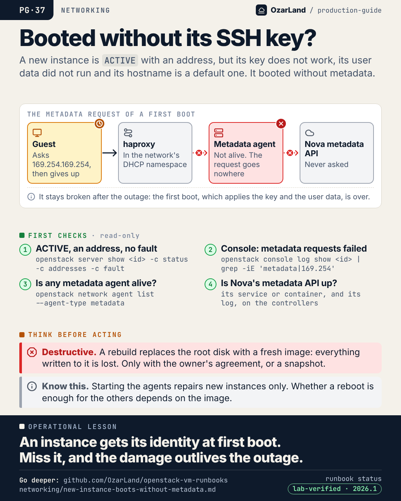

[← Production Guide](../../README.md#catalog) · Networking

<!-- Generated by scripts/build.cjs from booted-without-its-ssh-key.yml. Do not edit: change the source and rebuild. -->

# PG-37 · Booted without its SSH key?



> **Operational lesson.** An instance gets its identity at first boot. Miss it, and the damage outlives the outage.

## The memo as text

**Situation.** A new instance is `ACTIVE` with an address, but its key does not work, its user data did not run and its hostname is a default one. It booted without metadata.

**First checks** (read-only):

1. **ACTIVE, an address, no fault**: `openstack server show <id> -c status -c addresses -c fault`
2. **Console: metadata requests failed**: `openstack console log show <id> | grep -iE 'metadata|169.254'`
3. **Is any metadata agent alive?**: `openstack network agent list --agent-type metadata`
4. **Is Nova's metadata API up?**: `its service or container, and its log, on the controllers`

**Think before acting:**

- 🛑 **Destructive.** A rebuild replaces the root disk with a fresh image: everything written to it is lost. Only with the owner's agreement, or a snapshot.
- ℹ️ **Know this.** Starting the agents repairs new instances only. Whether a reboot is enough for the others depends on the image.

## Go deeper

This memo is a memory aid. The procedure, with every command, its risk warning and its limits, is in the runbook:

- [New instance has an address, but no SSH key, no user data, default hostname](https://github.com/OzarLand/openstack-vm-runbooks/blob/main/networking/new-instance-boots-without-metadata.md) · `lab-verified` on 2026.1 · highest risk in the page: destructive
- [New instance is ACTIVE but unreachable, it never got an IP address](https://github.com/OzarLand/openstack-vm-runbooks/blob/main/networking/new-instance-gets-no-ip-dhcp-agents-down.md) · `lab-verified` on 2026.1 · highest risk in the page: state-changing

**Where this holds.** Lab-verified on OpenStack 2026.1 with Kolla-Ansible and ML2/OVS, with every metadata agent down and CirrOS guests, which read the metadata at every boot. Not reproduced: agents alive but Nova's metadata API not answering. cloud-init images were not tested. Instances booted with a config drive do not use the metadata service for this. With OVN the metadata path is different.

## LinkedIn kit

- **Image:** [`dist/pg-37-booted-without-its-ssh-key.png`](../../dist/pg-37-booted-without-its-ssh-key.png) (1080 × 1350)
- **Post title:** ACTIVE, with an address, and no SSH key: the instance booted without metadata

```text
A new instance is ACTIVE. It has its address. And nobody can log in: the SSH key was never installed, the user data never ran, the hostname is a default one.

At first boot, the guest asks 169.254.169.254 for its metadata. On a Kolla-Ansible ML2/OVS platform that request goes through a haproxy in the network's DHCP namespace, then the Neutron metadata agent, then Nova's metadata API. With every metadata agent down, it goes nowhere. The image waits, then boots without it.

Nova reports nothing. Instances created earlier are fine.

The part that hurts: it stays broken after the agents are back. The first boot, the one that applies the key and the user data, is over. Every instance created during the outage has to be dealt with, one by one: a reboot is enough for some images, others need a rebuild.

Runbook: https://github.com/OzarLand/openstack-vm-runbooks/blob/main/networking/new-instance-boots-without-metadata.md
More memos: https://github.com/OzarLand/production-guide

#OpenStack #Neutron #Nova #CloudInit #CloudOperations #OzarLand
```

---

*Source: [`booted-without-its-ssh-key.yml`](booted-without-its-ssh-key.yml). Found an error, or does your platform behave differently? [Open an issue](https://github.com/OzarLand/production-guide/issues/new) or see [CONTRIBUTING](../../CONTRIBUTING.md).*
