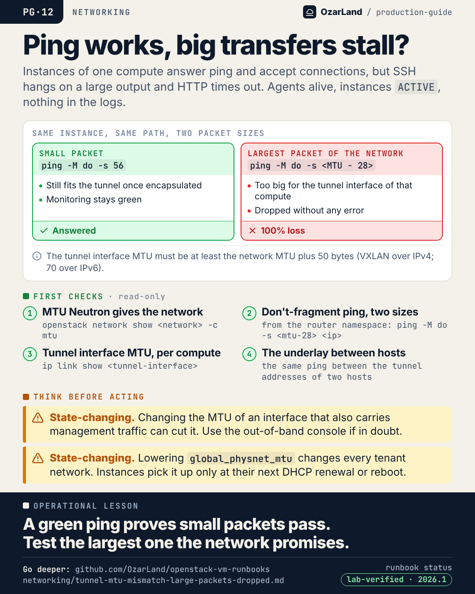

[← Production Guide](../../README.md#catalog) · Networking

<!-- Generated by scripts/build.cjs from ping-works-transfers-stall.yml. Do not edit: change the source and rebuild. -->

# PG-12 · Ping works, big transfers stall?



> **Operational lesson.** A green ping proves small packets pass. Test the largest one the network promises.

## The memo as text

**Situation.** Instances of one compute answer ping and accept connections, but SSH hangs on a large output and HTTP times out. Agents alive, instances `ACTIVE`, nothing in the logs.

**First checks** (read-only):

1. **MTU Neutron gives the network**: `openstack network show <network> -c mtu`
2. **Don't-fragment ping, two sizes**: `from the router namespace: ping -M do -s <mtu-28> <ip>`
3. **Tunnel interface MTU, per compute**: `ip link show <tunnel-interface>`
4. **The underlay between hosts**: `the same ping between the tunnel addresses of two hosts`

**Think before acting:**

- ⚠️ **State-changing.** Changing the MTU of an interface that also carries management traffic can cut it. Use the out-of-band console if in doubt.
- ⚠️ **State-changing.** Lowering `global_physnet_mtu` changes every tenant network. Instances pick it up only at their next DHCP renewal or reboot.

## Go deeper

This memo is a memory aid. The procedure, with every command, its risk warning and its limits, is in the runbook:

- [Instances of one compute answer ping, but large transfers stall](https://github.com/OzarLand/openstack-vm-runbooks/blob/main/networking/tunnel-mtu-mismatch-large-packets-dropped.md) · `lab-verified` on 2026.1 · highest risk in the page: state-changing

**Where this holds.** Lab-verified on OpenStack 2026.1 with Kolla-Ansible and ML2/OVS, VXLAN over an IPv4 underlay, for a tunnel interface whose MTU was lowered on one compute. A switch on the path dropping large frames, a platform-wide mismatch and an IPv6 underlay were not reproduced. Neutron never re-reads the MTU of the hosts after deployment. OVN was not tested.

## LinkedIn kit

- **Image:** [`dist/pg-12-ping-works-transfers-stall.png`](../../dist/pg-12-ping-works-transfers-stall.png) (1080 × 1350)
- **Post title:** Ping works, large transfers stall: test the largest packet

```text
Users say the service is "slow" or "hangs". Ping answers. SSH logs in, then freezes on a large output. Agents are alive, instances ACTIVE, the logs are clean.

On one compute, the interface that carries the VXLAN tunnels has a smaller MTU than Neutron assumes. Small packets still fit once encapsulated. Full-size packets do not, and are dropped without any error.

One test shows it, a don't-fragment ping at two sizes:
→ ping -M do -s 56: answered
→ ping -M do -s <network MTU - 28>: 100% loss

The rule: the tunnel interface MTU must be at least the network MTU plus 50 bytes for VXLAN over IPv4.

A green ping only proves that small packets pass.

Runbook: https://github.com/OzarLand/openstack-vm-runbooks/blob/main/networking/tunnel-mtu-mismatch-large-packets-dropped.md
More memos: https://github.com/OzarLand/production-guide

#OpenStack #Neutron #Networking #MTU #VXLAN #OzarLand
```

---

*Source: [`ping-works-transfers-stall.yml`](ping-works-transfers-stall.yml). Found an error, or does your platform behave differently? [Open an issue](https://github.com/OzarLand/production-guide/issues/new) or see [CONTRIBUTING](../../CONTRIBUTING.md).*
