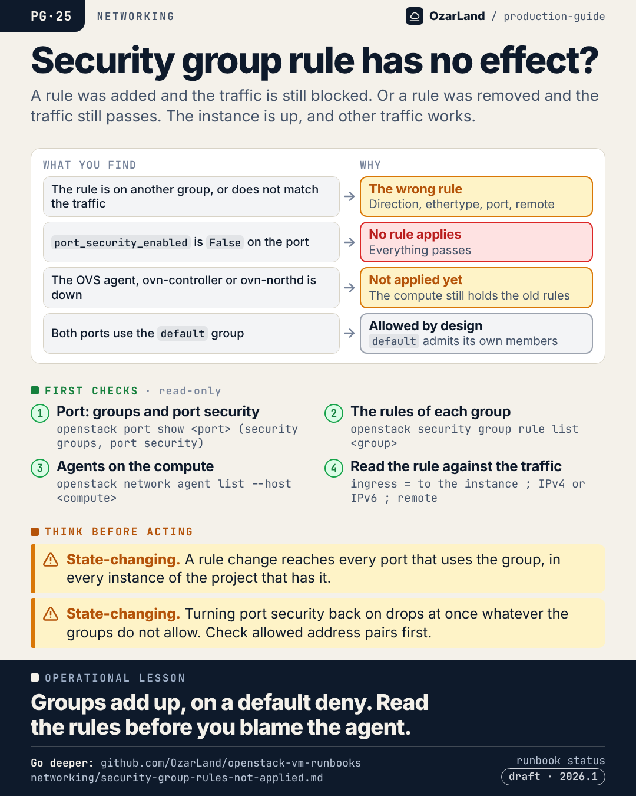

[← Production Guide](../../README.md#catalog) · Networking

<!-- Generated by scripts/build.cjs from security-group-rule-has-no-effect.yml. Do not edit: change the source and rebuild. -->

# PG-25 · Security group rule has no effect?



> **Operational lesson.** Groups add up, on a default deny. Read the rules before you blame the agent.

## The memo as text

**Situation.** A rule was added and the traffic is still blocked. Or a rule was removed and the traffic still passes. The instance is up, and other traffic works.

**First checks** (read-only):

1. **Port: groups and port security**: `openstack port show <port> (security groups, port security)`
2. **The rules of each group**: `openstack security group rule list <group>`
3. **Agents on the compute**: `openstack network agent list --host <compute>`
4. **Read the rule against the traffic**: `ingress = to the instance ; IPv4 or IPv6 ; remote`

**Think before acting:**

- ⚠️ **State-changing.** A rule change reaches every port that uses the group, in every instance of the project that has it.
- ⚠️ **State-changing.** Turning port security back on drops at once whatever the groups do not allow. Check allowed address pairs first.

## Go deeper

This memo is a memory aid. The procedure, with every command, its risk warning and its limits, is in the runbook:

- [A security group rule has no effect. Traffic it allows is still blocked, or traffic it should block still passes](https://github.com/OzarLand/openstack-vm-runbooks/blob/main/networking/security-group-rules-not-applied.md) · `draft` on 2026.1 · highest risk in the page: state-changing
- [Instance has its address and metadata, but is unreachable from outside](https://github.com/OzarLand/openstack-vm-runbooks/blob/main/networking/instance-unreachable-from-outside.md) · `lab-verified` on 2026.1 · highest risk in the page: state-changing

**Where this holds.** The runbook is a draft, written from the Neutron 2026.1 documentation and source. The wrong rule, port security off and a dead agent were reproduced on a Kolla-Ansible all-in-one with ML2/OVS and the iptables hybrid firewall driver. ML2/OVN and the native OVS firewall driver were not run on a lab. The traffic can also be filtered elsewhere (guest firewall, router), or let through by an allowed address pair or a second port. The default-group case was only checked read-only. With OVN, an established connection may survive a rule removal (not verified).

## LinkedIn kit

- **Image:** [`dist/pg-25-security-group-rule-has-no-effect.png`](../../dist/pg-25-security-group-rule-has-no-effect.png) (1080 × 1350)
- **Post title:** A security group rule that changes nothing: four things to check

```text
You add a rule. The port stays closed. Or you remove one, and the traffic still gets through.

Before blaming the agent, remember how security groups work: allow rules only, on a default deny, and the groups on a port add up. Then check four things.

→ The rule is on a group the port does not use, or it does not match: direction, ethertype (an IPv4 rule for IPv6 traffic), port range, or a remote group the traffic does not come from.
→ Port security is off on the port: no rule applies at all, everything passes.
→ The agent on the compute is dead: the rule exists in the API, the compute still holds the old ones.
→ Both instances are in "default": that group admits its own members, by design.

Only one of these four is about the agent.

Source runbook status: draft.

Runbook: https://github.com/OzarLand/openstack-vm-runbooks/blob/main/networking/security-group-rules-not-applied.md
More memos: https://github.com/OzarLand/production-guide

#OpenStack #Neutron #SecurityGroups #Networking #CloudOperations #OzarLand
```

---

*Source: [`security-group-rule-has-no-effect.yml`](security-group-rule-has-no-effect.yml). Found an error, or does your platform behave differently? [Open an issue](https://github.com/OzarLand/production-guide/issues/new) or see [CONTRIBUTING](../../CONTRIBUTING.md).*
