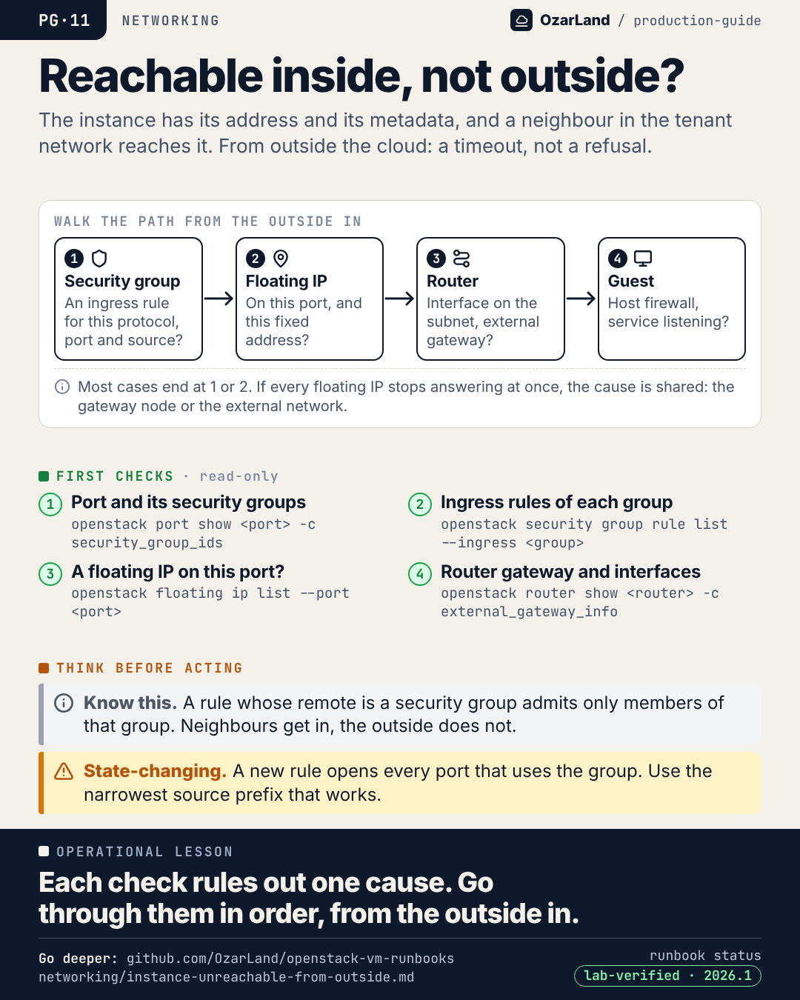

[← Production Guide](../../README.md#catalog) · Networking

<!-- Generated by scripts/build.cjs from unreachable-from-outside.yml. Do not edit: change the source and rebuild. -->

# PG-11 · Reachable inside, not outside?



> **Operational lesson.** Each check rules out one cause. Go through them in order, from the outside in.

## The memo as text

**Situation.** The instance has its address and its metadata, and a neighbour in the tenant network reaches it. From outside the cloud: a timeout, not a refusal.

**First checks** (read-only):

1. **Port and its security groups**: `openstack port show <port> -c security_group_ids`
2. **Ingress rules of each group**: `openstack security group rule list --ingress <group>`
3. **A floating IP on this port?**: `openstack floating ip list --port <port>`
4. **Router gateway and interfaces**: `openstack router show <router> -c external_gateway_info`

**Think before acting:**

- ℹ️ **Know this.** A rule whose remote is a security group admits only members of that group. Neighbours get in, the outside does not.
- ⚠️ **State-changing.** A new rule opens every port that uses the group. Use the narrowest source prefix that works.

## Go deeper

This memo is a memory aid. The procedure, with every command, its risk warning and its limits, is in the runbook:

- [Instance has its address and metadata, but is unreachable from outside](https://github.com/OzarLand/openstack-vm-runbooks/blob/main/networking/instance-unreachable-from-outside.md) · `lab-verified` on 2026.1 · highest risk in the page: state-changing
- [L3 agent dead, instances still reachable, router not moved](https://github.com/OzarLand/openstack-vm-runbooks/blob/main/networking/router-stuck-on-dead-l3-agent.md) · `lab-verified` on 2026.1 · highest risk in the page: destructive

**Where this holds.** Written from the Neutron 2026.1 documentation and lab-verified on ML2/OVS with the L3 agent and a legacy router, for the security group and floating IP causes. The OVN steps, the router missing on its node, the guest and the external network causes were not run on a lab. DVR, BGP-announced floating IPs and IPv6 without NAT are not covered.

## LinkedIn kit

- **Image:** [`dist/pg-11-unreachable-from-outside.png`](../../dist/pg-11-unreachable-from-outside.png) (1080 × 1350)
- **Post title:** Reachable from inside, not from outside: walk the path in order

```text
The instance got its address and its metadata. A neighbour in the same network reaches it. From outside: timeout.

This is rarely a mystery. It is four records to check, from the outside in:
1. Security group: is there an ingress rule for this protocol, port and source?
2. Floating IP: is it on this port, and on this fixed address?
3. Router: an interface on the subnet, and an external gateway?
4. The guest: its own firewall, a service actually listening?

Most cases end at 1 or 2.

One classic trap: an ingress rule whose remote is a security group, not a prefix. It admits members of that group only. That is exactly why the neighbour gets in and the outside does not.

Runbook: https://github.com/OzarLand/openstack-vm-runbooks/blob/main/networking/instance-unreachable-from-outside.md
More memos: https://github.com/OzarLand/production-guide

#OpenStack #Neutron #Networking #SecurityGroups #CloudOperations #OzarLand
```

---

*Source: [`unreachable-from-outside.yml`](unreachable-from-outside.yml). Found an error, or does your platform behave differently? [Open an issue](https://github.com/OzarLand/production-guide/issues/new) or see [CONTRIBUTING](../../CONTRIBUTING.md).*
