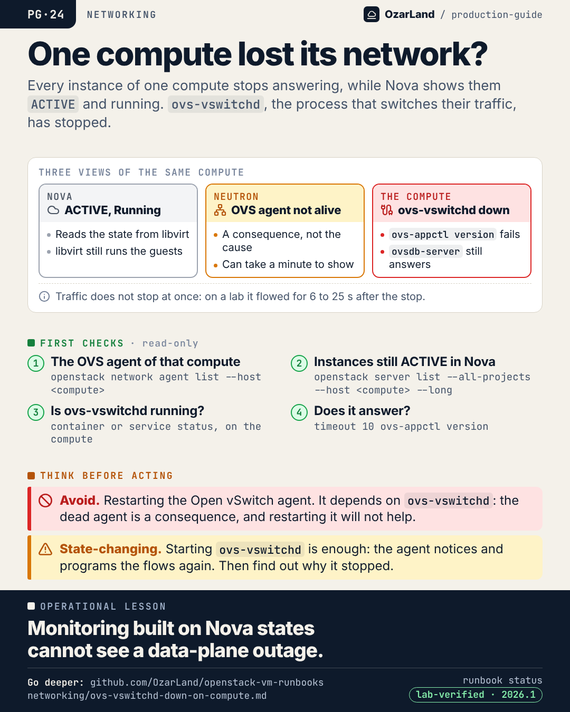

[← Production Guide](../../README.md#catalog) · Networking

<!-- Generated by scripts/build.cjs from whole-compute-lost-network.yml. Do not edit: change the source and rebuild. -->

# PG-24 · One compute lost its network?



> **Operational lesson.** Monitoring built on Nova states cannot see a data-plane outage.

## The memo as text

**Situation.** Every instance of one compute stops answering, while Nova shows them `ACTIVE` and running. `ovs-vswitchd`, the process that switches their traffic, has stopped.

**First checks** (read-only):

1. **The OVS agent of that compute**: `openstack network agent list --host <compute>`
2. **Instances still ACTIVE in Nova**: `openstack server list --all-projects --host <compute> --long`
3. **Is ovs-vswitchd running?**: `container or service status, on the compute`
4. **Does it answer?**: `timeout 10 ovs-appctl version`

**Think before acting:**

- ⛔ **Avoid.** Restarting the Open vSwitch agent. It depends on `ovs-vswitchd`: the dead agent is a consequence, and restarting it will not help.
- ⚠️ **State-changing.** Starting `ovs-vswitchd` is enough: the agent notices and programs the flows again. Then find out why it stopped.

## Go deeper

This memo is a memory aid. The procedure, with every command, its risk warning and its limits, is in the runbook:

- [Every instance on one compute loses the network while Nova shows them ACTIVE (ovs-vswitchd down)](https://github.com/OzarLand/openstack-vm-runbooks/blob/main/networking/ovs-vswitchd-down-on-compute.md) · `lab-verified` on 2026.1 · highest risk in the page: state-changing
- [I need to restart the Open vSwitch agent on a compute. Its instances keep their network](https://github.com/OzarLand/openstack-vm-runbooks/blob/main/networking/restarting-the-ovs-agent-does-not-cut-instances.md) · `lab-verified` on 2026.1 · highest risk in the page: state-changing

**Where this holds.** Lab-verified on OpenStack 2026.1 with Kolla-Ansible and ML2/OVS (VXLAN), with the host's own addresses on plain interfaces, not on an OVS bridge. The stop was made on purpose; a real out-of-memory kill or hang of ovs-vswitchd was not observed, and a stuck process was only simulated. OVN, other releases and deployment tools were not tested. With Kolla-Ansible, ovs-appctl runs in the openvswitch_vswitchd container.

## LinkedIn kit

- **Image:** [`dist/pg-24-whole-compute-lost-network.png`](../../dist/pg-24-whole-compute-lost-network.png) (1080 × 1350)
- **Post title:** Every instance on one compute lost its network. Nova says ACTIVE.

```text
Every instance on one compute stops answering. Ping, SSH, application traffic: nothing.

Nova shows all of them ACTIVE, power state Running. And Nova is right, from where it stands: it reads the state of instances from libvirt, and libvirt still runs them.

The process that actually switches their traffic, ovs-vswitchd, has stopped.

Three views of the same compute:
→ Nova: ACTIVE, Running
→ Neutron: the Open vSwitch agent is not alive (a consequence, and it can take a minute to show)
→ the compute: ovs-vswitchd does not answer

The trap is to restart the agent, because it is the one reported dead. The agent only programs flows. Start ovs-vswitchd, and the agent recovers by itself.

Monitoring built on Nova states cannot see a data-plane outage.

Runbook: https://github.com/OzarLand/openstack-vm-runbooks/blob/main/networking/ovs-vswitchd-down-on-compute.md
More memos: https://github.com/OzarLand/production-guide

#OpenStack #Neutron #OpenvSwitch #Monitoring #CloudOperations #OzarLand
```

---

*Source: [`whole-compute-lost-network.yml`](whole-compute-lost-network.yml). Found an error, or does your platform behave differently? [Open an issue](https://github.com/OzarLand/production-guide/issues/new) or see [CONTRIBUTING](../../CONTRIBUTING.md).*
