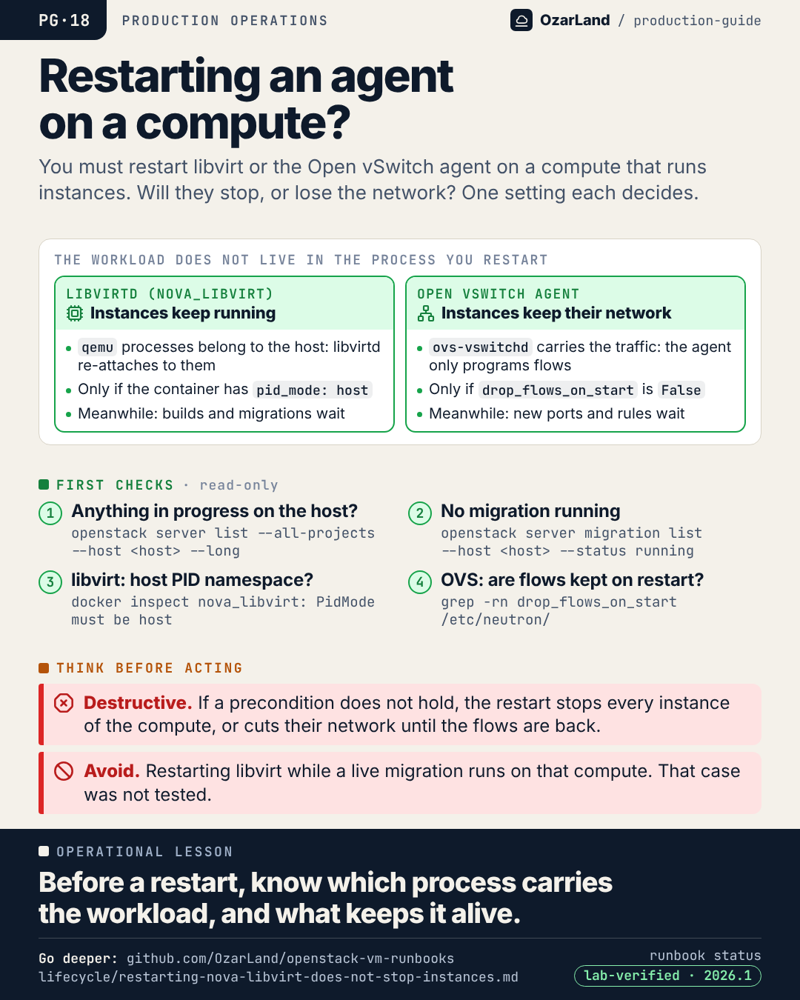

[← Production Guide](../../README.md#catalog) · Production operations

<!-- Generated by scripts/build.cjs from before-restarting-an-agent.yml. Do not edit: change the source and rebuild. -->

# PG-18 · Restarting an agent on a compute?



> **Operational lesson.** Before a restart, know which process carries the workload, and what keeps it alive.

## The memo as text

**Situation.** You must restart libvirt or the Open vSwitch agent on a compute that runs instances. Will they stop, or lose the network? One setting each decides.

**First checks** (read-only):

1. **Anything in progress on the host?**: `openstack server list --all-projects --host <host> --long`
2. **No migration running**: `openstack server migration list --host <host> --status running`
3. **libvirt: host PID namespace?**: `docker inspect nova_libvirt: PidMode must be host`
4. **OVS: are flows kept on restart?**: `grep -rn drop_flows_on_start /etc/neutron/`

**Think before acting:**

- 🛑 **Destructive.** If a precondition does not hold, the restart stops every instance of the compute, or cuts their network until the flows are back.
- ⛔ **Avoid.** Restarting libvirt while a live migration runs on that compute. That case was not tested.

## Go deeper

This memo is a memory aid. The procedure, with every command, its risk warning and its limits, is in the runbook:

- [I need to restart nova_libvirt on a compute. Its instances keep running](https://github.com/OzarLand/openstack-vm-runbooks/blob/main/lifecycle/restarting-nova-libvirt-does-not-stop-instances.md) · `lab-verified` on 2026.1 · highest risk in the page: state-changing
- [I need to restart the Open vSwitch agent on a compute. Its instances keep their network](https://github.com/OzarLand/openstack-vm-runbooks/blob/main/networking/restarting-the-ovs-agent-does-not-cut-instances.md) · `lab-verified` on 2026.1 · highest risk in the page: state-changing

**Where this holds.** Lab-verified on OpenStack 2026.1 with Kolla-Ansible defaults (nova_libvirt with pid_mode host, ML2/OVS with drop_flows_on_start at its default), and observed in production on an earlier release by the runbooks' maintainer. The docker commands are Kolla-Ansible specific. OVN was not tested. If ovs-vswitchd itself does not answer, restarting the agent will not help: that is another runbook.

## LinkedIn kit

- **Image:** [`dist/pg-18-before-restarting-an-agent.png`](../../dist/pg-18-before-restarting-an-agent.png) (1080 × 1350)
- **Post title:** Restarting libvirt or the OVS agent: will the instances survive?

```text
"I need to restart libvirt on a compute that runs 40 instances. Will they stop?"

The answer comes from knowing which process actually carries the workload.

libvirtd: the qemu processes are processes of the host, not children locked inside the container. A new libvirtd re-attaches to them. It holds only if the container runs in the host's PID namespace.

Open vSwitch agent: it does not carry traffic, ovs-vswitchd does. The agent only programs flows, and they stay in place while it restarts. It holds only if drop_flows_on_start is False, the default.

In both cases something does wait during the restart: builds, migrations, new ports, security group changes.

One setting each stands between "nobody noticed" and "every instance on the host stopped". Check it before, not after.

Runbook: https://github.com/OzarLand/openstack-vm-runbooks/blob/main/lifecycle/restarting-nova-libvirt-does-not-stop-instances.md
More memos: https://github.com/OzarLand/production-guide

#OpenStack #Nova #Neutron #ChangeManagement #CloudOperations #OzarLand
```

---

*Source: [`before-restarting-an-agent.yml`](before-restarting-an-agent.yml). Found an error, or does your platform behave differently? [Open an issue](https://github.com/OzarLand/production-guide/issues/new) or see [CONTRIBUTING](../../CONTRIBUTING.md).*
