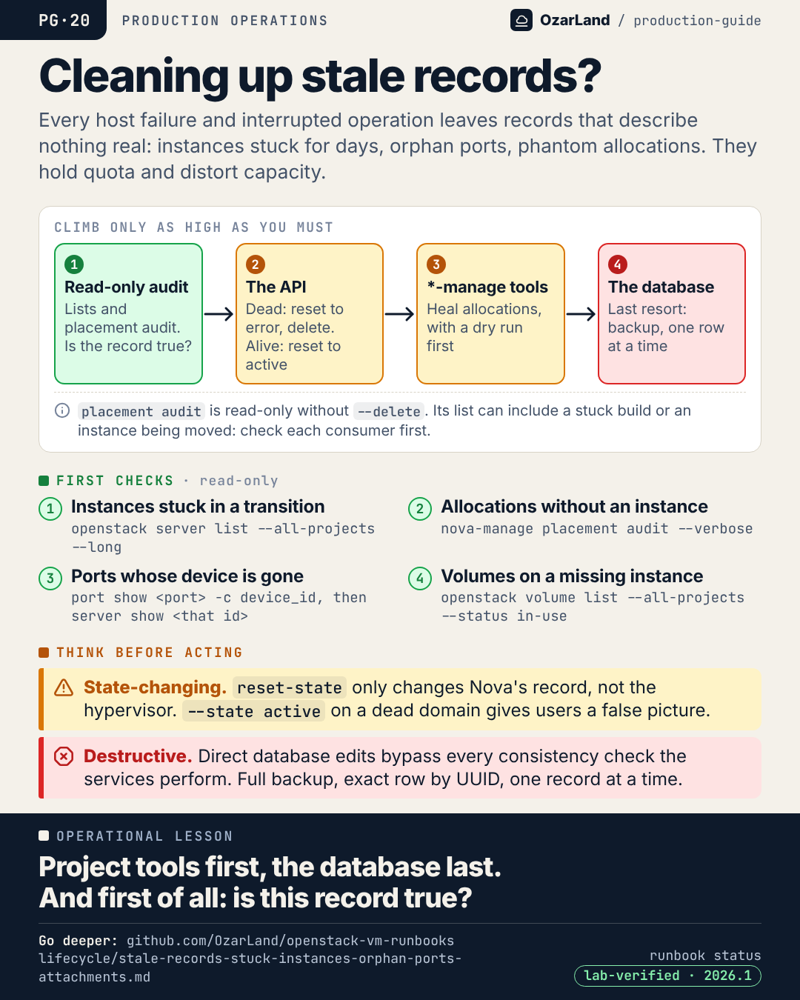

[← Production Guide](../../README.md#catalog) · Production operations

<!-- Generated by scripts/build.cjs from cleaning-up-stale-records.yml. Do not edit: change the source and rebuild. -->

# PG-20 · Cleaning up stale records?



> **Operational lesson.** Project tools first, the database last. And first of all: is this record true?

## The memo as text

**Situation.** Every host failure and interrupted operation leaves records that describe nothing real: instances stuck for days, orphan ports, phantom allocations. They hold quota and distort capacity.

**First checks** (read-only):

1. **Instances stuck in a transition**: `openstack server list --all-projects --long`
2. **Allocations without an instance**: `nova-manage placement audit --verbose`
3. **Ports whose device is gone**: `port show <port> -c device_id, then server show <that id>`
4. **Volumes on a missing instance**: `openstack volume list --all-projects --status in-use`

**Think before acting:**

- ⚠️ **State-changing.** `reset-state` only changes Nova's record, not the hypervisor. `--state active` on a dead domain gives users a false picture.
- 🛑 **Destructive.** Direct database edits bypass every consistency check the services perform. Full backup, exact row by UUID, one record at a time.

## Go deeper

This memo is a memory aid. The procedure, with every command, its risk warning and its limits, is in the runbook:

- [Stale records. Instances stuck in BUILD, ERROR or deleting, orphan ports and attachments, phantom allocations](https://github.com/OzarLand/openstack-vm-runbooks/blob/main/lifecycle/stale-records-stuck-instances-orphan-ports-attachments.md) · `lab-verified` on 2026.1 · highest risk in the page: destructive
- [Placement allocations do not match the instances. Compute looks full or empty, audit and heal](https://github.com/OzarLand/openstack-vm-runbooks/blob/main/scheduling/placement-allocations-out-of-sync-audit-and-heal.md) · `lab-verified` on 2026.1 · highest risk in the page: destructive

**Where this holds.** Lab-verified on OpenStack 2026.1 with Kolla-Ansible; the volume steps were not run on that lab (no Cinder). "nova-manage placement audit" is read-only without --delete. Archiving and purging soft-deleted rows is a destructive step of its own, with retention requirements to check first. python-openstackclient 10.5.0 asks for confirmation before "server set --state"; earlier clients were not checked. "audit --delete" also removes the allocation of an instance being moved.

## LinkedIn kit

- **Image:** [`dist/pg-20-cleaning-up-stale-records.png`](../../dist/pg-20-cleaning-up-stale-records.png) (1080 × 1350)
- **Post title:** Stale records: project tools first, the database last

```text
A long-lived platform accumulates records that describe nothing real. Instances in BUILD for days. Ports whose instance is gone. Volumes attached to nothing. Placement allocations for consumers that no longer exist.

No direct outage, which is why it is neglected. But they hold quota, distort capacity, and make every investigation start with the same question: is this record true?

The clean-up is a ladder. Climb only as high as you must:
1. Read-only audit
2. The API: reset the state, then delete through the API
3. The *-manage tools: audit without --delete, heal with --dry-run first
4. The database: last resort, with a backup, one row at a time

A direct database edit bypasses every consistency check the services perform.

Runbook: https://github.com/OzarLand/openstack-vm-runbooks/blob/main/lifecycle/stale-records-stuck-instances-orphan-ports-attachments.md
More memos: https://github.com/OzarLand/production-guide

#OpenStack #Nova #Placement #OperationalExcellence #CloudOperations #OzarLand
```

---

*Source: [`cleaning-up-stale-records.yml`](cleaning-up-stale-records.yml). Found an error, or does your platform behave differently? [Open an issue](https://github.com/OzarLand/production-guide/issues/new) or see [CONTRIBUTING](../../CONTRIBUTING.md).*
