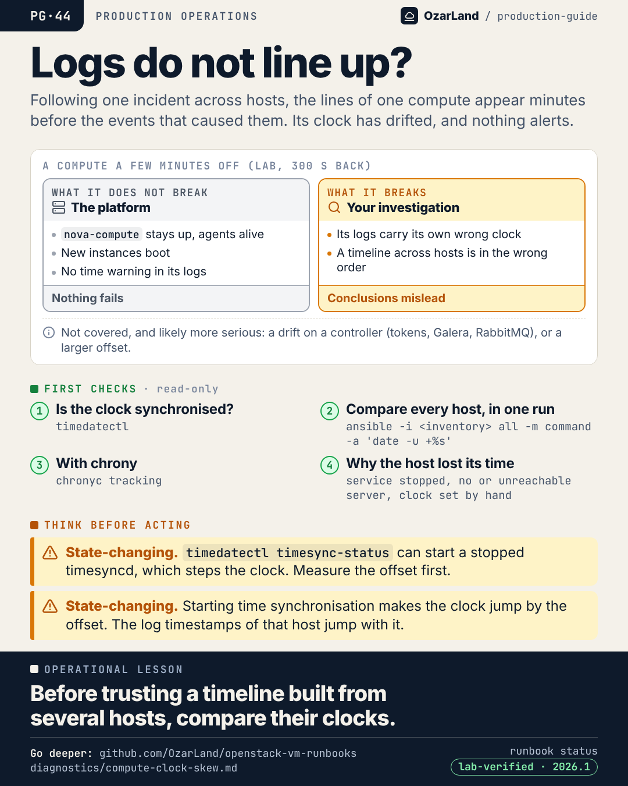

[← Production Guide](../../README.md#catalog) · Production operations

<!-- Generated by scripts/build.cjs from logs-do-not-line-up.yml. Do not edit: change the source and rebuild. -->

# PG-44 · Logs do not line up?



> **Operational lesson.** Before trusting a timeline built from several hosts, compare their clocks.

## The memo as text

**Situation.** Following one incident across hosts, the lines of one compute appear minutes before the events that caused them. Its clock has drifted, and nothing alerts.

**First checks** (read-only):

1. **Is the clock synchronised?**: `timedatectl`
2. **Compare every host, in one run**: `ansible -i <inventory> all -m command -a 'date -u +%s'`
3. **With chrony**: `chronyc tracking`
4. **Why the host lost its time**: `service stopped, no or unreachable server, clock set by hand`

**Think before acting:**

- ⚠️ **State-changing.** `timedatectl timesync-status` can start a stopped timesyncd, which steps the clock. Measure the offset first.
- ⚠️ **State-changing.** Starting time synchronisation makes the clock jump by the offset. The log timestamps of that host jump with it.

## Go deeper

This memo is a memory aid. The procedure, with every command, its risk warning and its limits, is in the runbook:

- [The logs of one compute do not line up with the controllers. Its clock has drifted](https://github.com/OzarLand/openstack-vm-runbooks/blob/main/diagnostics/compute-clock-skew.md) · `lab-verified` on 2026.1 · highest risk in the page: state-changing
- [Reading the time synchronisation logs (chrony, systemd-timesyncd), and how clock skew shows in OpenStack logs](https://github.com/OzarLand/openstack-vm-runbooks/blob/main/logs/time-sync-chrony-and-clock-skew.md) · `draft` on 2026.1 · highest risk in the page: read-only

**Where this holds.** Observed on one lab build: OpenStack 2026.1, Kolla-Ansible, ML2/OVS, Ubuntu 24.04 with systemd-timesyncd, a 300 s backward drift on one compute for a few minutes. chrony was not run. Not tested: a drift on a controller, a forward drift, a larger or longer offset, TLS certificate validity, OVN. Do not assume this memo applies to them. With Nova's database service group driver, liveness is recorded on the controllers, with their clocks, which is why Nova and Neutron do not complain.

## LinkedIn kit

- **Image:** [`dist/pg-44-logs-do-not-line-up.png`](../../dist/pg-44-logs-do-not-line-up.png) (1080 × 1350)
- **Post title:** The logs of one host do not line up: check its clock before your theory

```text
You are rebuilding an incident from the logs of several hosts. On one compute, the lines appear minutes before the events that caused them. The story stops making sense.

Before building a theory around it, compare the clocks.

A compute whose clock is a few minutes off keeps working. On a lab, with 300 seconds of drift: nova-compute up, agents alive, new instances booting, no time-related warning in its logs. Nothing fails and nothing alerts. The only thing it breaks is your investigation: its logs carry its own wrong time.

One detail worth knowing: on a host where systemd-timesyncd is only stopped, running timedatectl timesync-status starts it, which steps the clock and erases the offset you wanted to measure. Compare the clocks first.

A drift on a controller is another story, likely a more serious one, and not tested here.

Runbook: https://github.com/OzarLand/openstack-vm-runbooks/blob/main/diagnostics/compute-clock-skew.md
More memos: https://github.com/OzarLand/production-guide

#OpenStack #Observability #IncidentResponse #SRE #CloudOperations #OzarLand
```

---

*Source: [`logs-do-not-line-up.yml`](logs-do-not-line-up.yml). Found an error, or does your platform behave differently? [Open an issue](https://github.com/OzarLand/production-guide/issues/new) or see [CONTRIBUTING](../../CONTRIBUTING.md).*
