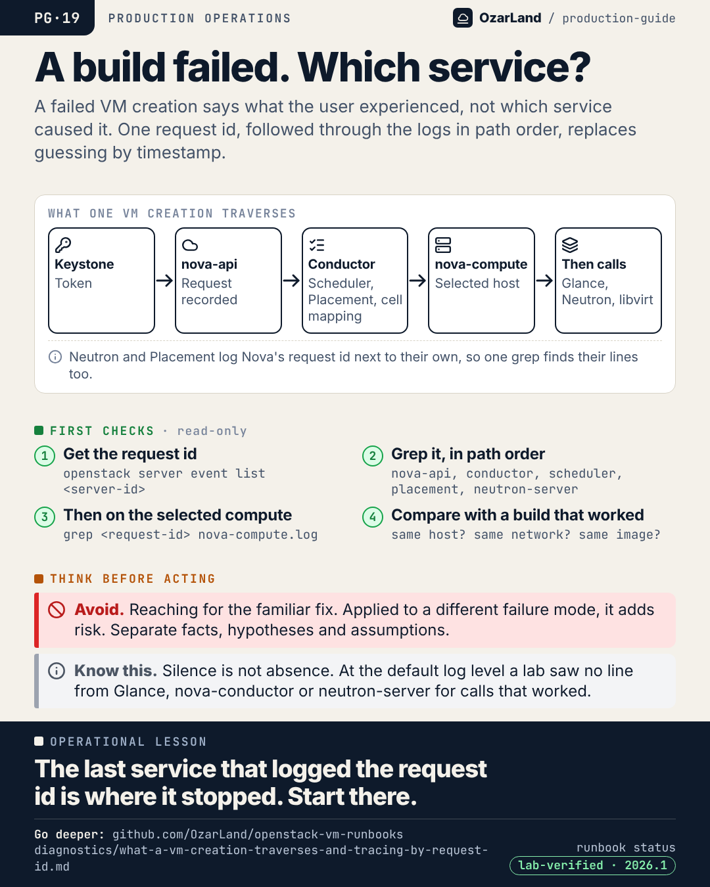

[← Production Guide](../../README.md#catalog) · Production operations

<!-- Generated by scripts/build.cjs from trace-one-request.yml. Do not edit: change the source and rebuild. -->

# PG-19 · A build failed. Which service?



> **Operational lesson.** The last service that logged the request id is where it stopped. Start there.

## The memo as text

**Situation.** A failed VM creation says what the user experienced, not which service caused it. One request id, followed through the logs in path order, replaces guessing by timestamp.

**First checks** (read-only):

1. **Get the request id**: `openstack server event list <server-id>`
2. **Grep it, in path order**: `nova-api, conductor, scheduler, placement, neutron-server`
3. **Then on the selected compute**: `grep <request-id> nova-compute.log`
4. **Compare with a build that worked**: `same host? same network? same image?`

**Think before acting:**

- ⛔ **Avoid.** Reaching for the familiar fix. Applied to a different failure mode, it adds risk. Separate facts, hypotheses and assumptions.
- ℹ️ **Know this.** Silence is not absence. At the default log level a lab saw no line from Glance, nova-conductor or neutron-server for calls that worked.

## Go deeper

This memo is a memory aid. The procedure, with every command, its risk warning and its limits, is in the runbook:

- [What a VM creation traverses, and how to trace one failed boot by request id](https://github.com/OzarLand/openstack-vm-runbooks/blob/main/diagnostics/what-a-vm-creation-traverses-and-tracing-by-request-id.md) · `lab-verified` on 2026.1 · highest risk in the page: read-only
- [Following one request, instance, port or volume through the logs of every service and host](https://github.com/OzarLand/openstack-vm-runbooks/blob/main/logs/tracing-one-request-across-services-and-hosts.md) · `draft` on 2026.1 · highest risk in the page: read-only

**Where this holds.** The provisioning path is common to current releases; the tracing was lab-verified on a 2026.1 Kolla-Ansible all-in-one, on two failures (no valid host, port binding). With several controllers, search them all. Past nova-compute, follow the port id (agent) and the instance name (libvirt). The server events can be thin after a rescheduled build: the cause is then only in the logs. The first error after the point where the request stopped can itself be the symptom of a dependency failing underneath (bus, database).

## LinkedIn kit

- **Image:** [`dist/pg-19-trace-one-request.png`](../../dist/pg-19-trace-one-request.png) (1080 × 1350)
- **Post title:** A VM creation failed. Follow one request id, not the timestamps.

```text
A failed VM creation tells you what the user experienced. It does not tell you which service caused it.

A scheduling problem looks like a Nova problem. A network timeout looks like a Neutron problem. The architecture makes each one plausible without making any of them true.

One build traverses Keystone, nova-api, the conductor and scheduler with Placement, nova-compute on the selected host, then Glance, Neutron and libvirt. Every API request carries a request id that the services propagate in their logs.

So:
1. get the request id from the server's events
2. grep it through the services, in path order
3. the last service that logged it is where the request stopped

Then compare with a request that succeeded. Same host? Same network? Same image? The difference is the lead.

Runbook: https://github.com/OzarLand/openstack-vm-runbooks/blob/main/diagnostics/what-a-vm-creation-traverses-and-tracing-by-request-id.md
More memos: https://github.com/OzarLand/production-guide

#OpenStack #Troubleshooting #Observability #IncidentResponse #SRE #OzarLand
```

---

*Source: [`trace-one-request.yml`](trace-one-request.yml). Found an error, or does your platform behave differently? [Open an issue](https://github.com/OzarLand/production-guide/issues/new) or see [CONTRIBUTING](../../CONTRIBUTING.md).*
