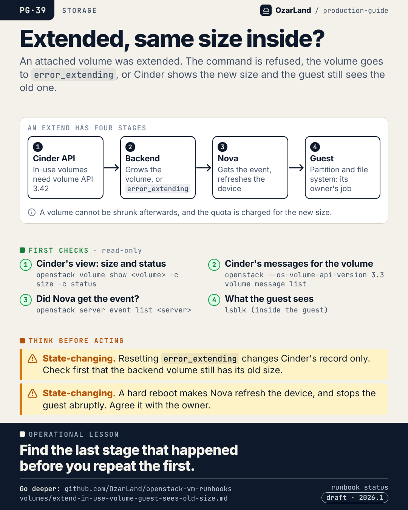

[← Production Guide](../../README.md#catalog) · Storage

<!-- Generated by scripts/build.cjs from extended-but-same-size-inside.yml. Do not edit: change the source and rebuild. -->

# PG-39 · Extended, same size inside?



> **Operational lesson.** Find the last stage that happened before you repeat the first.

## The memo as text

**Situation.** An attached volume was extended. The command is refused, the volume goes to `error_extending`, or Cinder shows the new size and the guest still sees the old one.

**First checks** (read-only):

1. **Cinder's view: size and status**: `openstack volume show <volume> -c size -c status`
2. **Cinder's messages for the volume**: `openstack --os-volume-api-version 3.3 volume message list`
3. **Did Nova get the event?**: `openstack server event list <server>`
4. **What the guest sees**: `lsblk (inside the guest)`

**Think before acting:**

- ⚠️ **State-changing.** Resetting `error_extending` changes Cinder's record only. Check first that the backend volume still has its old size.
- ⚠️ **State-changing.** A hard reboot makes Nova refresh the device, and stops the guest abruptly. Agree it with the owner.

## Go deeper

This memo is a memory aid. The procedure, with every command, its risk warning and its limits, is in the runbook:

- [Extending an attached volume. Refused, error_extending, or the instance still sees the old size](https://github.com/OzarLand/openstack-vm-runbooks/blob/main/volumes/extend-in-use-volume-guest-sees-old-size.md) · `draft` on 2026.1 · highest risk in the page: state-changing

**Where this holds.** The runbook is a draft, written from the Cinder and Nova 2026.1 sources. Lab-run on an all-in-one with Cinder LVM over iSCSI: the refusals, a backend failure and Nova not refreshing the device. Not run: growing a file system in the guest, a refresh failure on the compute, Ceph RBD and Fibre Channel. When the pool has too little space the scheduler refuses the extend: the volume keeps its old size and status.

## LinkedIn kit

- **Image:** [`dist/pg-39-extended-but-same-size-inside.png`](../../dist/pg-39-extended-but-same-size-inside.png) (1080 × 1350)
- **Post title:** The volume was extended. The guest still sees the old size.

```text
"I extended the volume and nothing changed." Extending an attached volume is not one operation. It is four stages, and it can stop after any of them:

1. The Cinder API accepts it. For an in-use volume that needs volume API 3.42.
2. The backend grows the volume, or the volume goes to error_extending.
3. Nova receives a volume-extended event and refreshes the device on the compute.
4. Inside the guest, the partition and the file system are grown. That one is the owner's job.

So before extending again, find the last stage that actually happened: Cinder's size and status, Cinder's messages for the volume, the instance's events, and lsblk inside the guest.

And remember that a volume cannot be shrunk afterwards.

Source runbook status: draft.

Runbook: https://github.com/OzarLand/openstack-vm-runbooks/blob/main/volumes/extend-in-use-volume-guest-sees-old-size.md
More memos: https://github.com/OzarLand/production-guide

#OpenStack #Cinder #Nova #Storage #CloudOperations #OzarLand
```

---

*Source: [`extended-but-same-size-inside.yml`](extended-but-same-size-inside.yml). Found an error, or does your platform behave differently? [Open an issue](https://github.com/OzarLand/production-guide/issues/new) or see [CONTRIBUTING](../../CONTRIBUTING.md).*
