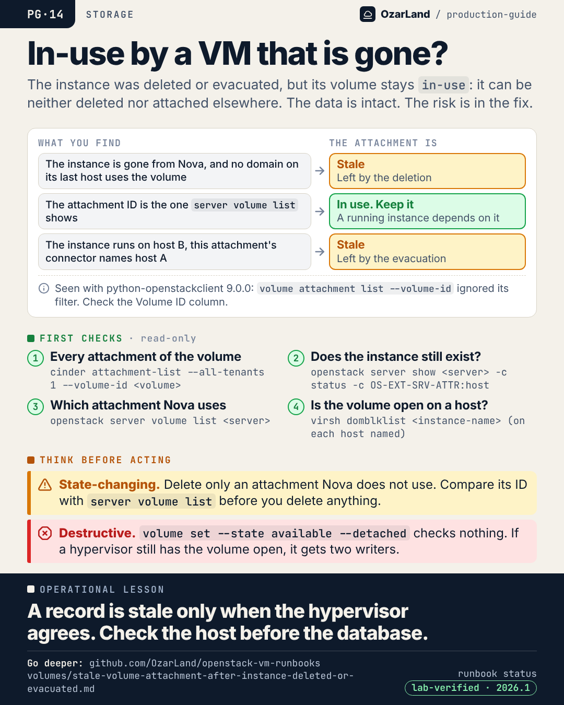

[← Production Guide](../../README.md#catalog) · Storage

<!-- Generated by scripts/build.cjs from volume-in-use-by-a-missing-instance.yml. Do not edit: change the source and rebuild. -->

# PG-14 · In-use by a VM that is gone?



> **Operational lesson.** A record is stale only when the hypervisor agrees. Check the host before the database.

## The memo as text

**Situation.** The instance was deleted or evacuated, but its volume stays `in-use`: it can be neither deleted nor attached elsewhere. The data is intact. The risk is in the fix.

**First checks** (read-only):

1. **Every attachment of the volume**: `cinder attachment-list --all-tenants 1 --volume-id <volume>`
2. **Does the instance still exist?**: `openstack server show <server> -c status -c OS-EXT-SRV-ATTR:host`
3. **Which attachment Nova uses**: `openstack server volume list <server>`
4. **Is the volume open on a host?**: `virsh domblklist <instance-name> (on each host named)`

**Think before acting:**

- ⚠️ **State-changing.** Delete only an attachment Nova does not use. Compare its ID with `server volume list` before you delete anything.
- 🛑 **Destructive.** `volume set --state available --detached` checks nothing. If a hypervisor still has the volume open, it gets two writers.

## Go deeper

This memo is a memory aid. The procedure, with every command, its risk warning and its limits, is in the runbook:

- [Stale volume attachment. The volume is still in-use for an instance that was deleted or evacuated](https://github.com/OzarLand/openstack-vm-runbooks/blob/main/volumes/stale-volume-attachment-after-instance-deleted-or-evacuated.md) · `lab-verified` on 2026.1 · highest risk in the page: destructive

**Where this holds.** Written from the 2026.1 documentation and partly observed on an all-in-one lab; the evacuation case needs two computes and was not run. Applies to volumes that are not multi-attach. Attachment records need volume API 3.27 or later, the attachment ID in server volume list needs compute API 2.89 or later. With python-openstackclient 9.0.0, "openstack volume attachment list --volume-id" ignored its filter and listed every attachment of the cloud: check the Volume ID column.

## LinkedIn kit

- **Image:** [`dist/pg-14-volume-in-use-by-a-missing-instance.png`](../../dist/pg-14-volume-in-use-by-a-missing-instance.png) (1080 × 1350)
- **Post title:** A volume still in-use for an instance that no longer exists

```text
The instance was deleted, or evacuated. Its volume is still "in-use", attached to something that is gone. It cannot be deleted. It cannot be attached anywhere else.

The data is intact. The risk is entirely in the fix.

An attachment record is stale only if the hypervisor agrees:
→ instance gone from Nova, no domain on its last host uses the volume: stale, left by the deletion
→ the attachment ID is the one Nova's server volume list shows: in use, keep it
→ the instance runs on host B, the connector names host A: stale, left by the evacuation

Forcing the volume back to "available" checks none of this. If a hypervisor still has it open, the next attach creates a second writer.

Check the host before you touch the database.

Runbook: https://github.com/OzarLand/openstack-vm-runbooks/blob/main/volumes/stale-volume-attachment-after-instance-deleted-or-evacuated.md
More memos: https://github.com/OzarLand/production-guide

#OpenStack #Cinder #Storage #DataIntegrity #CloudOperations #OzarLand
```

---

*Source: [`volume-in-use-by-a-missing-instance.yml`](volume-in-use-by-a-missing-instance.yml). Found an error, or does your platform behave differently? [Open an issue](https://github.com/OzarLand/production-guide/issues/new) or see [CONTRIBUTING](../../CONTRIBUTING.md).*
