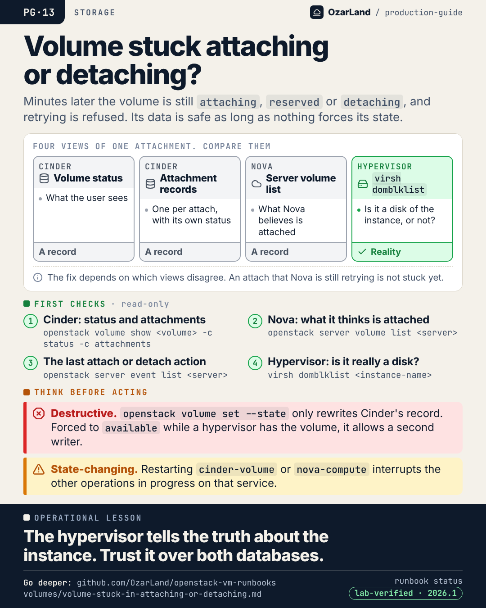

[← Production Guide](../../README.md#catalog) · Storage

<!-- Generated by scripts/build.cjs from volume-stuck-attaching-or-detaching.yml. Do not edit: change the source and rebuild. -->

# PG-13 · Volume stuck attaching or detaching?



> **Operational lesson.** The hypervisor tells the truth about the instance. Trust it over both databases.

## The memo as text

**Situation.** Minutes later the volume is still `attaching`, `reserved` or `detaching`, and retrying is refused. Its data is safe as long as nothing forces its state.

**First checks** (read-only):

1. **Cinder: status and attachments**: `openstack volume show <volume> -c status -c attachments`
2. **Nova: what it thinks is attached**: `openstack server volume list <server>`
3. **The last attach or detach action**: `openstack server event list <server>`
4. **Hypervisor: is it really a disk?**: `virsh domblklist <instance-name>`

**Think before acting:**

- 🛑 **Destructive.** `openstack volume set --state` only rewrites Cinder's record. Forced to `available` while a hypervisor has the volume, it allows a second writer.
- ⚠️ **State-changing.** Restarting `cinder-volume` or `nova-compute` interrupts the other operations in progress on that service.

## Go deeper

This memo is a memory aid. The procedure, with every command, its risk warning and its limits, is in the runbook:

- [Volume stuck in attaching, reserved or detaching. The attach or detach never finishes](https://github.com/OzarLand/openstack-vm-runbooks/blob/main/volumes/volume-stuck-in-attaching-or-detaching.md) · `lab-verified` on 2026.1 · highest risk in the page: destructive

**Where this holds.** Written from the 2026.1 documentation and lab-verified on an all-in-one lab with LVM over iSCSI. A compute that cannot connect to the storage, other backends (RBD, multipath) and a multinode platform were not observed. Attachment records need volume API 3.27 or later; the attachment ID in server volume list needs compute API 2.89 or later. Does not cover multi-attach or boot volumes.

## LinkedIn kit

- **Image:** [`dist/pg-13-volume-stuck-attaching-or-detaching.png`](../../dist/pg-13-volume-stuck-attaching-or-detaching.png) (1080 × 1350)
- **Post title:** Volume stuck in attaching or detaching: four views, one truth

```text
A volume sits in "attaching" or "detaching" and every retry is refused. The tempting fix is one command: reset its state.

That command only rewrites Cinder's database record. It does not check the hypervisor. If a hypervisor still has the volume open, the next attach gives it a second writer, and two writers corrupt a filesystem.

Before any fix, compare four views of the same attachment:
→ Cinder: the volume status
→ Cinder: the attachment records
→ Nova: the server's volume list
→ the hypervisor: virsh domblklist

Three of them are database records. One is reality. The fix depends on which ones disagree.

The data is safe as long as nothing forces the state.

Runbook: https://github.com/OzarLand/openstack-vm-runbooks/blob/main/volumes/volume-stuck-in-attaching-or-detaching.md
More memos: https://github.com/OzarLand/production-guide

#OpenStack #Cinder #Nova #Storage #CloudOperations #OzarLand
```

---

*Source: [`volume-stuck-attaching-or-detaching.yml`](volume-stuck-attaching-or-detaching.yml). Found an error, or does your platform behave differently? [Open an issue](https://github.com/OzarLand/production-guide/issues/new) or see [CONTRIBUTING](../../CONTRIBUTING.md).*
