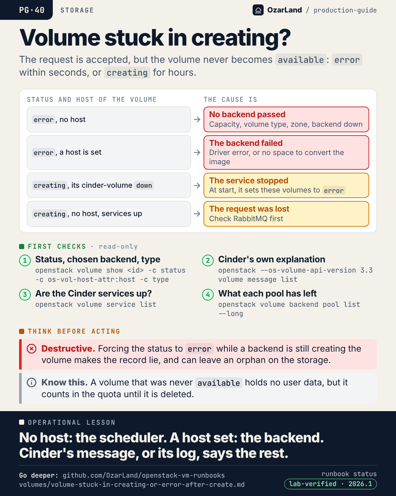

[← Production Guide](../../README.md#catalog) · Storage

<!-- Generated by scripts/build.cjs from volume-stuck-in-creating.yml. Do not edit: change the source and rebuild. -->

# PG-40 · Volume stuck in creating?



> **Operational lesson.** No host: the scheduler. A host set: the backend. Cinder's message, or its log, says the rest.

## The memo as text

**Situation.** The request is accepted, but the volume never becomes `available`: `error` within seconds, or `creating` for hours.

**First checks** (read-only):

1. **Status, chosen backend, type**: `openstack volume show <id> -c status -c os-vol-host-attr:host -c type`
2. **Cinder's own explanation**: `openstack --os-volume-api-version 3.3 volume message list`
3. **Are the Cinder services up?**: `openstack volume service list`
4. **What each pool has left**: `openstack volume backend pool list --long`

**Think before acting:**

- 🛑 **Destructive.** Forcing the status to `error` while a backend is still creating the volume makes the record lie, and can leave an orphan on the storage.
- ℹ️ **Know this.** A volume that was never `available` holds no user data, but it counts in the quota until it is deleted.

## Go deeper

This memo is a memory aid. The procedure, with every command, its risk warning and its limits, is in the runbook:

- [Volume stuck in creating, or in error right after create](https://github.com/OzarLand/openstack-vm-runbooks/blob/main/volumes/volume-stuck-in-creating-or-error-after-create.md) · `lab-verified` on 2026.1 · highest risk in the page: destructive

**Where this holds.** Written from the Cinder 2026.1 source and Kolla-Ansible 2026.1; four causes reproduced on an all-in-one lab. A large image copied slowly is a further case: wait, and follow the cinder-volume log. A request refused at once (quota, invalid type) creates no volume and is not this case. Volumes created by Nova for a boot from volume, backups, snapshots and encrypted volumes are not covered.

## LinkedIn kit

- **Image:** [`dist/pg-40-volume-stuck-in-creating.png`](../../dist/pg-40-volume-stuck-in-creating.png) (1080 × 1350)
- **Post title:** Volume stuck in creating: one field tells the scheduler from the backend

```text
A volume is created. The request is accepted. And it never becomes available: "error" within seconds, or "creating" for hours.

One field splits the problem in two, the host Cinder chose for the volume:
→ error, no host: no backend passed the scheduler. Capacity, a volume type that matches no backend, the zone, a backend that is down.
→ error, a host is set: the backend was chosen and its driver failed.
→ creating, and that host's cinder-volume is down: the service stopped with the request in hand.
→ creating, no host, every service up: the request was lost. Look at RabbitMQ.

And Cinder often explains itself in one line: openstack --os-volume-api-version 3.3 volume message list.

The shortcut to avoid is forcing the status while a backend is in fact still working on the volume.

Runbook: https://github.com/OzarLand/openstack-vm-runbooks/blob/main/volumes/volume-stuck-in-creating-or-error-after-create.md
More memos: https://github.com/OzarLand/production-guide

#OpenStack #Cinder #Storage #CloudOperations #SRE #OzarLand
```

---

*Source: [`volume-stuck-in-creating.yml`](volume-stuck-in-creating.yml). Found an error, or does your platform behave differently? [Open an issue](https://github.com/OzarLand/production-guide/issues/new) or see [CONTRIBUTING](../../CONTRIBUTING.md).*
