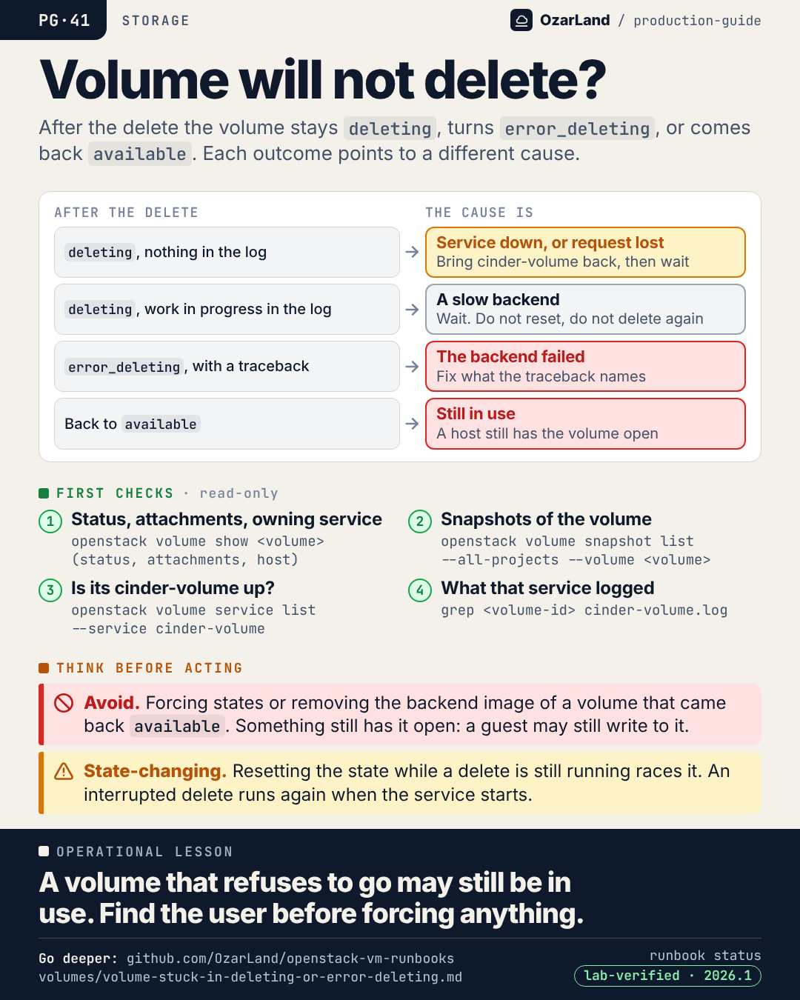

[← Production Guide](../../README.md#catalog) · Storage

<!-- Generated by scripts/build.cjs from volume-will-not-delete.yml. Do not edit: change the source and rebuild. -->

# PG-41 · Volume will not delete?



> **Operational lesson.** A volume that refuses to go may still be in use. Find the user before forcing anything.

## The memo as text

**Situation.** After the delete the volume stays `deleting`, turns `error_deleting`, or comes back `available`. Each outcome points to a different cause.

**First checks** (read-only):

1. **Status, attachments, owning service**: `openstack volume show <volume> (status, attachments, host)`
2. **Snapshots of the volume**: `openstack volume snapshot list --all-projects --volume <volume>`
3. **Is its cinder-volume up?**: `openstack volume service list --service cinder-volume`
4. **What that service logged**: `grep <volume-id> cinder-volume.log`

**Think before acting:**

- ⛔ **Avoid.** Forcing states or removing the backend image of a volume that came back `available`. Something still has it open: a guest may still write to it.
- ⚠️ **State-changing.** Resetting the state while a delete is still running races it. An interrupted delete runs again when the service starts.

## Go deeper

This memo is a memory aid. The procedure, with every command, its risk warning and its limits, is in the runbook:

- [Volume stuck in deleting, in error_deleting, or back to available after a delete](https://github.com/OzarLand/openstack-vm-runbooks/blob/main/volumes/volume-stuck-in-deleting-or-error-deleting.md) · `lab-verified` on 2026.1 · highest risk in the page: destructive
- [Stale volume attachment. The volume is still in-use for an instance that was deleted or evacuated](https://github.com/OzarLand/openstack-vm-runbooks/blob/main/volumes/stale-volume-attachment-after-instance-deleted-or-evacuated.md) · `lab-verified` on 2026.1 · highest risk in the page: destructive

**Where this holds.** Written from the Cinder 2026.1 source. Reproduced on an all-in-one lab with Cinder LVM for a service down, a backend failure and a delete refused by the API; the Ceph RBD and encrypted-volume parts were not. On LVM a volume still open gives error_deleting rather than available. A delete can also be refused at once: attached, with snapshots, migrating or in a group. If the request was lost, waiting is not enough: once the service is up and idle, reset to error and delete again. An encrypted volume loses its key as soon as the delete is accepted, even if it comes back available.

## LinkedIn kit

- **Image:** [`dist/pg-41-volume-will-not-delete.png`](../../dist/pg-41-volume-will-not-delete.png) (1080 × 1350)
- **Post title:** A volume that will not delete may still be in use

```text
You delete a volume. It does not go away. What it does instead tells you the cause.

→ It stays "deleting" and the log is silent: the cinder-volume service is down, or the request was lost. Bring the service back, then wait: an interrupted delete is run again at start-up. If nothing happens once it is up, reset the volume to error and delete again.
→ It stays "deleting" and the log shows work in progress: a slow backend. Wait.
→ It turns "error_deleting" with a traceback: the backend failed. Fix what it names.
→ It comes back "available": the backend found the volume still open somewhere.

That last one deserves respect. A volume that refuses to be deleted because something still uses it is the system working correctly. Find the compute and the instance that still has it open before forcing anything.

Runbook: https://github.com/OzarLand/openstack-vm-runbooks/blob/main/volumes/volume-stuck-in-deleting-or-error-deleting.md
More memos: https://github.com/OzarLand/production-guide

#OpenStack #Cinder #Storage #DataIntegrity #CloudOperations #OzarLand
```

---

*Source: [`volume-will-not-delete.yml`](volume-will-not-delete.yml). Found an error, or does your platform behave differently? [Open an issue](https://github.com/OzarLand/production-guide/issues/new) or see [CONTRIBUTING](../../CONTRIBUTING.md).*
