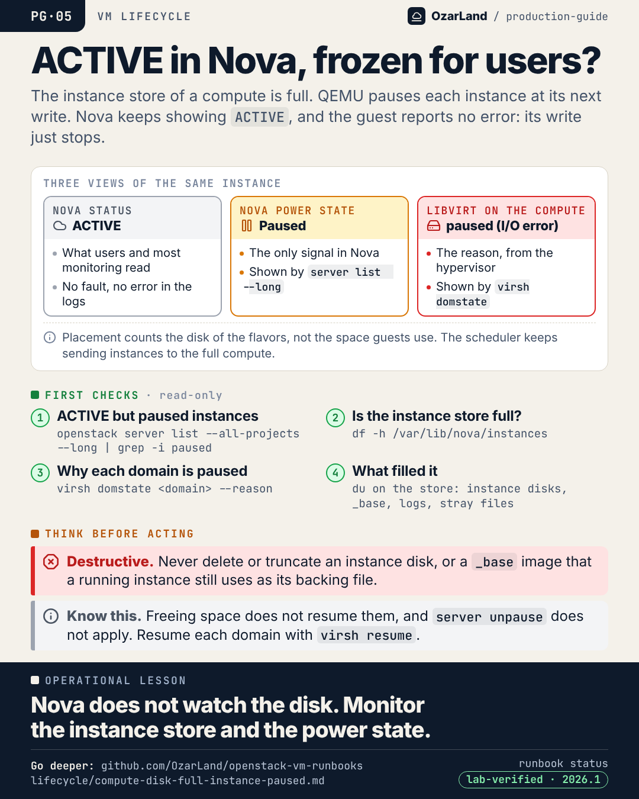

[← Production Guide](../../README.md#catalog) · VM lifecycle

<!-- Generated by scripts/build.cjs from active-but-frozen.yml. Do not edit: change the source and rebuild. -->

# PG-05 · ACTIVE in Nova, frozen for users?



> **Operational lesson.** Nova does not watch the disk. Monitor the instance store and the power state.

## The memo as text

**Situation.** The instance store of a compute is full. QEMU pauses each instance at its next write. Nova keeps showing `ACTIVE`, and the guest reports no error: its write just stops.

**First checks** (read-only):

1. **ACTIVE but paused instances**: `openstack server list --all-projects --long | grep -i paused`
2. **Is the instance store full?**: `df -h /var/lib/nova/instances`
3. **Why each domain is paused**: `virsh domstate <domain> --reason`
4. **What filled it**: `du on the store: instance disks, _base, logs, stray files`

**Think before acting:**

- 🛑 **Destructive.** Never delete or truncate an instance disk, or a `_base` image that a running instance still uses as its backing file.
- ℹ️ **Know this.** Freeing space does not resume them, and `server unpause` does not apply. Resume each domain with `virsh resume`.

## Go deeper

This memo is a memory aid. The procedure, with every command, its risk warning and its limits, is in the runbook:

- [Compute disk full. An instance that writes is frozen, while Nova still shows it ACTIVE](https://github.com/OzarLand/openstack-vm-runbooks/blob/main/lifecycle/compute-disk-full-instance-paused.md) · `lab-verified` on 2026.1 · highest risk in the page: destructive

**Where this holds.** Lab-verified on OpenStack 2026.1 with Kolla-Ansible, local qcow2 instance disks and CirrOS guests. Not tested with Ceph or other shared instance storage, volume-backed instances, or raw and LVM image backends. The pause comes from QEMU's default write-error policy; other releases were not checked. With Kolla-Ansible the store is the nova_compute Docker volume, not /var/lib/nova/instances on the host.

## LinkedIn kit

- **Image:** [`dist/pg-05-active-but-frozen.png`](../../dist/pg-05-active-but-frozen.png) (1080 × 1350)
- **Post title:** ACTIVE in Nova, frozen for the user: the silent full disk

```text
A user says their VM "hangs". Nova says ACTIVE. No fault, no error in the logs.

The compute's instance store is full. QEMU paused the instance on its next write, and it will wait there, losing nothing, until someone resumes it.

Three views of the same instance:
→ Nova status: ACTIVE
→ Nova power state: Paused (the only signal in Nova)
→ libvirt: paused (I/O error)

Placement does not help: it counts the disk of flavors, not the space guests actually use, so the scheduler keeps placing instances on the full host.

Freeing space is not enough. The domains stay paused until they are resumed.

Monitor the instance store, and alert on "ACTIVE but Paused".

Runbook: https://github.com/OzarLand/openstack-vm-runbooks/blob/main/lifecycle/compute-disk-full-instance-paused.md
More memos: https://github.com/OzarLand/production-guide

#OpenStack #Nova #Libvirt #Monitoring #CloudOperations #OzarLand
```

---

*Source: [`active-but-frozen.yml`](active-but-frozen.yml). Found an error, or does your platform behave differently? [Open an issue](https://github.com/OzarLand/production-guide/issues/new) or see [CONTRIBUTING](../../CONTRIBUTING.md).*
