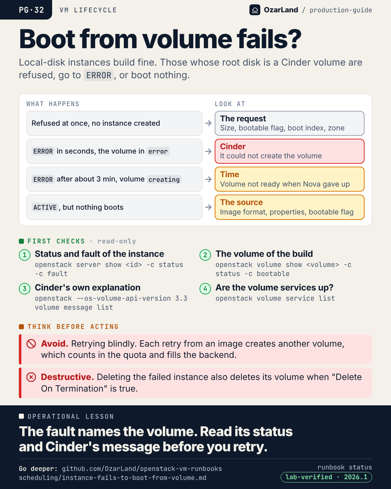

[← Production Guide](../../README.md#catalog) · VM lifecycle

<!-- Generated by scripts/build.cjs from boot-from-volume-fails.yml. Do not edit: change the source and rebuild. -->

# PG-32 · Boot from volume fails?



> **Operational lesson.** The fault names the volume. Read its status and Cinder's message before you retry.

## The memo as text

**Situation.** Local-disk instances build fine. Those whose root disk is a Cinder volume are refused, go to `ERROR`, or boot nothing.

**First checks** (read-only):

1. **Status and fault of the instance**: `openstack server show <id> -c status -c fault`
2. **The volume of the build**: `openstack volume show <volume> -c status -c bootable`
3. **Cinder's own explanation**: `openstack --os-volume-api-version 3.3 volume message list`
4. **Are the volume services up?**: `openstack volume service list`

**Think before acting:**

- ⛔ **Avoid.** Retrying blindly. Each retry from an image creates another volume, which counts in the quota and fills the backend.
- 🛑 **Destructive.** Deleting the failed instance also deletes its volume when "Delete On Termination" is true.

## Go deeper

This memo is a memory aid. The procedure, with every command, its risk warning and its limits, is in the runbook:

- [Instance fails to boot from volume. ERROR at build, or ACTIVE with no bootable disk](https://github.com/OzarLand/openstack-vm-runbooks/blob/main/scheduling/instance-fails-to-boot-from-volume.md) · `lab-verified` on 2026.1 · highest risk in the page: destructive
- [Volume stuck in creating, or in error right after create](https://github.com/OzarLand/openstack-vm-runbooks/blob/main/volumes/volume-stuck-in-creating-or-error-after-create.md) · `lab-verified` on 2026.1 · highest risk in the page: destructive

**Where this holds.** Written from the Nova and Cinder 2026.1 sources; its causes were partly reproduced on an all-in-one lab. The exact form of the fault messages varies with the client and the compute API microversion. A compute that cannot connect to the storage is a further cause, covered by the runbook. Ironic, encrypted volumes, and rescue and rebuild of volume-backed instances are not covered.

## LinkedIn kit

- **Image:** [`dist/pg-32-boot-from-volume-fails.png`](../../dist/pg-32-boot-from-volume-fails.png) (1080 × 1350)
- **Post title:** Boot from volume fails: Nova reports it, Cinder explains it

```text
Instances with a local disk build fine. The ones that boot from a volume do not.

What happens tells you where to look:
→ refused at once, no instance: the request itself. Volume smaller than the image's min_disk, a volume that is not bootable, no boot index 0.
→ ERROR within seconds, the volume in "error": Cinder could not create it.
→ ERROR after about three minutes, the volume still "creating": it was not ready when Nova stopped waiting.
→ ACTIVE, but nothing boots: the source. An image declared raw that is really qcow2 is written to the volume as it is.

For a volume in error, Cinder usually says why in one line: openstack volume message list.

What not to do: retry in a loop. Each retry from an image creates another volume, which counts in the quota.

Runbook: https://github.com/OzarLand/openstack-vm-runbooks/blob/main/scheduling/instance-fails-to-boot-from-volume.md
More memos: https://github.com/OzarLand/production-guide

#OpenStack #Nova #Cinder #Storage #CloudOperations #OzarLand
```

---

*Source: [`boot-from-volume-fails.yml`](boot-from-volume-fails.yml). Found an error, or does your platform behave differently? [Open an issue](https://github.com/OzarLand/production-guide/issues/new) or see [CONTRIBUTING](../../CONTRIBUTING.md).*
