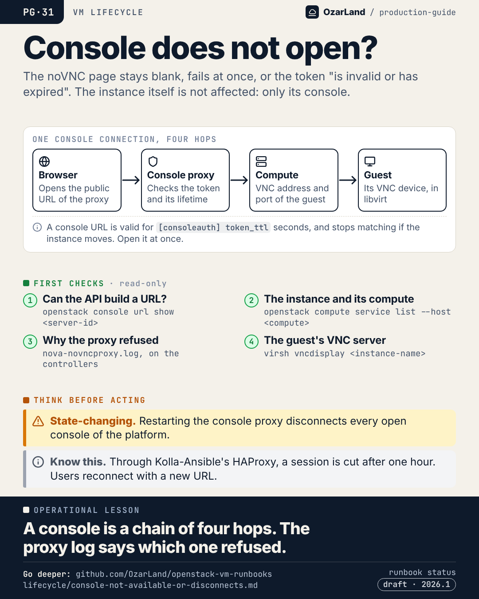

[← Production Guide](../../README.md#catalog) · VM lifecycle

<!-- Generated by scripts/build.cjs from console-does-not-open.yml. Do not edit: change the source and rebuild. -->

# PG-31 · Console does not open?



> **Operational lesson.** A console is a chain of four hops. The proxy log says which one refused.

## The memo as text

**Situation.** The noVNC page stays blank, fails at once, or the token "is invalid or has expired". The instance itself is not affected: only its console.

**First checks** (read-only):

1. **Can the API build a URL?**: `openstack console url show <server-id>`
2. **The instance and its compute**: `openstack compute service list --host <compute>`
3. **Why the proxy refused**: `nova-novncproxy.log, on the controllers`
4. **The guest's VNC server**: `virsh vncdisplay <instance-name>`

**Think before acting:**

- ⚠️ **State-changing.** Restarting the console proxy disconnects every open console of the platform.
- ℹ️ **Know this.** Through Kolla-Ansible's HAProxy, a session is cut after one hour. Users reconnect with a new URL.

## Go deeper

This memo is a memory aid. The procedure, with every command, its risk warning and its limits, is in the runbook:

- [Instance console (noVNC or SPICE) does not open, fails at once, or shows "invalid or has expired"](https://github.com/OzarLand/openstack-vm-runbooks/blob/main/lifecycle/console-not-available-or-disconnects.md) · `draft` on 2026.1 · highest risk in the page: state-changing

**Where this holds.** The runbook is a draft, written from the Nova 2026.1 remote console guide and source and from Kolla-Ansible 2026.1; it was not reproduced on a lab. It follows noVNC, Kolla-Ansible's default; SPICE is covered only by equivalence. Common causes: an expired token, a public URL the browser cannot use, a proxy that cannot reach the compute's VNC ports, or the proxy service down. VNC TLS, serial consoles and Horizon's own configuration are not covered.

## LinkedIn kit

- **Image:** [`dist/pg-31-console-does-not-open.png`](../../dist/pg-31-console-does-not-open.png) (1080 × 1350)
- **Post title:** The instance console does not open: four hops, one log

```text
"The console doesn't work." It is one of the vaguest tickets an OpenStack team gets, and usually nothing is wrong with the instance.

A console connection is a chain of four hops:
→ the browser opens the public URL of the console proxy
→ the proxy checks the token, and its lifetime
→ the proxy connects to the compute, on the guest's VNC port
→ the guest's own VNC device, in libvirt

Each one fails differently: a blank page, an Origin error, "the token is invalid or has expired", a connection refused. The console proxy log tells you which hop refused.

The most common cause is also the most boring one: a URL opened too late, or reused.

Source runbook status: draft.

Runbook: https://github.com/OzarLand/openstack-vm-runbooks/blob/main/lifecycle/console-not-available-or-disconnects.md
More memos: https://github.com/OzarLand/production-guide

#OpenStack #Nova #Troubleshooting #CloudOperations #SRE #OzarLand
```

---

*Source: [`console-does-not-open.yml`](console-does-not-open.yml). Found an error, or does your platform behave differently? [Open an issue](https://github.com/OzarLand/production-guide/issues/new) or see [CONTRIBUTING](../../CONTRIBUTING.md).*
