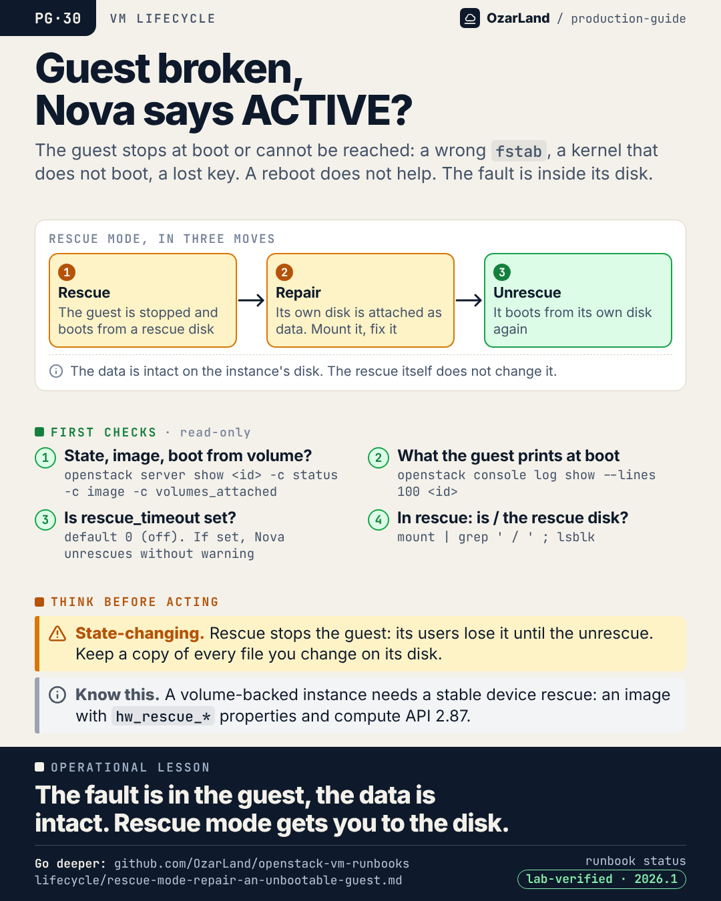

[← Production Guide](../../README.md#catalog) · VM lifecycle

<!-- Generated by scripts/build.cjs from guest-broken-nova-says-active.yml. Do not edit: change the source and rebuild. -->

# PG-30 · Guest broken, Nova says ACTIVE?



> **Operational lesson.** The fault is in the guest, the data is intact. Rescue mode gets you to the disk.

## The memo as text

**Situation.** The guest stops at boot or cannot be reached: a wrong `fstab`, a kernel that does not boot, a lost key. A reboot does not help. The fault is inside its disk.

**First checks** (read-only):

1. **State, image, boot from volume?**: `openstack server show <id> -c status -c image -c volumes_attached`
2. **What the guest prints at boot**: `openstack console log show --lines 100 <id>`
3. **Is rescue_timeout set?**: `default 0 (off). If set, Nova unrescues without warning`
4. **In rescue: is / the rescue disk?**: `mount | grep ' / ' ; lsblk`

**Think before acting:**

- ⚠️ **State-changing.** Rescue stops the guest: its users lose it until the unrescue. Keep a copy of every file you change on its disk.
- ℹ️ **Know this.** A volume-backed instance needs a stable device rescue: an image with `hw_rescue_*` properties and compute API 2.87.

## Go deeper

This memo is a memory aid. The procedure, with every command, its risk warning and its limits, is in the runbook:

- [The guest does not boot or cannot be reached (broken fstab, kernel, network or SSH configuration). Repair its disk in rescue mode](https://github.com/OzarLand/openstack-vm-runbooks/blob/main/lifecycle/rescue-mode-repair-an-unbootable-guest.md) · `lab-verified` on 2026.1 · highest risk in the page: state-changing

**Where this holds.** Written from the Nova 2026.1 rescue guide and source, and reproduced on an all-in-one lab with CirrOS guests: legacy rescue of a local-disk instance, stable device rescue of a volume-backed and a local-disk instance. The repair itself depends on the guest's operating system; other guests were not tested, and Windows guests are not covered. If / in the rescue system is the original disk, the rescue booted the broken system: use another rescue image.

## LinkedIn kit

- **Image:** [`dist/pg-30-guest-broken-nova-says-active.png`](../../dist/pg-30-guest-broken-nova-says-active.png) (1080 × 1350)
- **Post title:** The guest is broken, Nova says ACTIVE: rescue mode

```text
Nova shows the instance ACTIVE. The guest is stuck in an emergency shell after a wrong fstab line. Or it boots, and nobody can log in any more.

A reboot will not help: the fault is inside the guest's disk. And from Nova's point of view, nothing is wrong.

Rescue mode is the way in, in three moves:
1. Rescue: the guest is stopped and boots from a rescue disk
2. Repair: its own disk is attached as a data disk. Mount it, fix the file.
3. Unrescue: it boots from its own disk again

Two things to check before starting. Whether rescue_timeout is set on the compute: if it is, Nova unrescues without warning, possibly with the disk still mounted. And whether the instance boots from a volume: that needs a rescue image with the hw_rescue properties.

Runbook: https://github.com/OzarLand/openstack-vm-runbooks/blob/main/lifecycle/rescue-mode-repair-an-unbootable-guest.md
More memos: https://github.com/OzarLand/production-guide

#OpenStack #Nova #Troubleshooting #CloudOperations #SRE #OzarLand
```

---

*Source: [`guest-broken-nova-says-active.yml`](guest-broken-nova-says-active.yml). Found an error, or does your platform behave differently? [Open an issue](https://github.com/OzarLand/production-guide/issues/new) or see [CONTRIBUTING](../../CONTRIBUTING.md).*
