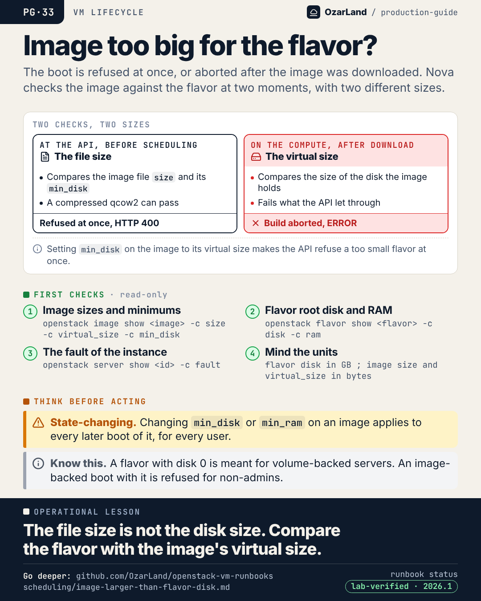

[← Production Guide](../../README.md#catalog) · VM lifecycle

<!-- Generated by scripts/build.cjs from image-too-big-for-the-flavor.yml. Do not edit: change the source and rebuild. -->

# PG-33 · Image too big for the flavor?



> **Operational lesson.** The file size is not the disk size. Compare the flavor with the image's virtual size.

## The memo as text

**Situation.** The boot is refused at once, or aborted after the image was downloaded. Nova checks the image against the flavor at two moments, with two different sizes.

**First checks** (read-only):

1. **Image sizes and minimums**: `openstack image show <image> -c size -c virtual_size -c min_disk`
2. **Flavor root disk and RAM**: `openstack flavor show <flavor> -c disk -c ram`
3. **The fault of the instance**: `openstack server show <id> -c fault`
4. **Mind the units**: `flavor disk in GB ; image size and virtual_size in bytes`

**Think before acting:**

- ⚠️ **State-changing.** Changing `min_disk` or `min_ram` on an image applies to every later boot of it, for every user.
- ℹ️ **Know this.** A flavor with disk 0 is meant for volume-backed servers. An image-backed boot with it is refused for non-admins.

## Go deeper

This memo is a memory aid. The procedure, with every command, its risk warning and its limits, is in the runbook:

- [Boot refused or aborted because the flavor's disk is too small for the image](https://github.com/OzarLand/openstack-vm-runbooks/blob/main/scheduling/image-larger-than-flavor-disk.md) · `lab-verified` on 2026.1 · highest risk in the page: state-changing

**Where this holds.** Written from the Nova 2026.1 source and lab-run on Kolla-Ansible with local disks: an image without min_disk, a zero-disk flavor and min_ram. Not run: the API refusal on the image file size, and the check on a Ceph RBD image backend. Booting from a volume of the right size is the other way out: the flavor's disk is then not used for the root disk. Resizes to a smaller disk are another subject.

## LinkedIn kit

- **Image:** [`dist/pg-33-image-too-big-for-the-flavor.png`](../../dist/pg-33-image-too-big-for-the-flavor.png) (1080 × 1350)
- **Post title:** Flavor's disk is too small: the file size is not the disk size

```text
The same image, the same flavor. Sometimes the boot is refused at once. Sometimes the instance is scheduled, the image is downloaded, and the build is aborted.

Nova checks the image against the flavor twice, with two different numbers:
→ at the API, before scheduling: the size of the image FILE, and its min_disk
→ on the compute, after the download: the VIRTUAL size, the disk the image actually holds

A compressed qcow2 has a small file and a large virtual disk. With no min_disk set, it passes the first check and fails the second, after wasting a scheduling round and a download.

The clean fix is on the image: set min_disk to its virtual size, and the API refuses a too small flavor immediately, with a clear message.

Runbook: https://github.com/OzarLand/openstack-vm-runbooks/blob/main/scheduling/image-larger-than-flavor-disk.md
More memos: https://github.com/OzarLand/production-guide

#OpenStack #Nova #Glance #CloudOperations #SRE #OzarLand
```

---

*Source: [`image-too-big-for-the-flavor.yml`](image-too-big-for-the-flavor.yml). Found an error, or does your platform behave differently? [Open an issue](https://github.com/OzarLand/production-guide/issues/new) or see [CONTRIBUTING](../../CONTRIBUTING.md).*
