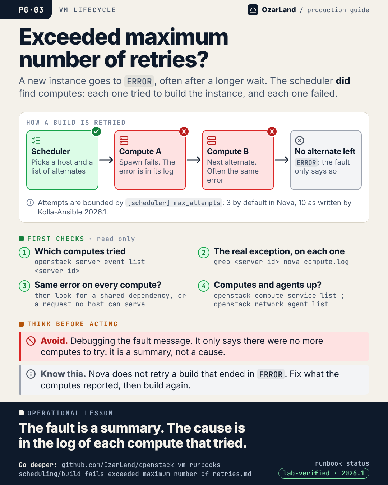

[← Production Guide](../../README.md#catalog) · VM lifecycle

<!-- Generated by scripts/build.cjs from max-retries-exceeded.yml. Do not edit: change the source and rebuild. -->

# PG-03 · Exceeded maximum number of retries?



> **Operational lesson.** The fault is a summary. The cause is in the log of each compute that tried.

## The memo as text

**Situation.** A new instance goes to `ERROR`, often after a longer wait. The scheduler did find computes: each one tried to build the instance, and each one failed.

**First checks** (read-only):

1. **Which computes tried**: `openstack server event list <server-id>`
2. **The real exception, on each one**: `grep <server-id> nova-compute.log`
3. **Same error on every compute?**: `then look for a shared dependency, or a request no host can serve`
4. **Computes and agents up?**: `openstack compute service list ; openstack network agent list`

**Think before acting:**

- ⛔ **Avoid.** Debugging the fault message. It only says there were no more computes to try: it is a summary, not a cause.
- ℹ️ **Know this.** Nova does not retry a build that ended in `ERROR`. Fix what the computes reported, then build again.

## Go deeper

This memo is a memory aid. The procedure, with every command, its risk warning and its limits, is in the runbook:

- [New instance in ERROR with "Exceeded maximum number of retries". The real error is on the computes that tried](https://github.com/OzarLand/openstack-vm-runbooks/blob/main/scheduling/build-fails-exceeded-maximum-number-of-retries.md) · `lab-verified` on 2026.1 · highest risk in the page: state-changing

**Where this holds.** Written from the Nova 2026.1 source and lab-verified with two computes. Not every failure is retried: a network allocation failure or a boot-from-volume block device failure aborts the build on the first compute with another fault. Retries of resize and cold migration, and Ironic, are not covered.

## LinkedIn kit

- **Image:** [`dist/pg-03-max-retries-exceeded.png`](../../dist/pg-03-max-retries-exceeded.png) (1080 × 1350)
- **Post title:** "Exceeded maximum number of retries" tells you nothing. The computes do.

```text
"Exceeded maximum number of retries. Exhausted all hosts available for retrying build failures."

This fault is not a scheduling failure. The scheduler found hosts. Each one tried to spawn the instance, failed, and Nova moved on to the next alternate until none was left.

So the message is a summary. The cause is the exception each compute logged, and it is usually the same on all of them:
→ one broken compute: builds succeed elsewhere, just slower
→ a shared dependency: every attempt fails the same way
→ a request no host can satisfy at spawn time

Start with `openstack server event list`, then read nova-compute.log on each host that tried.

Runbook: https://github.com/OzarLand/openstack-vm-runbooks/blob/main/scheduling/build-fails-exceeded-maximum-number-of-retries.md
More memos: https://github.com/OzarLand/production-guide

#OpenStack #Nova #Troubleshooting #CloudOperations #SRE #OzarLand
```

---

*Source: [`max-retries-exceeded.yml`](max-retries-exceeded.yml). Found an error, or does your platform behave differently? [Open an issue](https://github.com/OzarLand/production-guide/issues/new) or see [CONTRIBUTING](../../CONTRIBUTING.md).*
