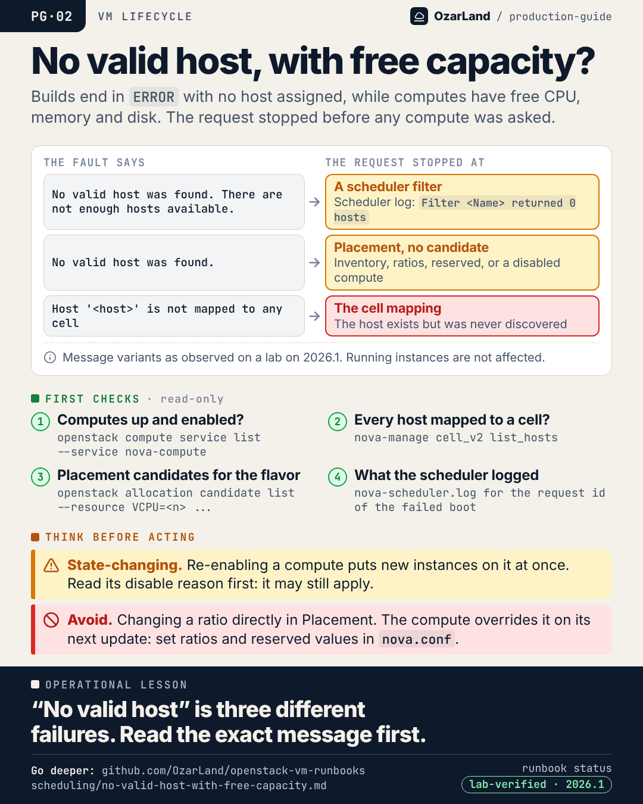

[← Production Guide](../../README.md#catalog) · VM lifecycle

<!-- Generated by scripts/build.cjs from no-valid-host.yml. Do not edit: change the source and rebuild. -->

# PG-02 · No valid host, with free capacity?



> **Operational lesson.** “No valid host” is three different failures. Read the exact message first.

## The memo as text

**Situation.** Builds end in `ERROR` with no host assigned, while computes have free CPU, memory and disk. The request stopped before any compute was asked.

**First checks** (read-only):

1. **Computes up and enabled?**: `openstack compute service list --service nova-compute`
2. **Every host mapped to a cell?**: `nova-manage cell_v2 list_hosts`
3. **Placement candidates for the flavor**: `openstack allocation candidate list --resource VCPU=<n> ...`
4. **What the scheduler logged**: `nova-scheduler.log for the request id of the failed boot`

**Think before acting:**

- ⚠️ **State-changing.** Re-enabling a compute puts new instances on it at once. Read its disable reason first: it may still apply.
- ⛔ **Avoid.** Changing a ratio directly in Placement. The compute overrides it on its next update: set ratios and reserved values in `nova.conf`.

## Go deeper

This memo is a memory aid. The procedure, with every command, its risk warning and its limits, is in the runbook:

- [No valid host was found, although capacity exists](https://github.com/OzarLand/openstack-vm-runbooks/blob/main/scheduling/no-valid-host-with-free-capacity.md) · `lab-verified` on 2026.1 · highest risk in the page: state-changing

**Where this holds.** Cells v2 and Placement apply to every current release. Lab-verified on OpenStack 2026.1 (all-in-one, Kolla-Ansible): unmapped host, reserved memory, disabled service and a filter. Stale allocations and missing traits were not reproduced. The allocation candidate commands need the osc-placement plugin. Ironic is not covered.

## LinkedIn kit

- **Image:** [`dist/pg-02-no-valid-host.png`](../../dist/pg-02-no-valid-host.png) (1080 × 1350)
- **Post title:** "No valid host was found" is not one failure. It is three.

```text
Capacity exists. Hypervisors have free CPU, memory and disk. And every build still ends with "No valid host was found".

Before opening a capacity ticket, read the exact message. It tells you where the request stopped:

→ "...There are not enough hosts available." A scheduler filter rejected every host. The scheduler log names it.
→ "No valid host was found." and nothing after: Placement returned no candidate. Look at inventory, allocation ratios, reserved values, disabled computes.
→ "Host '<host>' is not mapped to any cell": the compute exists but was never mapped. Classic after adding hosts.

Three causes, three different fixes, one message that looks the same at a glance.

Runbook: https://github.com/OzarLand/openstack-vm-runbooks/blob/main/scheduling/no-valid-host-with-free-capacity.md
More memos: https://github.com/OzarLand/production-guide

#OpenStack #Nova #Placement #CloudOperations #SRE #OzarLand
```

---

*Source: [`no-valid-host.yml`](no-valid-host.yml). Found an error, or does your platform behave differently? [Open an issue](https://github.com/OzarLand/production-guide/issues/new) or see [CONTRIBUTING](../../CONTRIBUTING.md).*
