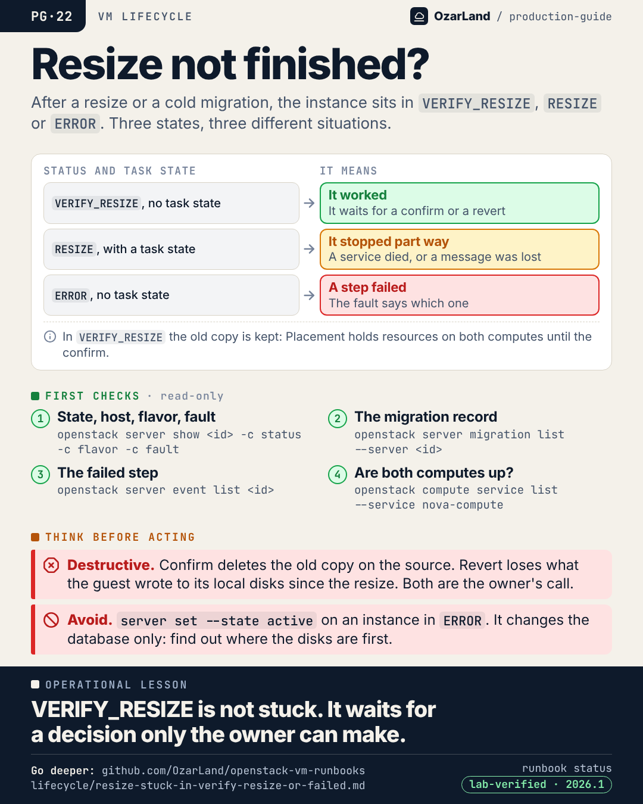

[← Production Guide](../../README.md#catalog) · VM lifecycle

<!-- Generated by scripts/build.cjs from resize-not-finished.yml. Do not edit: change the source and rebuild. -->

# PG-22 · Resize not finished?



> **Operational lesson.** VERIFY_RESIZE is not stuck. It waits for a decision only the owner can make.

## The memo as text

**Situation.** After a resize or a cold migration, the instance sits in `VERIFY_RESIZE`, `RESIZE` or `ERROR`. Three states, three different situations.

**First checks** (read-only):

1. **State, host, flavor, fault**: `openstack server show <id> -c status -c flavor -c fault`
2. **The migration record**: `openstack server migration list --server <id>`
3. **The failed step**: `openstack server event list <id>`
4. **Are both computes up?**: `openstack compute service list --service nova-compute`

**Think before acting:**

- 🛑 **Destructive.** Confirm deletes the old copy on the source. Revert loses what the guest wrote to its local disks since the resize. Both are the owner's call.
- ⛔ **Avoid.** `server set --state active` on an instance in `ERROR`. It changes the database only: find out where the disks are first.

## Go deeper

This memo is a memory aid. The procedure, with every command, its risk warning and its limits, is in the runbook:

- [Resize or cold migration not finished. Instance in VERIFY_RESIZE, stuck in RESIZE, or in ERROR after a failed resize](https://github.com/OzarLand/openstack-vm-runbooks/blob/main/lifecycle/resize-stuck-in-verify-resize-or-failed.md) · `lab-verified` on 2026.1 · highest risk in the page: destructive

**Where this holds.** Written from the Nova 2026.1 source and lab-verified with Kolla-Ansible, two computes and local qcow2 disks: the unconfirmed resize, a service dying part way, SSH between computes and a smaller disk were reproduced; a destination that cannot run the guest was not. Nova does not shrink disks, except a root disk booted from volume. With resize_confirm_window set, resizes are confirmed automatically and can no longer be reverted.

## LinkedIn kit

- **Image:** [`dist/pg-22-resize-not-finished.png`](../../dist/pg-22-resize-not-finished.png) (1080 × 1350)
- **Post title:** VERIFY_RESIZE is not a stuck state. It is a pending decision.

```text
After a resize or a cold migration, an instance can sit in three states that look alike on a dashboard and mean very different things.

→ VERIFY_RESIZE, no task state: the resize worked. It waits for a confirm or a revert, and can wait for days.
→ RESIZE, with a task state: the operation stopped part way. A service died, or a message was lost.
→ ERROR: a step failed, and the fault says which one.

The first is the one that surprises people. While an instance stays in VERIFY_RESIZE, the old copy is kept on the source and Placement holds resources on both computes. Many of them make hosts look fuller than they are.

And neither way out can be undone: confirm deletes the old copy, revert loses what the guest wrote to its local disks since the resize. That decision belongs to the owner.

Runbook: https://github.com/OzarLand/openstack-vm-runbooks/blob/main/lifecycle/resize-stuck-in-verify-resize-or-failed.md
More memos: https://github.com/OzarLand/production-guide

#OpenStack #Nova #Placement #CloudOperations #SRE #OzarLand
```

---

*Source: [`resize-not-finished.yml`](resize-not-finished.yml). Found an error, or does your platform behave differently? [Open an issue](https://github.com/OzarLand/production-guide/issues/new) or see [CONTRIBUTING](../../CONTRIBUTING.md).*
