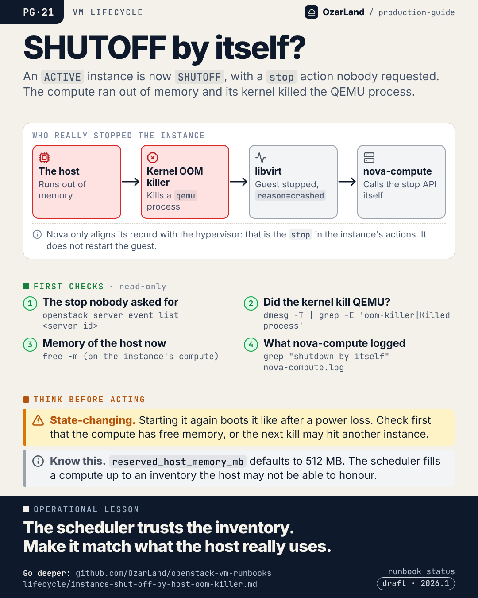

[← Production Guide](../../README.md#catalog) · VM lifecycle

<!-- Generated by scripts/build.cjs from shutoff-by-itself.yml. Do not edit: change the source and rebuild. -->

# PG-21 · SHUTOFF by itself?



> **Operational lesson.** The scheduler trusts the inventory. Make it match what the host really uses.

## The memo as text

**Situation.** An `ACTIVE` instance is now `SHUTOFF`, with a `stop` action nobody requested. The compute ran out of memory and its kernel killed the QEMU process.

**First checks** (read-only):

1. **The stop nobody asked for**: `openstack server event list <server-id>`
2. **Did the kernel kill QEMU?**: `dmesg -T | grep -E 'oom-killer|Killed process'`
3. **Memory of the host now**: `free -m (on the instance's compute)`
4. **What nova-compute logged**: `grep "shutdown by itself" nova-compute.log`

**Think before acting:**

- ⚠️ **State-changing.** Starting it again boots it like after a power loss. Check first that the compute has free memory, or the next kill may hit another instance.
- ℹ️ **Know this.** `reserved_host_memory_mb` defaults to 512 MB. The scheduler fills a compute up to an inventory the host may not be able to honour.

## Go deeper

This memo is a memory aid. The procedure, with every command, its risk warning and its limits, is in the runbook:

- [Instance goes SHUTOFF by itself, nobody stopped it. The compute's OOM killer killed its QEMU process](https://github.com/OzarLand/openstack-vm-runbooks/blob/main/lifecycle/instance-shut-off-by-host-oom-killer.md) · `draft` on 2026.1 · highest risk in the page: state-changing

**Where this holds.** The runbook is a draft, written from the Nova 2026.1, kernel and libvirt sources. On a lab only a cgroup-level OOM of one guest was reproduced; a host-wide OOM and memory overcommit were not. "Memory cgroup out of memory" in the kernel log means a cgroup limit was reached, not the host's memory. No "Killed process" line at that time means QEMU stopped for another reason. An out-of-memory inside the guest is a different problem.

## LinkedIn kit

- **Image:** [`dist/pg-21-shutoff-by-itself.png`](../../dist/pg-21-shutoff-by-itself.png) (1080 × 1350)
- **Post title:** An instance went SHUTOFF by itself. Nova did not stop it: the kernel did.

```text
An instance that was ACTIVE is SHUTOFF. Its owner did not stop it. And yet its action list shows a "stop".

That stop was made by Nova itself, after the fact. The real sequence:
→ the compute ran out of memory
→ the kernel's OOM killer killed a QEMU process
→ libvirt reported the guest as stopped
→ nova-compute aligned its record by calling the stop API

Nova does not restart the guest. It stays SHUTOFF until someone starts it, and it boots like after a power loss.

The usual root cause is not the instance. It is the inventory: reserved_host_memory_mb left at its 512 MB default on a host whose own services use several GB. The scheduler fills the compute up to a number the host cannot honour.

Source runbook status: draft. Read its limits before acting.

Runbook: https://github.com/OzarLand/openstack-vm-runbooks/blob/main/lifecycle/instance-shut-off-by-host-oom-killer.md
More memos: https://github.com/OzarLand/production-guide

#OpenStack #Nova #Linux #CapacityPlanning #CloudOperations #OzarLand
```

---

*Source: [`shutoff-by-itself.yml`](shutoff-by-itself.yml). Found an error, or does your platform behave differently? [Open an issue](https://github.com/OzarLand/production-guide/issues/new) or see [CONTRIBUTING](../../CONTRIBUTING.md).*
