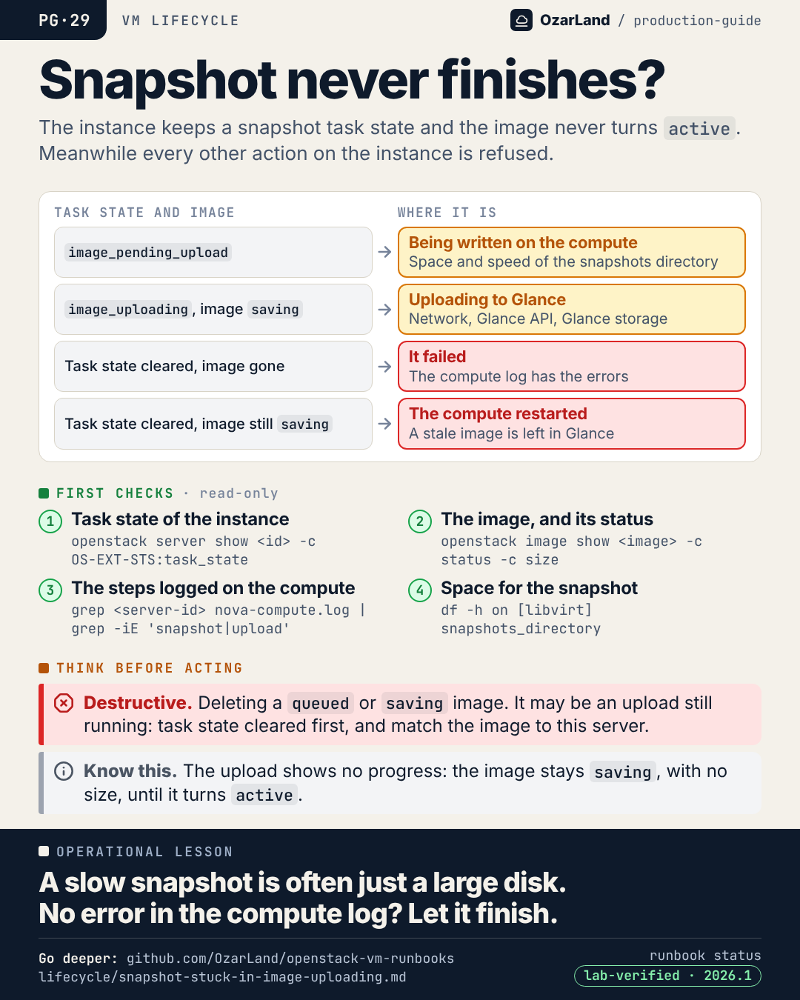

[← Production Guide](../../README.md#catalog) · VM lifecycle

<!-- Generated by scripts/build.cjs from snapshot-never-finishes.yml. Do not edit: change the source and rebuild. -->

# PG-29 · Snapshot never finishes?



> **Operational lesson.** A slow snapshot is often just a large disk. No error in the compute log? Let it finish.

## The memo as text

**Situation.** The instance keeps a snapshot task state and the image never turns `active`. Meanwhile every other action on the instance is refused.

**First checks** (read-only):

1. **Task state of the instance**: `openstack server show <id> -c OS-EXT-STS:task_state`
2. **The image, and its status**: `openstack image show <image> -c status -c size`
3. **The steps logged on the compute**: `grep <server-id> nova-compute.log | grep -iE 'snapshot|upload'`
4. **Space for the snapshot**: `df -h on [libvirt] snapshots_directory`

**Think before acting:**

- 🛑 **Destructive.** Deleting a `queued` or `saving` image. It may be an upload still running: task state cleared first, and match the image to this server.
- ℹ️ **Know this.** The upload shows no progress: the image stays `saving`, with no size, until it turns `active`.

## Go deeper

This memo is a memory aid. The procedure, with every command, its risk warning and its limits, is in the runbook:

- [Instance snapshot never finishes. Task state image_pending_upload or image_uploading, image queued or saving](https://github.com/OzarLand/openstack-vm-runbooks/blob/main/lifecycle/snapshot-stuck-in-image-uploading.md) · `lab-verified` on 2026.1 · highest risk in the page: destructive
- [Compute disk full. An instance that writes is frozen, while Nova still shows it ACTIVE](https://github.com/OzarLand/openstack-vm-runbooks/blob/main/lifecycle/compute-disk-full-instance-paused.md) · `lab-verified` on 2026.1 · highest risk in the page: destructive

**Where this holds.** Written from the Nova 2026.1 source. Lab-run on the standard path for a slow upload, an upload failure and a nova-compute restart mid-snapshot. Not run: a full compute disk or Glance store, the cold snapshot, and the direct snapshot on Ceph RBD, where the states differ. With Kolla-Ansible, HAProxy cuts an upload to Glance that lasts more than 6 hours. The whole disk is written on the compute first: a full file system there (shared with the instances by default) can also freeze instances that write. Earlier states: image_snapshot_pending (not received), image_snapshot (waiting for a slot).

## LinkedIn kit

- **Image:** [`dist/pg-29-snapshot-never-finishes.png`](../../dist/pg-29-snapshot-never-finishes.png) (1080 × 1350)
- **Post title:** A snapshot that never finishes: find where it is before you clear it

```text
An instance snapshot has been running for an hour. The image is still "saving". Every other action on the instance is refused. Is it stuck?

Often not. On the standard path, the whole disk is first written on the compute, then uploaded to Glance, and the upload has no progress indicator at all: the image stays "saving", with no size, until the moment it turns active.

The task state tells you where it is:
→ image_pending_upload: being written on the compute
→ image_uploading with the image "saving": on its way to Glance
→ task state cleared and image gone: it failed, and the compute log says why
→ task state cleared and the image still "saving": the compute restarted, and left a stale image behind

The dangerous shortcut is deleting a "saving" image that turns out to be someone else's upload.

Runbook: https://github.com/OzarLand/openstack-vm-runbooks/blob/main/lifecycle/snapshot-stuck-in-image-uploading.md
More memos: https://github.com/OzarLand/production-guide

#OpenStack #Nova #Glance #CloudOperations #SRE #OzarLand
```

---

*Source: [`snapshot-never-finishes.yml`](snapshot-never-finishes.yml). Found an error, or does your platform behave differently? [Open an issue](https://github.com/OzarLand/production-guide/issues/new) or see [CONTRIBUTING](../../CONTRIBUTING.md).*
