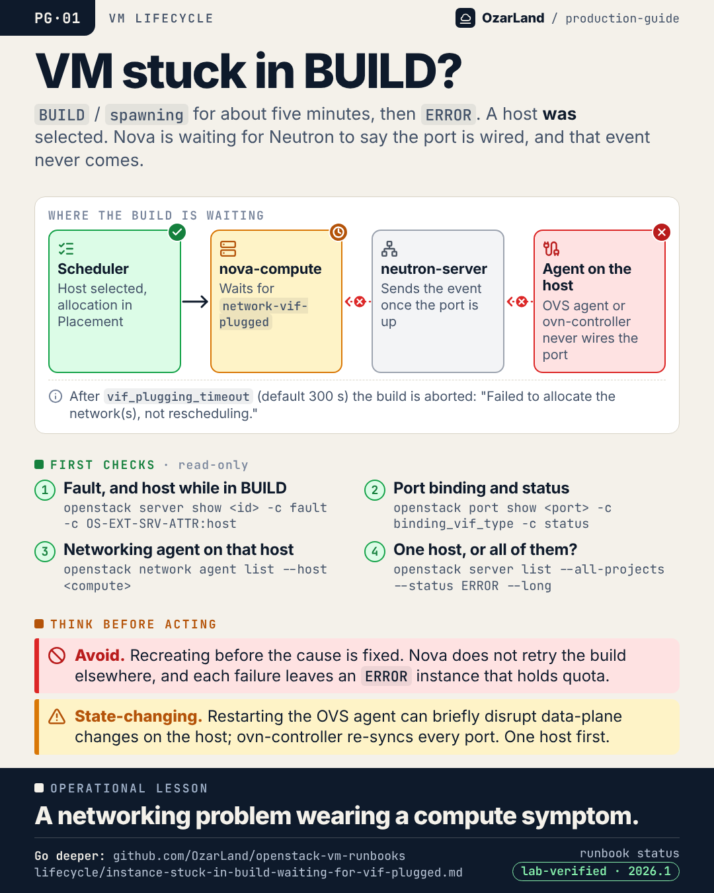

[← Production Guide](../../README.md#catalog) · VM lifecycle

<!-- Generated by scripts/build.cjs from vm-stuck-in-build.yml. Do not edit: change the source and rebuild. -->

# PG-01 · VM stuck in BUILD?



> **Operational lesson.** A networking problem wearing a compute symptom.

## The memo as text

**Situation.** `BUILD` / `spawning` for about five minutes, then `ERROR`. A host was selected. Nova is waiting for Neutron to say the port is wired, and that event never comes.

**First checks** (read-only):

1. **Fault, and host while in BUILD**: `openstack server show <id> -c fault -c OS-EXT-SRV-ATTR:host`
2. **Port binding and status**: `openstack port show <port> -c binding_vif_type -c status`
3. **Networking agent on that host**: `openstack network agent list --host <compute>`
4. **One host, or all of them?**: `openstack server list --all-projects --status ERROR --long`

**Think before acting:**

- ⛔ **Avoid.** Recreating before the cause is fixed. Nova does not retry the build elsewhere, and each failure leaves an `ERROR` instance that holds quota.
- ⚠️ **State-changing.** Restarting the OVS agent can briefly disrupt data-plane changes on the host; ovn-controller re-syncs every port. One host first.

## Go deeper

This memo is a memory aid. The procedure, with every command, its risk warning and its limits, is in the runbook:

- [Instance stuck in BUILD, then ERROR after vif_plugging_timeout](https://github.com/OzarLand/openstack-vm-runbooks/blob/main/lifecycle/instance-stuck-in-build-waiting-for-vif-plugged.md) · `lab-verified` on 2026.1 · highest risk in the page: state-changing

**Where this holds.** The mechanism is stable across recent releases. Lab-verified on OpenStack 2026.1 with Kolla-Ansible and ML2/OVS; the OVN steps of the runbook were not run on a lab. The diagram shows the cause reproduced on the lab; the runbook also covers Neutron being unable to notify Nova, and a host that is simply slow. If network-vif-plugged was received and the boot still fails, this is another problem. An agent already dead before the build gives binding_failed and a fast "Exceeded maximum number of retries" instead. Once in ERROR the host field is empty.

## LinkedIn kit

- **Image:** [`dist/pg-01-vm-stuck-in-build.png`](../../dist/pg-01-vm-stuck-in-build.png) (1080 × 1350)
- **Post title:** VM stuck in BUILD? Look at the network before you look at Nova.

```text
An instance sits in BUILD / spawning for five minutes, then goes to ERROR.

The reflex is to blame Nova. But scheduling already succeeded: a host was selected and Placement holds the allocation. nova-compute is waiting for one event from Neutron, network-vif-plugged, and it never arrives.

Three read-only checks tell you where it stopped:
→ the fault and the selected host
→ the port: binding_failed, or bound but DOWN?
→ the networking agent on that host

Deleting and recreating will not help while the agent on the host is not wiring ports.

The lesson: a networking problem wearing a compute symptom.

Runbook: https://github.com/OzarLand/openstack-vm-runbooks/blob/main/lifecycle/instance-stuck-in-build-waiting-for-vif-plugged.md
More memos: https://github.com/OzarLand/production-guide

#OpenStack #Nova #Neutron #CloudOperations #SRE #OzarLand
```

---

*Source: [`vm-stuck-in-build.yml`](vm-stuck-in-build.yml). Found an error, or does your platform behave differently? [Open an issue](https://github.com/OzarLand/production-guide/issues/new) or see [CONTRIBUTING](../../CONTRIBUTING.md).*
