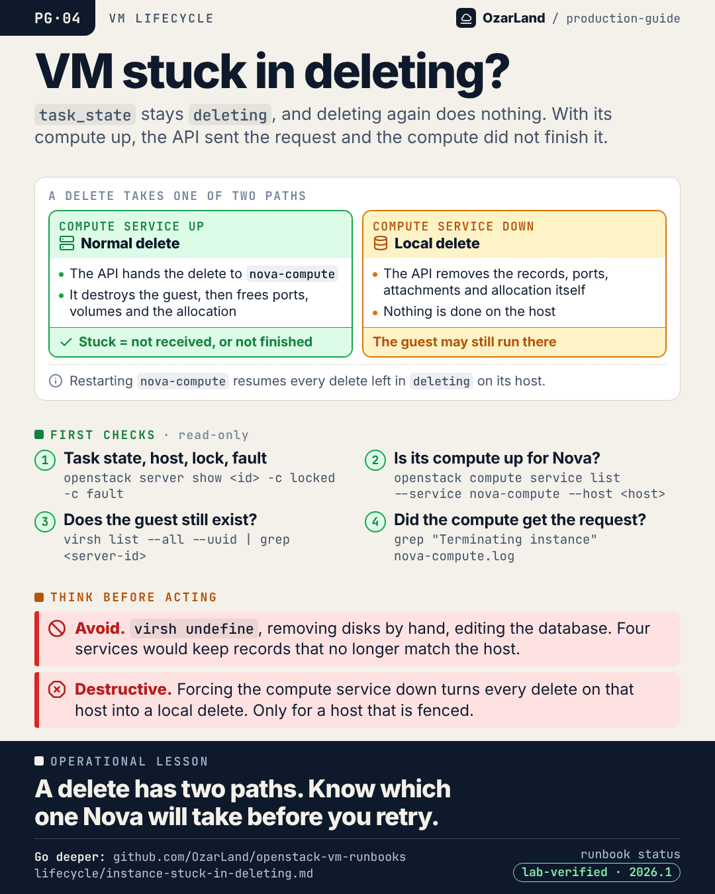

[← Production Guide](../../README.md#catalog) · VM lifecycle

<!-- Generated by scripts/build.cjs from vm-stuck-in-deleting.yml. Do not edit: change the source and rebuild. -->

# PG-04 · VM stuck in deleting?



> **Operational lesson.** A delete has two paths. Know which one Nova will take before you retry.

## The memo as text

**Situation.** `task_state` stays `deleting`, and deleting again does nothing. With its compute up, the API sent the request and the compute did not finish it.

**First checks** (read-only):

1. **Task state, host, lock, fault**: `openstack server show <id> -c locked -c fault`
2. **Is its compute up for Nova?**: `openstack compute service list --service nova-compute --host <host>`
3. **Does the guest still exist?**: `virsh list --all --uuid | grep <server-id>`
4. **Did the compute get the request?**: `grep "Terminating instance" nova-compute.log`

**Think before acting:**

- ⛔ **Avoid.** `virsh undefine`, removing disks by hand, editing the database. Four services would keep records that no longer match the host.
- 🛑 **Destructive.** Forcing the compute service down turns every delete on that host into a local delete. Only for a host that is fenced.

## Go deeper

This memo is a memory aid. The procedure, with every command, its risk warning and its limits, is in the runbook:

- [Instance stuck in deleting, or in ERROR after a delete. Deleting it again does nothing](https://github.com/OzarLand/openstack-vm-runbooks/blob/main/lifecycle/instance-stuck-in-deleting.md) · `lab-verified` on 2026.1 · highest risk in the page: destructive

**Where this holds.** Written from the Nova 2026.1 source; three of five causes reproduced on an all-in-one lab. A local delete also deletes the volumes created with delete_on_termination. Soft delete (reclaim_instance_interval), Ironic and down cells are not covered.

## LinkedIn kit

- **Image:** [`dist/pg-04-vm-stuck-in-deleting.png`](../../dist/pg-04-vm-stuck-in-deleting.png) (1080 × 1350)
- **Post title:** VM stuck in deleting: why deleting it again does nothing

```text
An instance stays in task_state "deleting". You run the delete again. Nothing changes.

That is by design: while the compute is up, Nova ignores a second delete for an instance already in deleting.

What matters is which of two paths the delete takes:
→ Compute service UP: the API hands the delete to nova-compute, which destroys the guest and frees ports, volumes and the allocation. Stuck means the compute never got the request, or never finished it.
→ Compute service DOWN: a local delete. The records go, nothing is done on the host. If that host is not really dead, the guest keeps running.

The shortcuts (virsh undefine, a database edit) leave four services with records that no longer match reality.

Runbook: https://github.com/OzarLand/openstack-vm-runbooks/blob/main/lifecycle/instance-stuck-in-deleting.md
More memos: https://github.com/OzarLand/production-guide

#OpenStack #Nova #Troubleshooting #CloudOperations #SRE #OzarLand
```

---

*Source: [`vm-stuck-in-deleting.yml`](vm-stuck-in-deleting.yml). Found an error, or does your platform behave differently? [Open an issue](https://github.com/OzarLand/production-guide/issues/new) or see [CONTRIBUTING](../../CONTRIBUTING.md).*
